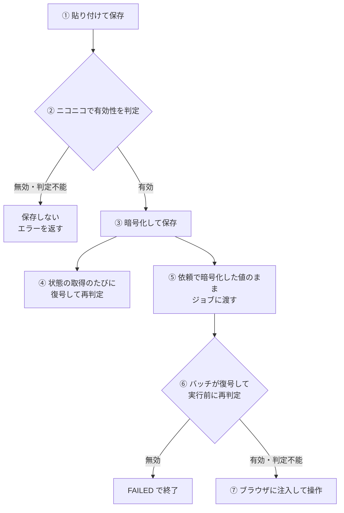
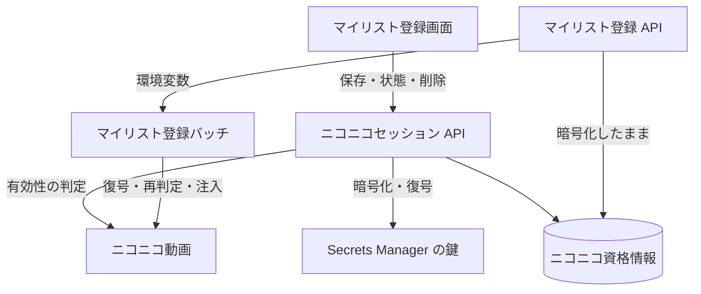

# セッションの登録から利用まで

利用者が貼り付けた[ニコニコセッション](../term/user-session.md)が、検証され、暗号化して保存され、バッチのブラウザに注入されてニコニコ動画を操作するまでの流れ。サービスはニコニコへのログインを自動で行わず、パスワードも扱わない。

## 起点

- 利用者が、ブラウザでニコニコ動画にログインして `user_session` クッキーの値を取り出し、[マイリスト登録画面](../screen/mylist-register.md)の「セッション管理」で貼り付けて保存する
- 画面の注記は、普段使いとは別の場所 (シークレット窓) で取得するよう案内している

## 経路

1. **保存の依頼**: 画面が `POST /api/niconico/session` に値を送る。空なら画面が送らない
2. **判定**: API が、ニコニコ動画のマイリストのページをクッキー付きで取得して、有効性を決める ([user_session](../term/user-session.md))。有効のときだけ先へ進む
3. **保存**: 鍵 (Secrets Manager) で暗号化し、取得日時 (今) と推定有効期限 (30 日後) と合わせて、利用者ごとに 1 件保存する。以前の値は上書きされる
4. **状態の表示**: マイリスト登録画面を開くたびに `GET /api/niconico/session` が、保存した値を復号して有効性を判定し直す。無効や未登録なら、画面は登録を止めて更新を促す。判定不能のときは止めない
5. **依頼**: [マイリスト登録 API](../api/mylist-register.md) は、保存した値を復号せず、暗号化したままジョブの環境変数 `ENCRYPTED_USER_SESSION` に載せる。この時点では有効性を確かめない (保存の有無だけ見る)
6. **実行前の判定**: [バッチ](../batch/mylist-register.md)が値を復号し、ニコニコ動画で有効性を判定し直す。無効ならジョブを失敗にして終了する。判定不能は、続行する
7. **注入**: バッチが、ブラウザのコンテキストに `user_session` をクッキーとして入れ、ログインの操作なしでマイリストを操作する

## 届く先

- **ニコニコ動画**: セッションの持ち主として、マイリストの削除・作成・動画の登録を行う。そのアカウントの操作権限が、そのまま使われる

## 失敗・取りこぼしのとき

- 保存の判定で無効か判定不能なら、保存しない。画面に理由を出す。保存済みの値は変わらない
- 有効期限の目安 (30 日) は、保存した時刻から数えた値で、ニコニコ側の実際の失効は見ていない。失効は、画面の状態の取得 (④) と、バッチの実行前の判定 (⑥) で分かる
- 保存した値が壊れていて復号できないときは、状態を「無効」として返す。画面から削除して入れ直せる
- 依頼のあとで失効すると、バッチが ⑥ で止める。ジョブは `FAILED`、`errorMessage` は「user_session が無効です。再取得してください」になる
- セッションの値は、画面の入力欄 (伏せ字)、API の応答、ログのどこにも出さない

## つながり

