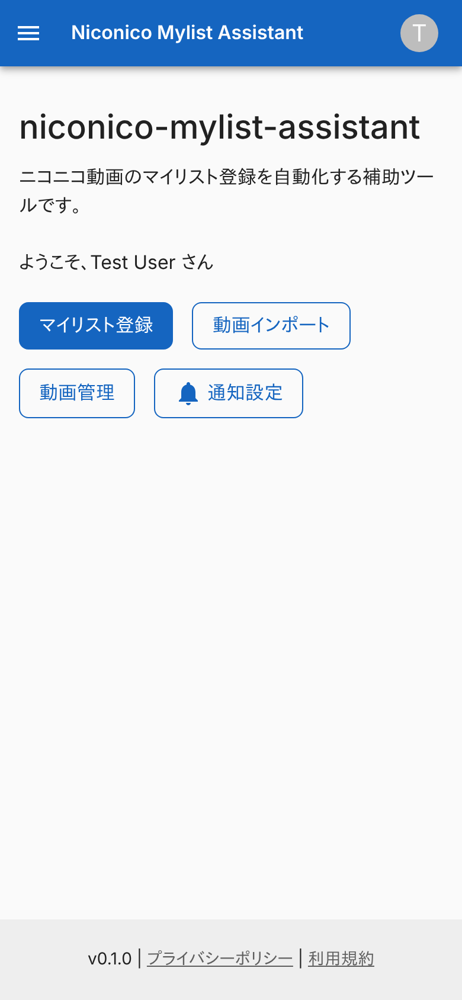
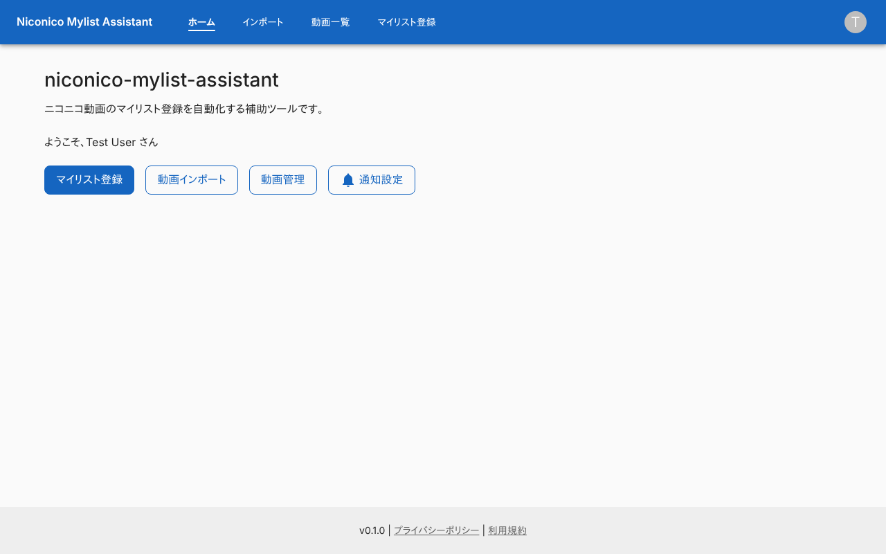
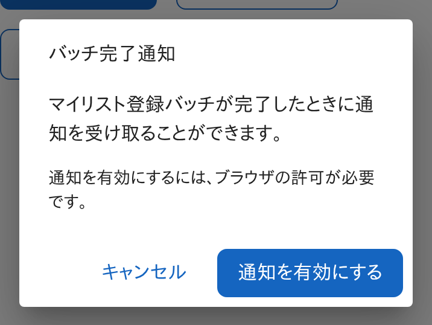
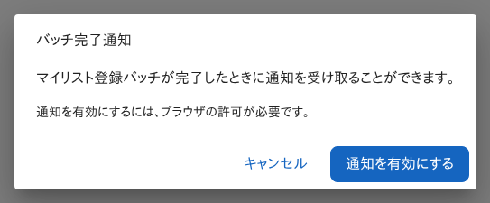
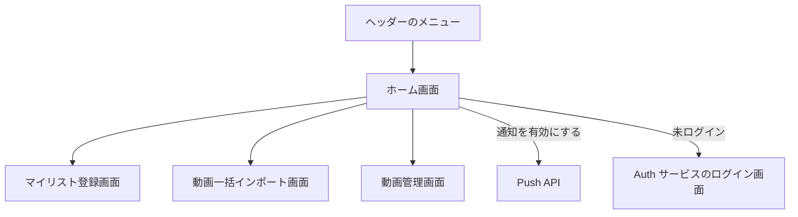

# ホーム画面

各画面への入口と、マイリスト登録の完了通知の設定をまとめた画面。ログインしていなくても開ける唯一の画面。

## 入口

- パスは `/`。ヘッダーの「ホーム」か、サービス名から来る
- ヘッダーのメニューは「ホーム」「インポート」「動画一覧」「マイリスト登録」の 4 つで、全画面に付く。「動画一覧」は[動画管理画面](./videos.md)に行く。狭い画面ではメニューがドロワーにまとまる
- ホーム以外の画面は、ログインしていないと Auth サービスのログイン画面へ移される。戻り先には、開こうとした画面の URL を渡す

## 表示の条件

| 条件 | 表示 |
|---|---|
| ログイン済み | 利用者の名前 (「ようこそ、{名前} さん」) と、各画面へのボタン |
| 未ログイン | 「このサービスを利用するには、ログインが必要です。」と「ログイン」ボタン。ボタンは Auth サービスのログイン画面へ行き、戻り先はこのサービスのトップ |

## 表示するもの

| 部分 | 内容 |
|---|---|
| 見出しと説明 | サービス名と「ニコニコ動画のマイリスト登録を自動化する補助ツールです。」 |
| 各画面へのボタン | 「マイリスト登録」([マイリスト登録画面](./mylist-register.md))、「動画インポート」([動画一括インポート画面](./import.md))、「動画管理」([動画管理画面](./videos.md)) |
| 通知設定ボタン | ブラウザが Web Push に対応しているときだけ出る |

## 状態

- 通知設定のダイアログ (「バッチ完了通知」) は、購読済みかどうかで中身が変わる

| 購読 | 説明 | ボタン |
|---|---|---|
| 未購読 | 「通知を有効にするには、ブラウザの許可が必要です。」 | 「キャンセル」「通知を有効にする」 |
| 購読済み | 「✓ 通知は既に有効になっています」 | 「キャンセル」だけ |

## 操作

| 操作 | 結果 |
|---|---|
| 各画面へのボタン | その画面に移る |
| 通知設定 | ダイアログを開く |
| 通知を有効にする | ブラウザの通知の許可を求め、許可されれば Web Push を購読して[Push API](../api/push.md)へ送る。結果はブラウザの警告で知らせる (成功は「通知が有効になりました!」、失敗は「通知の有効化に失敗しました」に理由を添えたもの)。どちらもダイアログを閉じる |

- 購読の宛先は、マイリスト登録を依頼するとき画面が添える ([マイリスト登録の経路](../flow/mylist-registration.md))。ここで有効にした購読が、完了の通知の宛先になる

## 画面の見た目

### 通常表示

ログイン済みの表示。

| スマホ | PC |
|---|---|
|  |  |

### 通知設定のダイアログ

購読していない状態。

| スマホ | PC |
|---|---|
|  |  |

## つながり

