# ジョブの状態画面

マイリストの登録を依頼したあと、[ジョブ](../term/batch-job.md)の進み具合と結果を見る画面。ステータスが終わるまで、定期的に取得し直す。

## 入口

- パスは `/mylist/status/{jobId}`
- [マイリスト登録画面](./mylist-register.md)で依頼すると、3 秒後に自動で来る
- ヘッダーのメニューには入口がない。登録の完了通知をタップしても、この画面ではなく動画管理画面 (`/mylist`) が開く ([マイリスト登録の経路](../flow/mylist-registration.md))
- ログインしていなければ、ミドルウェアが Auth のログイン画面へ移す。ページ自身も、セッションがなければホーム (`/`) に移す
- 自分が作ったジョブの ID だけが見える。ほかの利用者のジョブ ID を開くと、ジョブがないときと同じになる

## 表示するもの

| 部分 | 内容 |
|---|---|
| 「登録画面に戻る」 | [マイリスト登録画面](./mylist-register.md)に移る |
| ステータス | 札 (色つき)、アイコン、ジョブ ID、説明文 |
| 進行中の帯 | 投入済み・実行中・二段階認証待ちのあいだ出る |
| 処理結果 | 結果があれば出す。「登録成功: N 件」「登録失敗: N 件」「総件数: N 件」と、エラーがあれば「エラー: ...」 |
| 日時 | 作成日時、更新日時、完了日時 (あれば)。日本時間の `YYYY/MM/DD HH:mm:ss` |

ステータスごとの表示。

| ステータス | 札 | 説明文 |
|---|---|---|
| `SUBMITTED` | 投入済み | ジョブの実行を待機中... |
| `RUNNING` | 実行中 | マイリスト登録処理を実行中... |
| `WAITING_FOR_2FA` | 二段階認証待ち | 二段階認証が必要です。メールに送られた6桁のコードを入力してください。 |
| `SUCCEEDED` | 完了 | マイリスト登録が完了しました |
| `FAILED` | 失敗 | マイリスト登録に失敗しました |

- 結果の帯は、`SUCCEEDED` なら緑、`FAILED` なら赤。一部の動画だけ登録に失敗しても `SUCCEEDED` で、失敗の件数に出る
- `WAITING_FOR_2FA` のときだけ、「二段階認証コード」の入力欄 (6 文字、数字用のキーボード) と「コードを送信」を出す。6 文字そろうまで送信は押せない。今のバッチはこのステータスにしないので、通常は出ない

## 状態

- 最初の取得が終わるまでは、札の代わりにスピナーを出し、日時もステータスも出さない
- 完了 (`SUCCEEDED`) になると、画面の下に「マイリスト登録が完了しました! (成功: N 件, 失敗: M 件)」を 6 秒間出す。結果が付いているときだけ。失敗 (`FAILED`) は結果の帯で見せ、この通知は出さない

| 取得の結果 | 表示 | 取得を続けるか |
|---|---|---|
| ジョブがない (404) | 「指定されたジョブが見つかりません」 | 止める |
| 一時的な失敗 | 応答が 404 以外の失敗なら「ジョブステータスの取得に失敗しました」。通信そのものの失敗は、ブラウザが出したエラーの文。直前の表示は残す | 続ける。次に成功するとエラーは消える |
| 30 分たっても終わらない | 「ジョブステータスの取得がタイムアウトしました」 | 止める |

- エラーは閉じられる

## 操作

| 操作 | 結果 |
|---|---|
| 自動の取得 | 開いた直後に 1 回、その後は 5 秒ごと (最大 360 回 = 30 分)。`SUCCEEDED` か `FAILED` になるか、ジョブがないと分かると止める。[ジョブ API](../api/batch-jobs.md) (`GET /api/batch/status/{jobId}`) を呼ぶ |
| コードを送信 | 6 桁の数字でなければ「6桁の数字を入力してください」。通れば[ジョブ API](../api/batch-jobs.md) (`POST /api/batch/2fa`) に送り、成功すると入力欄を空にする。失敗は入力欄の下に理由を出す |
| 登録画面に戻る | [マイリスト登録画面](./mylist-register.md)に移る |

## 画面の見た目

### 取得中

最初の取得を待っている状態。

| スマホ | PC |
|---|---|
| 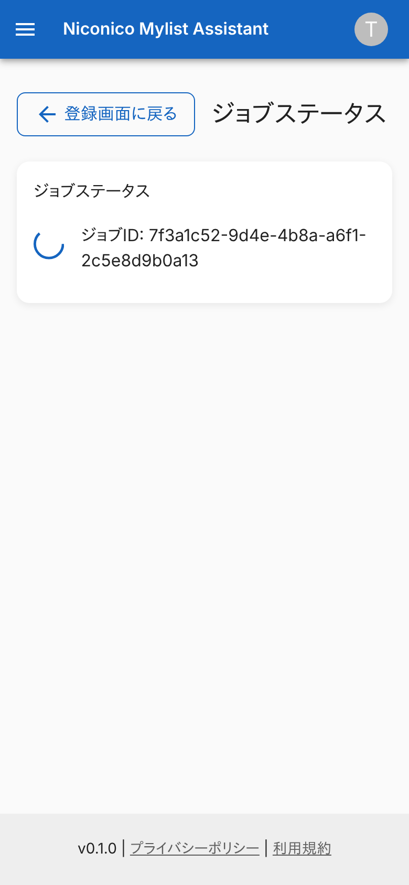 | 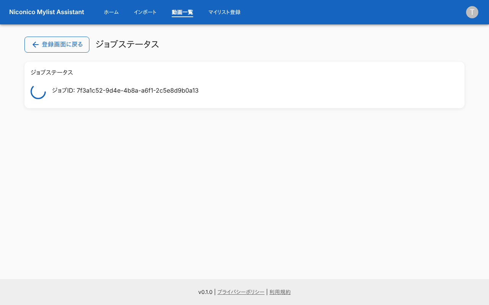 |

### 投入済み

| スマホ | PC |
|---|---|
| 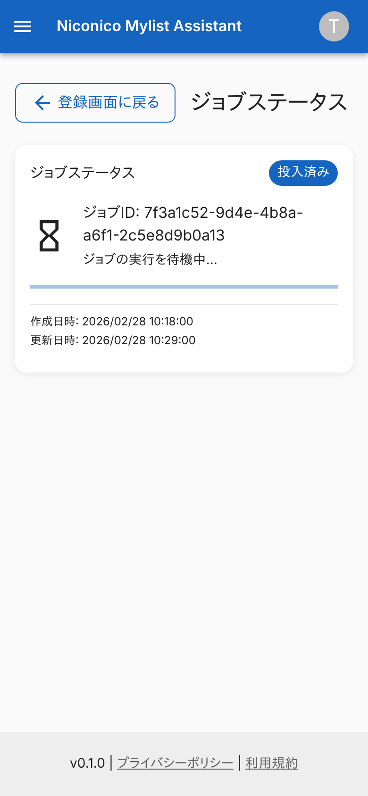 | 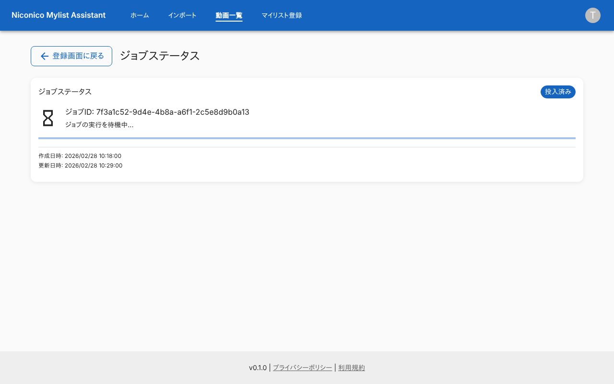 |

### 実行中

| スマホ | PC |
|---|---|
| 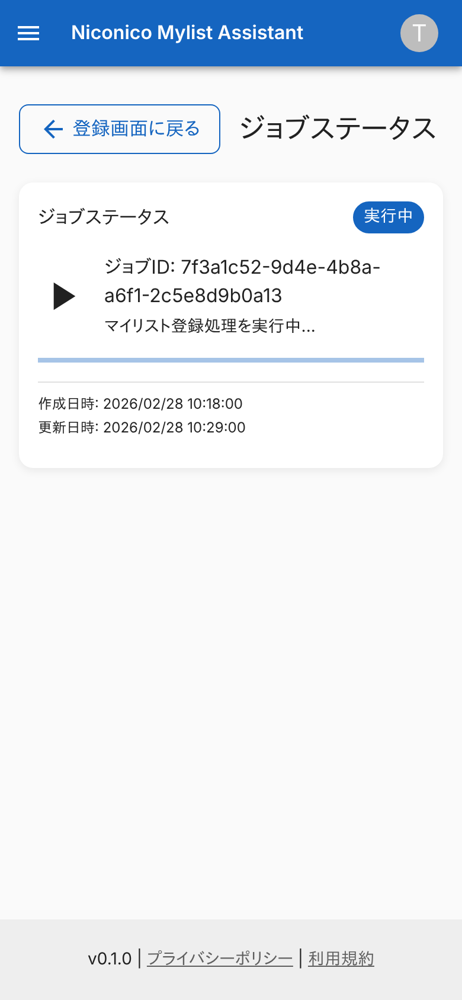 | 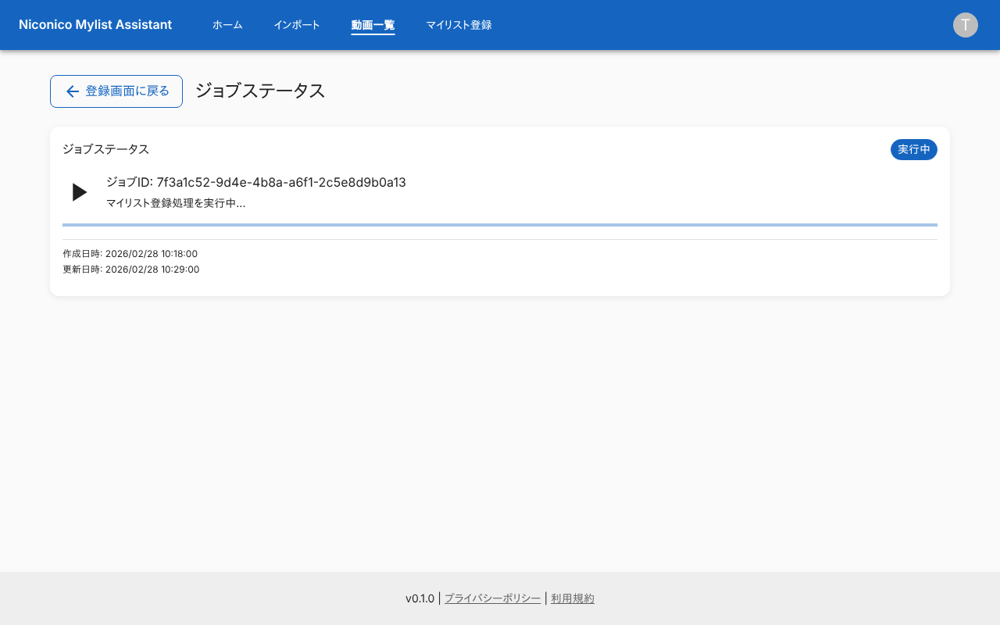 |

### 二段階認証待ち

コードを入力している途中 (6 文字に満たないので送れない)。

| スマホ | PC |
|---|---|
| 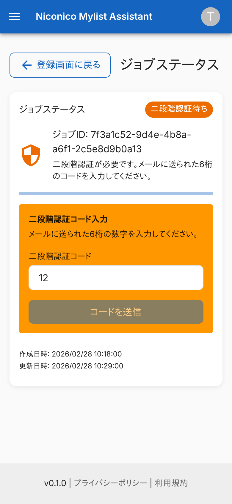 | 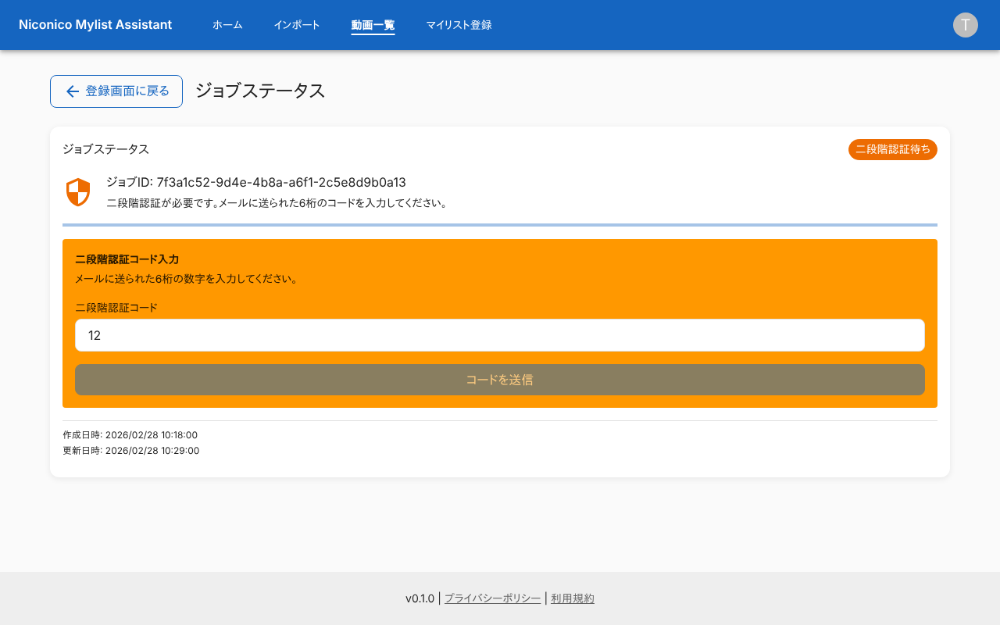 |

### 完了

一部の動画の登録に失敗した例。完了の通知を画面の下に出している。

| スマホ | PC |
|---|---|
| 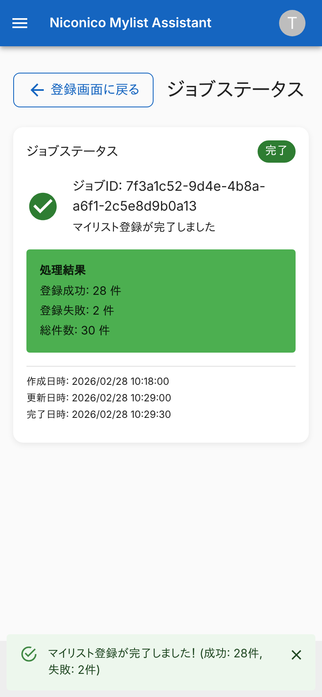 | 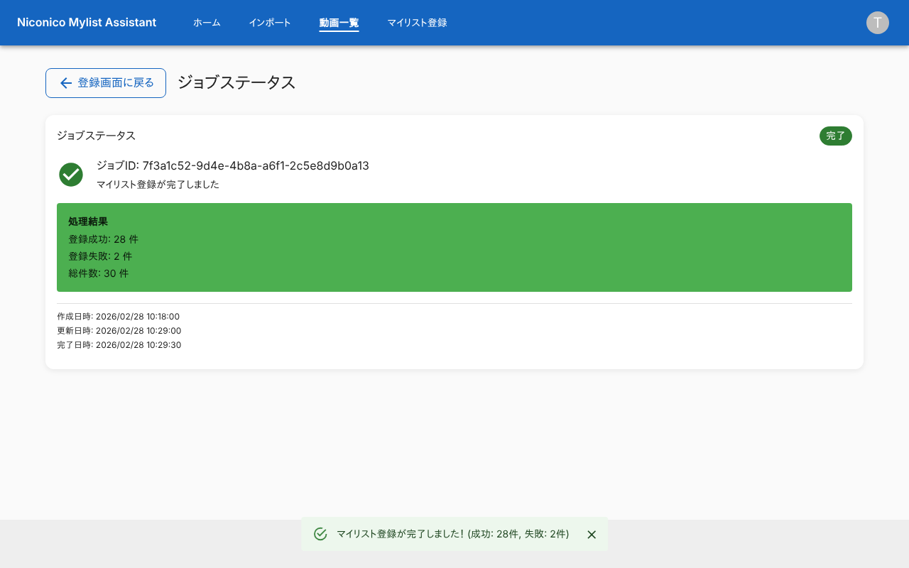 |

### 失敗

セッションが無効で、実行前に止まった例。

| スマホ | PC |
|---|---|
| 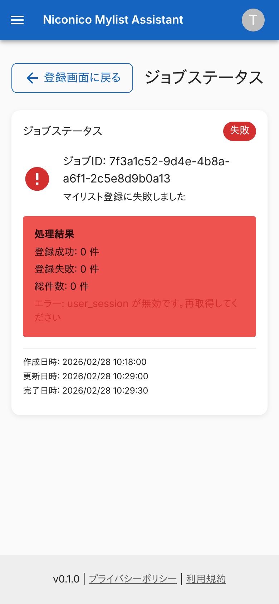 | 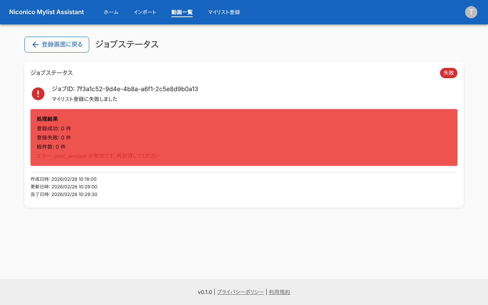 |

### ジョブが見つからないとき

| スマホ | PC |
|---|---|
| 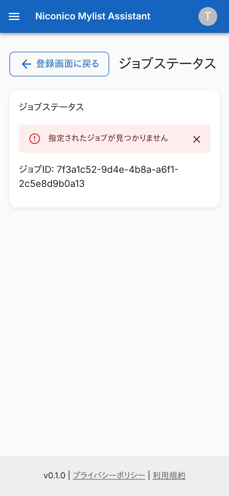 | 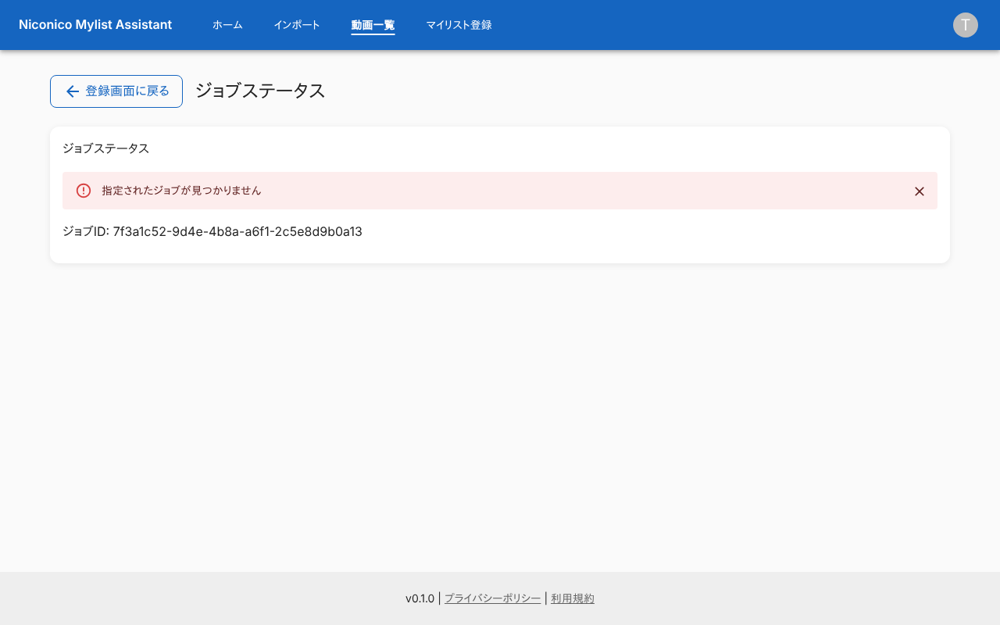 |

### 取得に失敗したとき

一時的な失敗として、取得は続く。

| スマホ | PC |
|---|---|
| 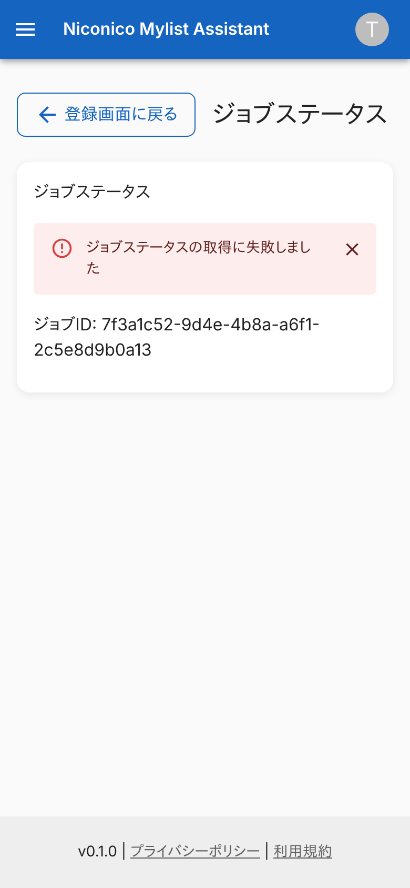 | 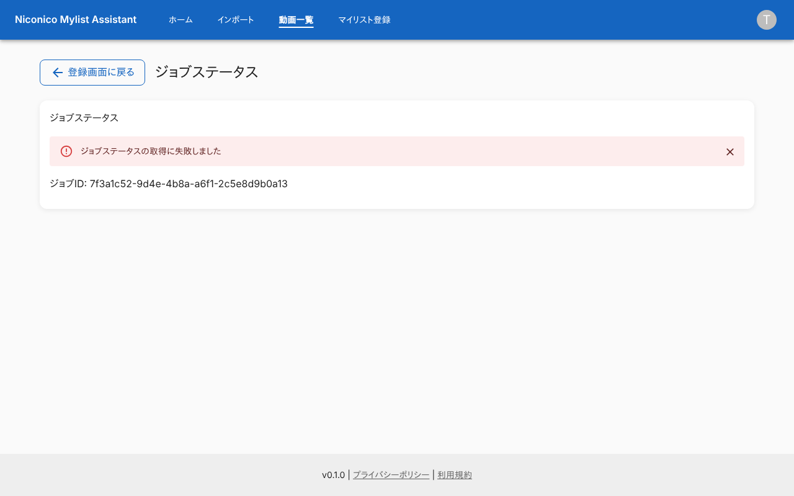 |

## つながり

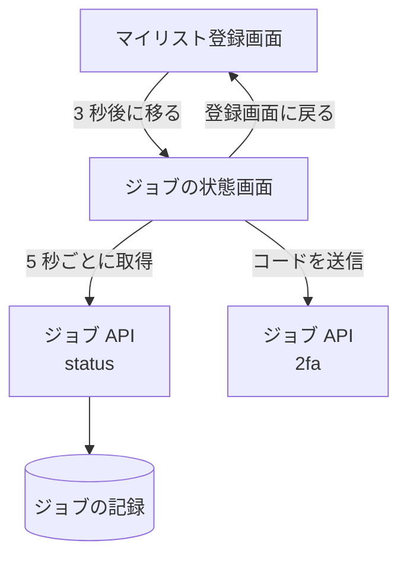
