# 動画管理画面

取り込んだ動画の一覧を見て、お気に入りとスキップを切り替え、メモの編集や削除を行う画面。ここで付けた[ユーザー設定](../term/video-setting.md)が、マイリスト登録で動画を選ぶ条件になる。

## 入口

- パスは `/mylist`。ヘッダーの「動画一覧」と、[ホーム画面](./home.md)の「動画管理」から来る。見出しは「動画管理」
- [動画一括インポート画面](./import.md)の「動画一覧を見る」からも来る
- ログインしていなければ、ミドルウェアが Auth のログイン画面へ移す。ページ自身も、セッションがなければホーム (`/`) に移す

## 表示するもの

| 部分 | 内容 |
|---|---|
| 絞り込み | 「お気に入り」(すべて、お気に入りのみ、お気に入り以外)、「スキップ」(すべて、通常動画のみ、スキップ動画のみ)、タイトルの検索欄と「検索」 |
| 一覧 | 動画のカードを、新しい順に 1 ページ 20 件。画面が広いほど列が増える (狭い画面は 1 列、広い画面は 4 列まで) |
| ページ送り | 総件数が 20 件を超えるときだけ。「N 件中 a - b 件を表示」と、ページ番号 (先頭・末尾へのボタン付き) |
| 動画の詳細 | カードを押すと開くダイアログ |

動画のカード。

| 部分 | 内容 |
|---|---|
| サムネイルとタイトル | タイトルは 2 行まで。画像が読み込めないときは代替の文言に変わる |
| 長さと日付 | 動画の長さと、[動画基本情報](../term/video-basic-info.md)の登録日 (日本時間の `YYYY/MM/DD`) |
| ハート | お気に入りの切り替え。お気に入りなら赤 |
| スキップの印 | スキップの切り替え。スキップなら橙色で、カード全体を薄く表示する |

## 状態

- 初回の取得中は、絞り込みも含めて、読み込み中の表示だけを出す
- 取得に失敗したときは、絞り込みの下に「動画一覧の取得に失敗しました」を出す (閉じられる)。それまでの一覧があれば残し、なければ一覧は空になる
- 0 件のときは「動画が見つかりませんでした」と「フィルター条件を変更するか、動画をインポートしてください」

## 操作

| 操作 | 結果 |
|---|---|
| 絞り込みを変える | 1 ページ目に戻して取得し直す。絞り込みとページは URL のクエリ (`favorite`、`skip`、`search`、`offset`) に入り、ブラウザの戻る・進むで復元する |
| 検索 | 入力したタイトルで絞り込む。検索ボタンかエンターキーで実行する (入力しただけでは動かない)。大文字と小文字は区別せず、部分一致 |
| ページを変える | そのページを取得し、画面の先頭へ戻る |
| ハート・スキップの印を押す | 画面の表示を先に切り替えて、[動画 API](../api/videos.md) (`PUT /api/videos/{id}/settings`) に送る。成功したら一覧を取得し直す。失敗したら表示を戻し、「お気に入りの更新に失敗しました」か「スキップの更新に失敗しました」を出す。同じ動画の更新が終わるまで、その動画のボタンは押せない |
| カードを押す | 動画の詳細を開く |

絞り込みの 3 つの条件は、すべて満たすものだけが出る (AND)。

動画の詳細ダイアログ (「動画詳細」)。

| 部分 | 内容 |
|---|---|
| 内容 | 大きなサムネイル、タイトル、ニコニコ動画で開くリンク (別のタブ)、長さと日時 |
| お気に入り・スキップ | ボタン。押すと保存して、一覧にも反映する |
| メモ | 複数行の入力欄。「N/1000文字」を出し、超えると保存できない。「メモを保存」で保存する |
| 「動画を削除」 | 押すと、ダイアログの中に「この動画を削除してもよろしいですか?この操作は取り消せません。」を出す。「削除する」で [動画 API](../api/videos.md) (`DELETE /api/videos/{id}`) を呼び、成功したらダイアログを閉じて一覧を取得し直す |
| 取得に失敗 | 本体の代わりに「動画情報の取得に失敗しました」を出す |
| 操作に失敗 | 本体と編集中のメモを残したまま、「設定の更新に失敗しました」か「動画の削除に失敗しました」を上に出す |

- 保存していないメモがあるまま閉じようとすると (閉じる、×、背景、エスケープのどれでも)、「保存していないメモがあります」の確認を出す。「破棄して閉じる」で閉じ、「キャンセル」で戻る

## 画面の見た目

### 通常表示

45 件のうち 1 ページ目。お気に入り (赤いハート) とスキップ (橙色で薄い表示) が混ざっている。

| スマホ | PC |
|---|---|
|  | 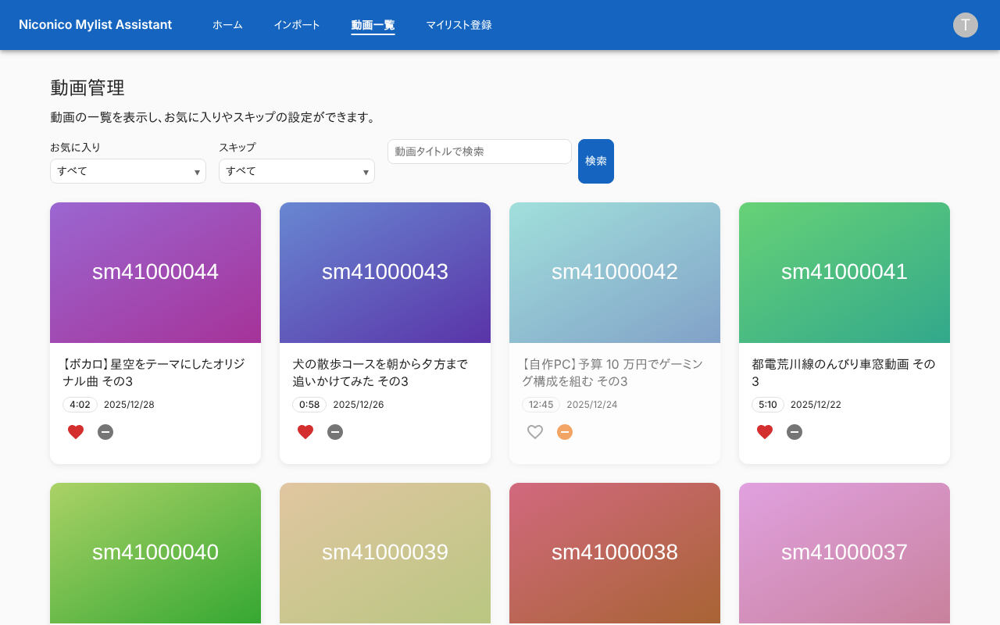 |

### ページ送り

一覧の下端。

| スマホ | PC |
|---|---|
| 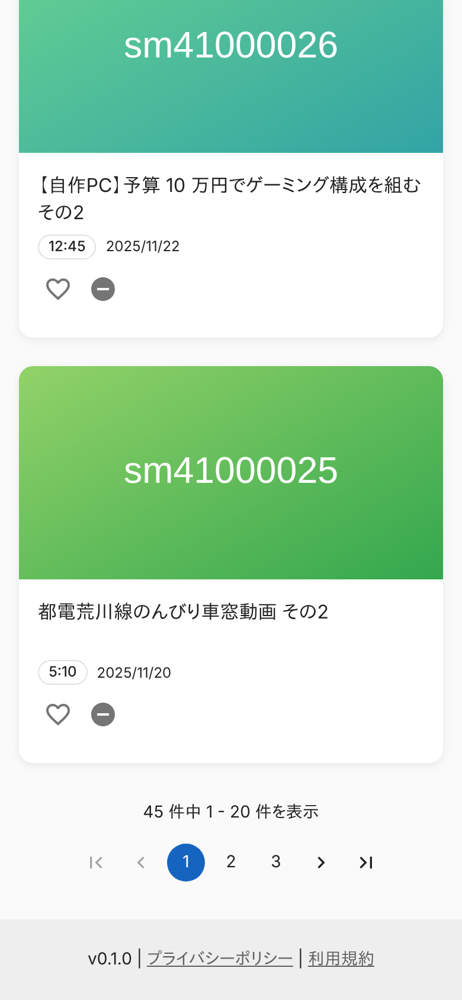 | 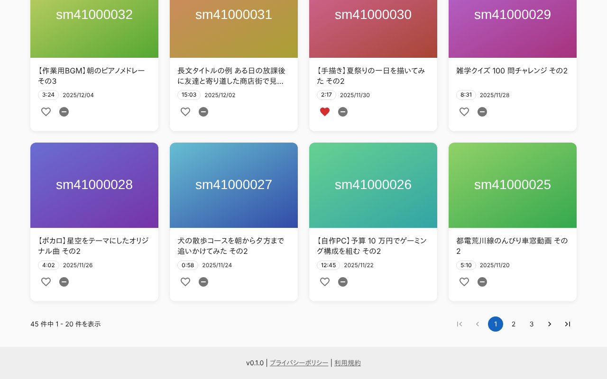 |

### お気に入りで絞り込んだ状態

URL に `favorite=true` を付けて開いた状態。

| スマホ | PC |
|---|---|
| 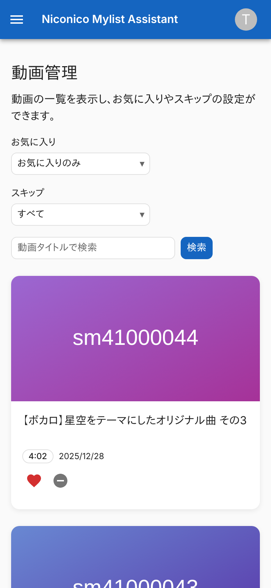 | 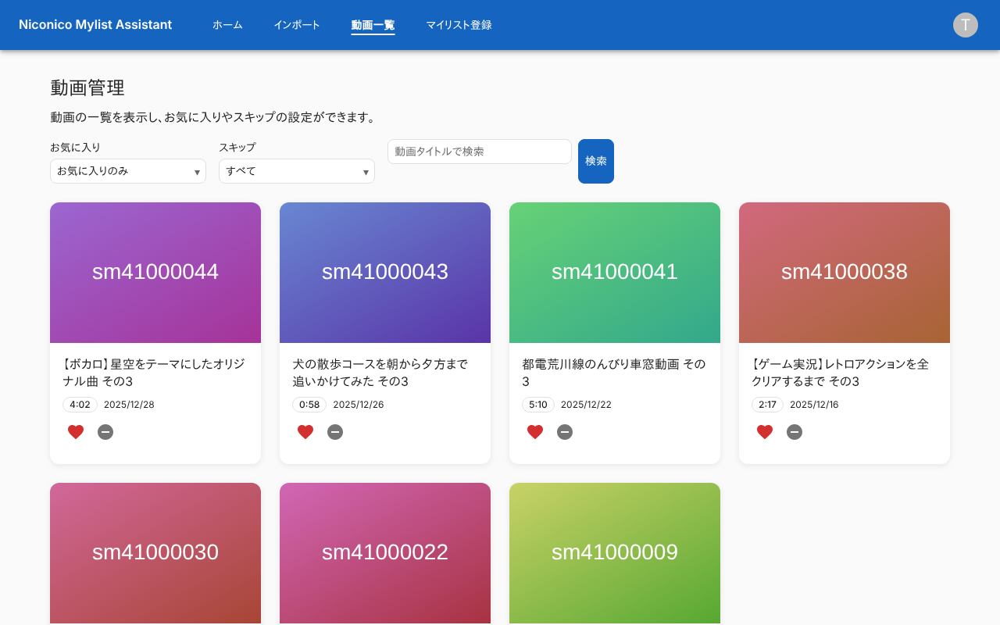 |

### 動画の詳細ダイアログ

お気に入りで、メモのある動画。

| スマホ | PC |
|---|---|
| 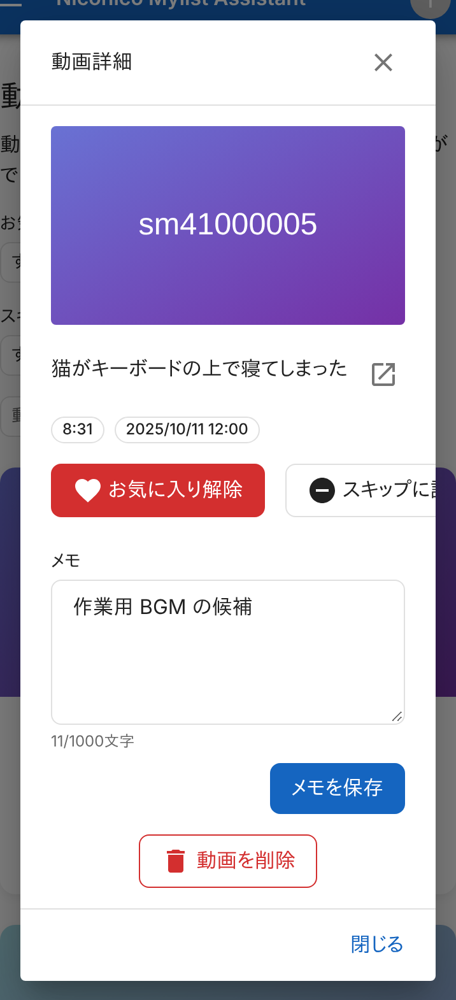 | 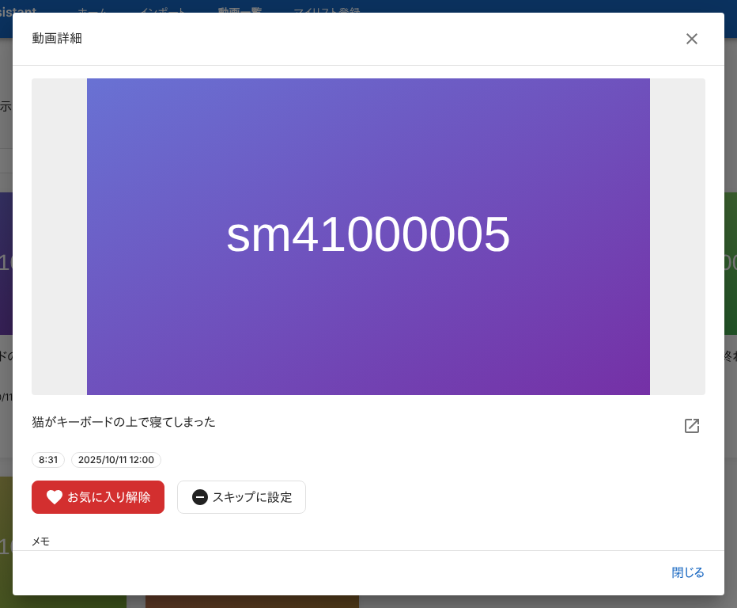 |

### メモを保存せずに閉じようとしたとき

| スマホ | PC |
|---|---|
| 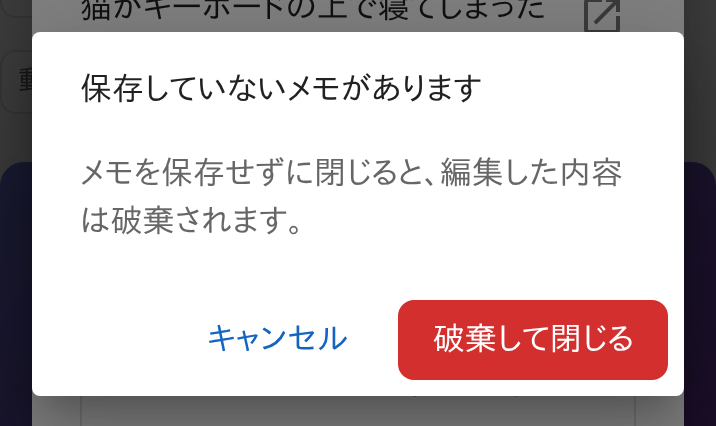 | 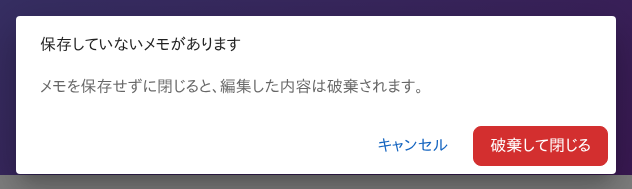 |

### 動画の削除の確認

確認は、ダイアログの下端に出る。

| スマホ | PC |
|---|---|
| 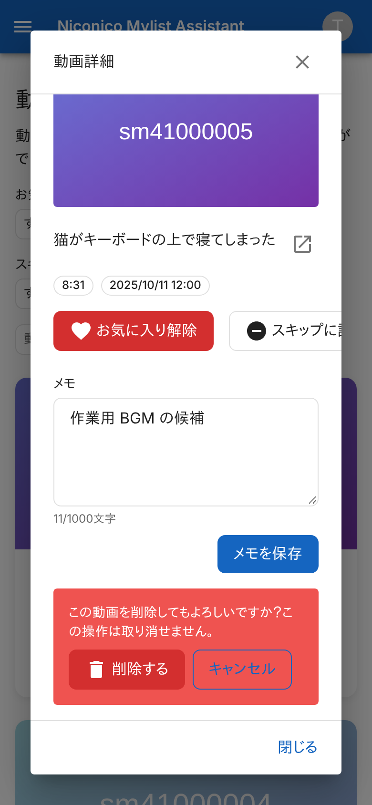 | 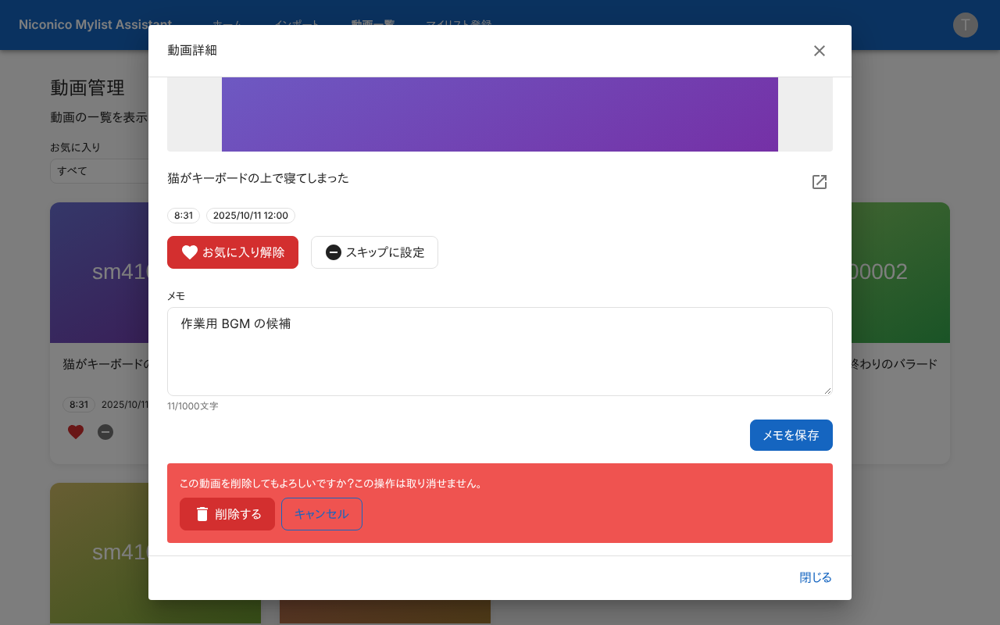 |

### 動画がないとき

| スマホ | PC |
|---|---|
| 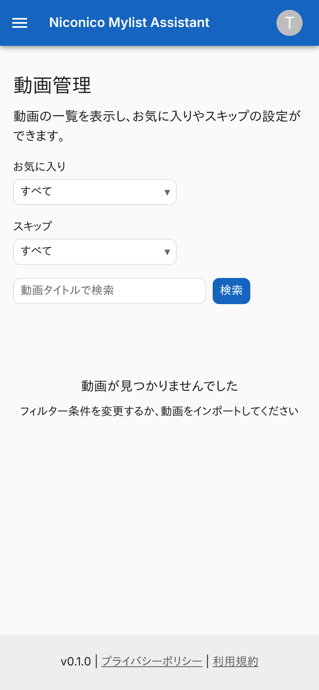 | 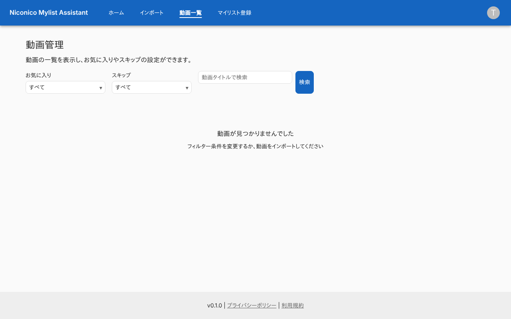 |

### 一覧の取得に失敗したとき

| スマホ | PC |
|---|---|
| 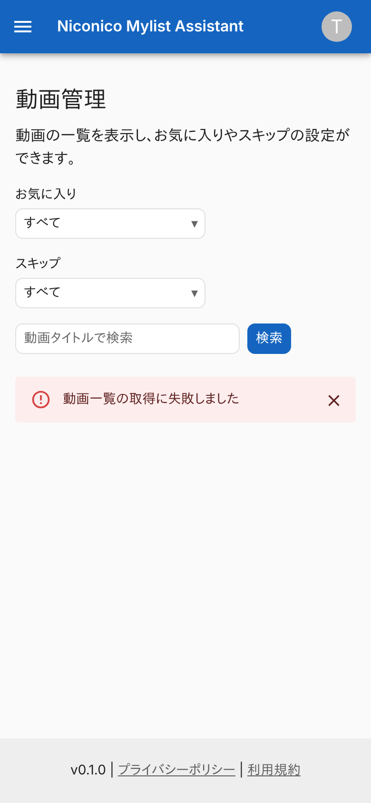 | 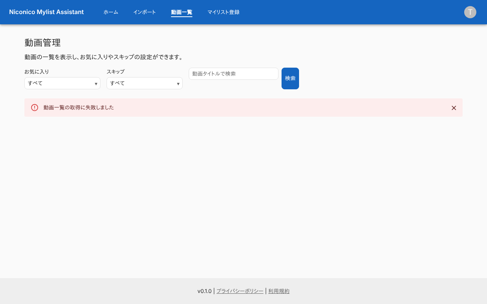 |

## つながり

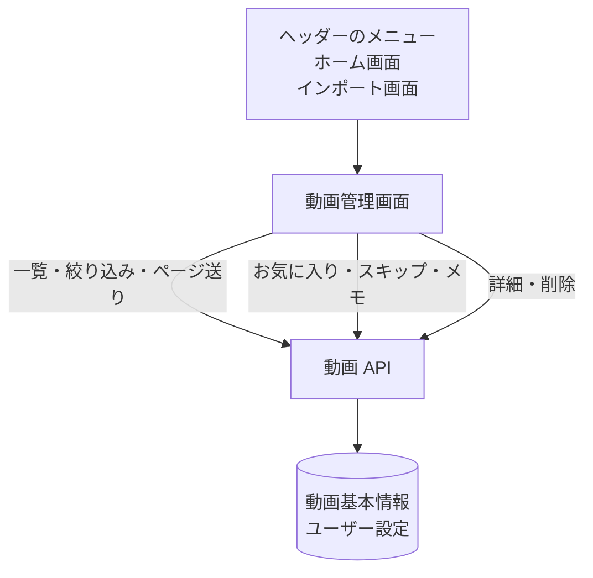
