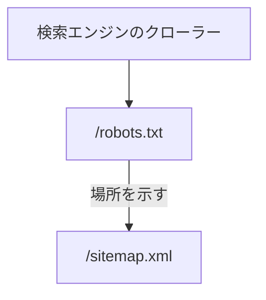

# robots.txt

検索エンジンのクローラーに、巡回してよい範囲とサイトマップの場所を伝えるテキスト。

## エンドポイント

| メソッド | パス | 権限 |
|---|---|---|
| GET | `/robots.txt` | なし |

## 入力と出力

- 入力はない。出力は固定で、次の 4 行
    - `User-Agent: *`
    - `Allow: /`
    - `Host: https://nagiyu.com`
    - `Sitemap: https://nagiyu.com/sitemap.xml`
- 巡回を禁じるパスはない。すべてのクローラーに全体を許す
- 内容はビルド時に決まる

## エラー

- ここで返すエラーを決めていない

## つながり

