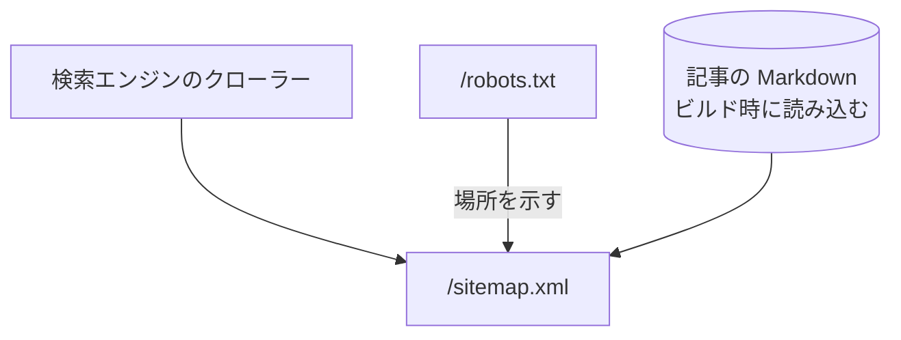

# サイトマップ

検索エンジンに、公開しているページの一覧を渡す XML。画面と記事から作り、手で書いたものはない。

## エンドポイント

| メソッド | パス | 権限 |
|---|---|---|
| GET | `/sitemap.xml` | なし |

## 入力と出力

- 入力はない。次のページを、`https://nagiyu.com` を付けた URL で、表の順に並べる

| ページ | 更新頻度 (changefreq) | 優先度 (priority) | 更新日 (lastmod) |
|---|---|---|---|
| `/` | weekly | 1 | ビルドした日時 |
| `/about` | monthly | 0.7 | ビルドした日時 |
| `/contact` | yearly | 0.5 | ビルドした日時 |
| `/privacy` | yearly | 0.3 | ビルドした日時 |
| `/terms` | yearly | 0.3 | ビルドした日時 |
| `/tech` | weekly | 0.9 | ビルドした日時 |
| 記事 1 本ごとの `/tech/{slug}` | monthly | 0.7 | `updatedAt`、なければ `publishedAt` |

- 固定の 6 ページの後に、[記事](../term/article.md)を公開日の新しい順に並べる
- 内容はビルド時に決まり、記事を足しても、再ビルドするまで変わらない ([記事が公開されるまで](../flow/article-publishing.md))
- 固定のページの一覧は手で書いた定数で、ページを足してもここには自動で入らない

## エラー

- ここで返すエラーを決めていない

## つながり

