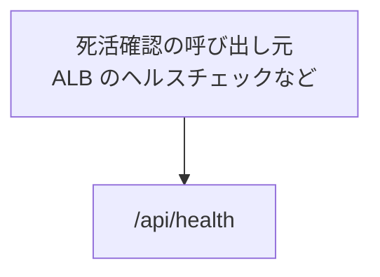

# システム系の API

業務の機能ではない API。死活確認だけがある。

## エンドポイント

| メソッド | パス | 権限 |
|---|---|---|
| GET | `/api/health` | なし |

## 入力と出力

- `{ status: 'ok' }` を返す。入力はない
- 他のサービスの死活確認と違い、`service`、`version`、`timestamp` は返さない
- 記事の読み込みなどは確かめず、サーバーが応答できるかだけを示す
- 画面と違い、ビルド時に固定せず、呼ばれるたびにサーバーが応答する

## エラー

- ここで返すエラーを決めていない。GET 以外のメソッドは 405

## つながり

