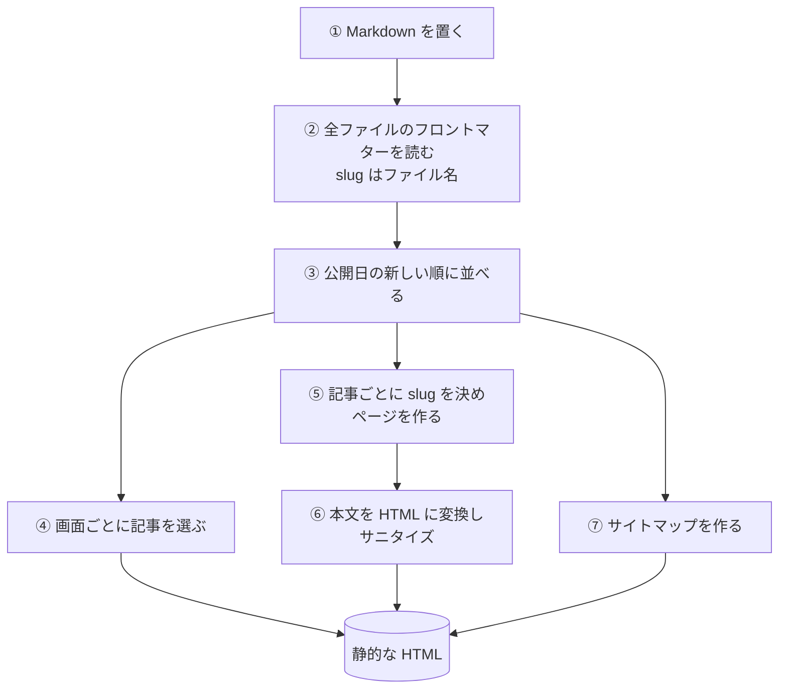
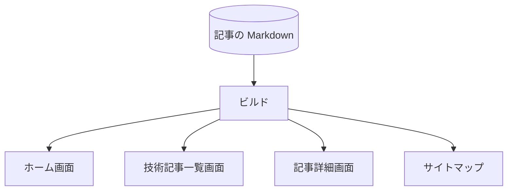

# 記事が公開されるまで

Markdown で書いた[記事](../term/article.md)が、ビルドで静的な HTML になり、一覧・詳細・トップ・サイトマップに出るまでの経路。

## 起点

- `services/portal/web/src/content/tech/` に `{slug}.md` を置く (フロントマターの項目は[記事](../term/article.md))
- 画面を描くときにファイルを読むのはビルドだけ。起動したあとのサーバーは、記事のファイルを読まない。記事を足す・直すときは、ビルドし直して配信し直す

## 経路

| 段階 | 中身 |
|---|---|
| ② | `.md` で終わるファイルをすべて読む。`slug` はファイル名から決まり、フロントマターの `slug` は使わない。ディレクトリがなければ記事は 0 件 |
| ③ | `publishedAt` の降順。日付が同じ記事の順は、ファイルを読んだ順 |
| ④ | [ホーム画面](../screen/home.md): 特集は `featured: true` の記事から先頭の 3 件 ([特集記事](../term/featured.md))、最新は先頭の 6 件。[技術記事一覧画面](../screen/tech.md): 全件 |
| ⑤ | `generateStaticParams` が記事の slug の一覧を返す。この一覧にない slug は開けず、[404 画面](../screen/not-found.md)になる |
| ⑥ | Markdown (GFM) を HTML に変換し、DOMPurify でサニタイズする。生の HTML タグは出力に残らない。[記事詳細画面](../screen/tech-article.md)の関連記事は、この時点で全記事のタグから選ぶ |
| ⑦ | [サイトマップ](../api/sitemap.md)に、記事ごとの URL と更新日を並べる |

- カテゴリのラベル名は、`content.ts` の表で slug から引く。表にない slug は slug のまま表示する ([カテゴリ](../term/category.md))

## 届く先

- [ホーム画面](../screen/home.md)の「特集記事」と「最新の技術記事」
- [技術記事一覧画面](../screen/tech.md)
- [記事詳細画面](../screen/tech-article.md)
- [サイトマップ](../api/sitemap.md)

## 失敗・取りこぼしのとき

- フロントマターの必須項目 (題名、公開日、タグなど) の欠けを検査する仕組みはない
- 読み込めない記事を飛ばす仕組みもない。例外はそのままビルドの失敗になる

## つながり

