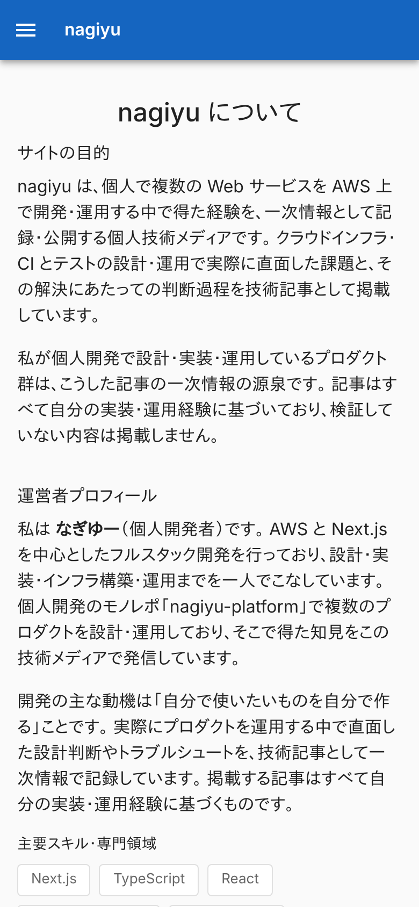
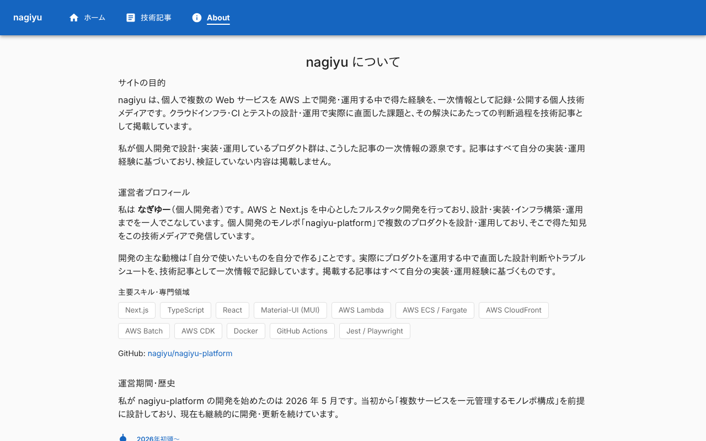
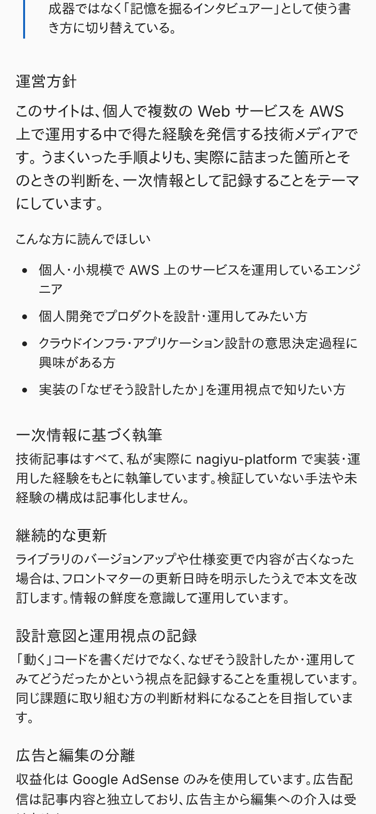
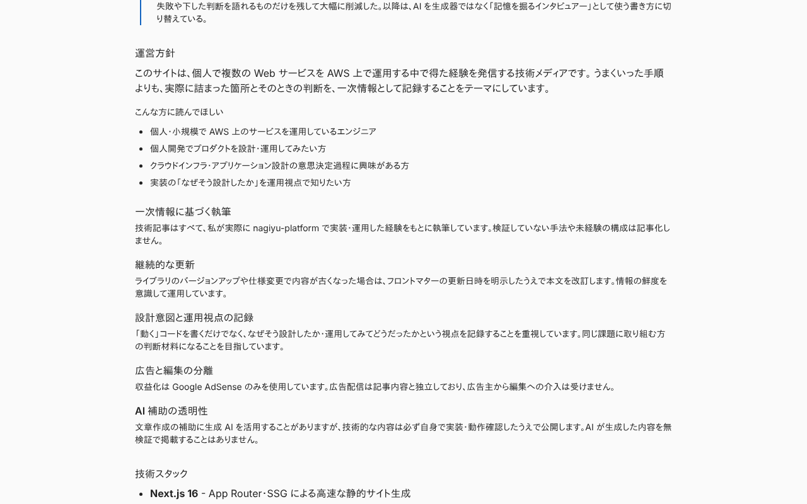
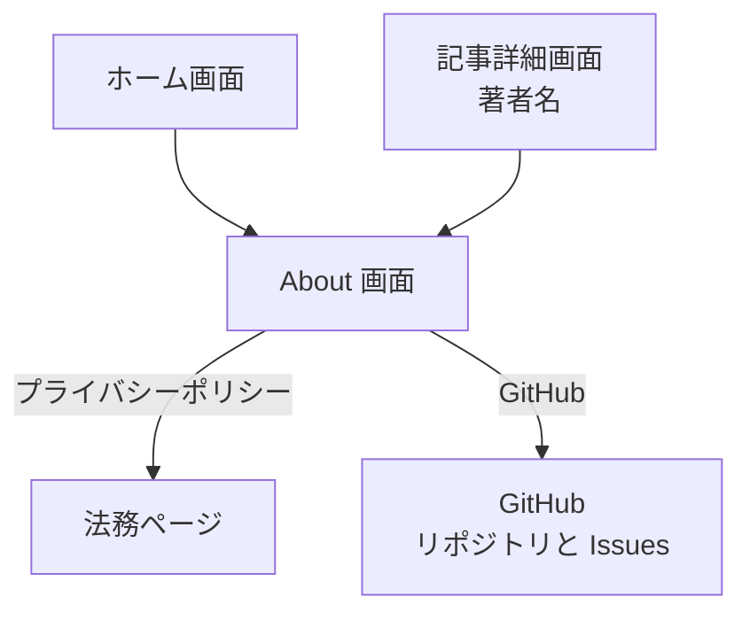

# About 画面

運営者と運営方針を示す画面。ログインは要らない。ヘッダー・フッターは[ホーム画面](./home.md)の「全画面で共通の部分」と同じ。

## 入口

- パスは `/about`
- ヘッダーの「About」、フッターの「About」、[ホーム画面](./home.md)の「nagiyu について」、[記事詳細画面](./tech-article.md)の著者名から来る
- [プライバシーポリシー](./legal.md)へのリンクがある。[お問い合わせ画面](./contact.md)へのリンクはない

## 表示するもの

上から次の順に並ぶ。中身は文章と固定のデータで、画面が読み込むものはない。

| 節 | 内容 |
|---|---|
| (見出し) | 「nagiyu について」 |
| サイトの目的 | 2 段落の文章 |
| 運営者プロフィール | 運営者の説明、主要スキルのチップ 12 個、GitHub のリポジトリへのリンク (別タブ) |
| 運営期間・歴史 | 説明と、時系列のタイムライン 3 件 |
| 運営方針 | 説明、「こんな方に読んでほしい」(4 項目)、方針 5 項目 (見出しと説明) |
| 技術スタック | 5 項目の箇条書き |
| 編集ポリシー | 4 項目の箇条書き |
| お問い合わせ | 連絡先として GitHub Issues の URL (別タブ) |
| プライバシーとセキュリティ | 説明と、プライバシーポリシー (`/privacy`) へのリンク |

- 主要スキルは `lib/about.ts` の `SKILLS` で、分類 (フロントエンド、バックエンド、インフラ、ツール・その他) の値は持つが、画面には出さない
- タイムライン、対象読者、方針も `lib/about.ts` のデータ。文章を変えるときはコードを変える
- ページのタイトルは「nagiyu について - nagiyu」。canonical は `https://nagiyu.com/about`

## 操作

| 操作 | 結果 |
|---|---|
| GitHub のリンク | 運営者のリポジトリを別タブで開く |
| 連絡先の GitHub Issues のリンク | リポジトリの Issues を別タブで開く |
| 「プライバシーポリシー」 | [プライバシーポリシー](./legal.md)を開く |

- API は呼ばない

## 画面の見た目

### 通常表示

ページの先頭。

| スマホ | PC |
|---|---|
|  |  |

### 運営方針

対象読者と方針の項目が並ぶ節。

| スマホ | PC |
|---|---|
|  |  |

## つながり

