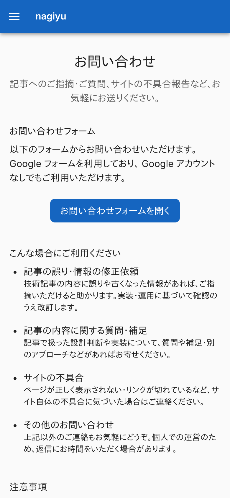
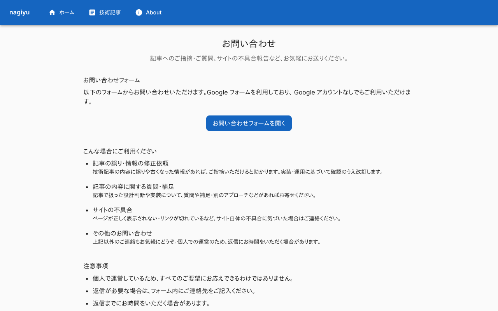
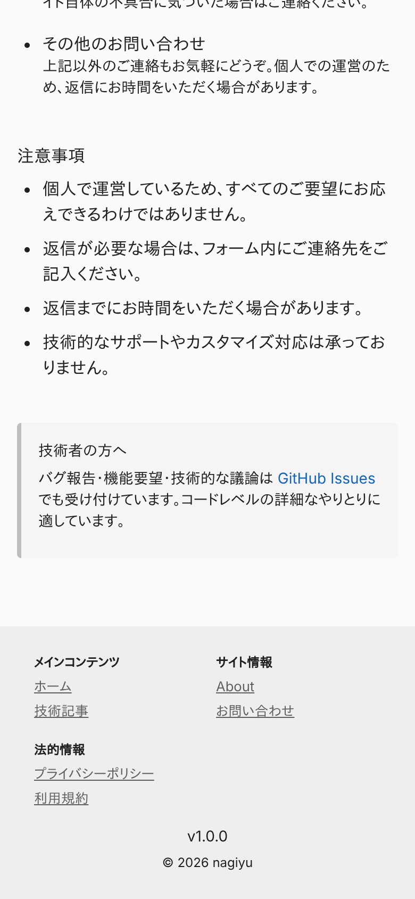
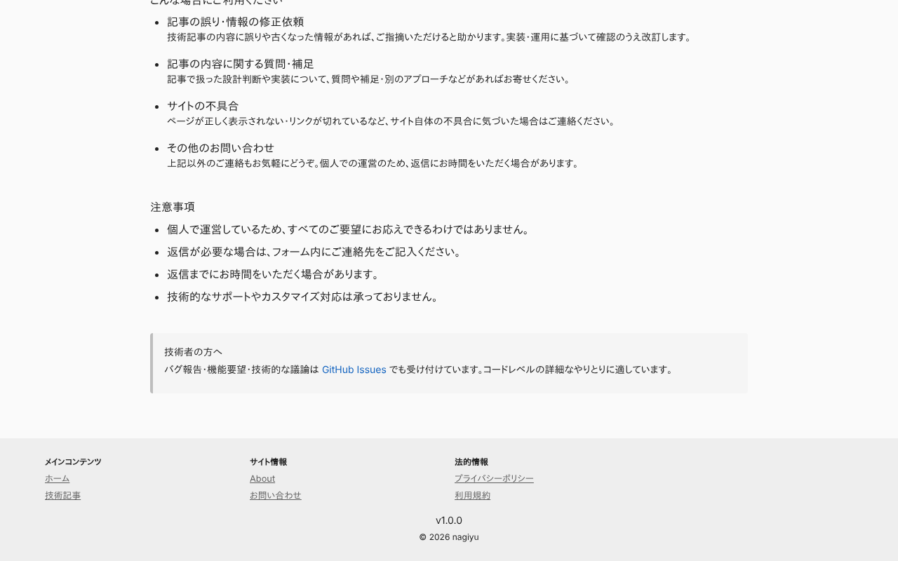
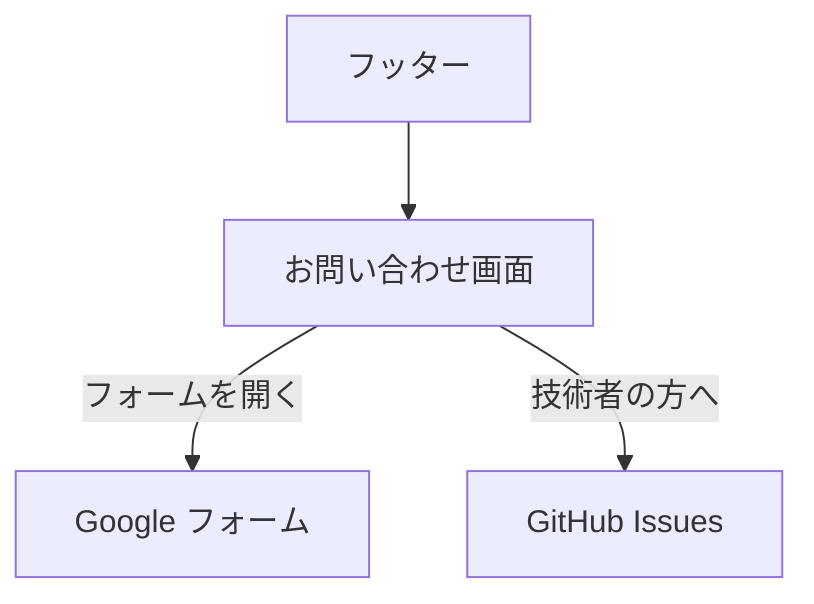

# お問い合わせ画面

問い合わせの手段と、受け付ける用件を示す画面。問い合わせそのものは外部の Google フォームで受け、Portal は入力欄を持たない。ログインは要らない。ヘッダー・フッターは[ホーム画面](./home.md)の「全画面で共通の部分」と同じ。

## 入口

- パスは `/contact`
- フッターの「お問い合わせ」から来る。ヘッダーのナビゲーションにはない。[About 画面](./about.md)からのリンクもない

## 表示するもの

上から次の順に並ぶ。

| 節 | 内容 |
|---|---|
| (見出し) | 「お問い合わせ」と、1 文の案内 |
| お問い合わせフォーム | 説明と、ボタン「お問い合わせフォームを開く」 |
| こんな場合にご利用ください | 用件 4 つ (記事の誤り・情報の修正依頼、記事の内容に関する質問・補足、サイトの不具合、その他) の見出しと説明 |
| 注意事項 | 4 項目の箇条書き |
| 技術者の方へ | GitHub Issues でも受け付ける旨と、そのリンク |

- 用件と注意事項は `lib/contact.ts` の固定のデータ
- ページのタイトルは「お問い合わせ - nagiyu」。canonical は `https://nagiyu.com/contact`

## 操作

| 操作 | 結果 |
|---|---|
| お問い合わせフォームを開く | Google フォームを別タブで開く (リンクの URL は `lib/contact.ts` の定数) |
| GitHub Issues | リポジトリの Issues を別タブで開く |

- API は呼ばない。送信の成否はこの画面からは分からない

## 画面の見た目

### 通常表示

ページの先頭。フォームを開くボタンが中央にある。

| スマホ | PC |
|---|---|
|  |  |

### 注意事項

ページの後半。注意事項と、GitHub Issues の案内 (灰色の枠)。

| スマホ | PC |
|---|---|
|  |  |

## つながり

