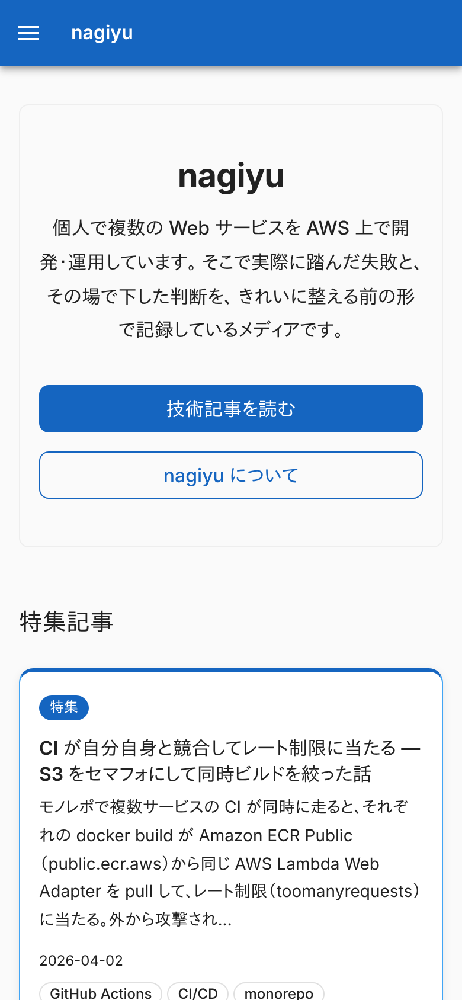
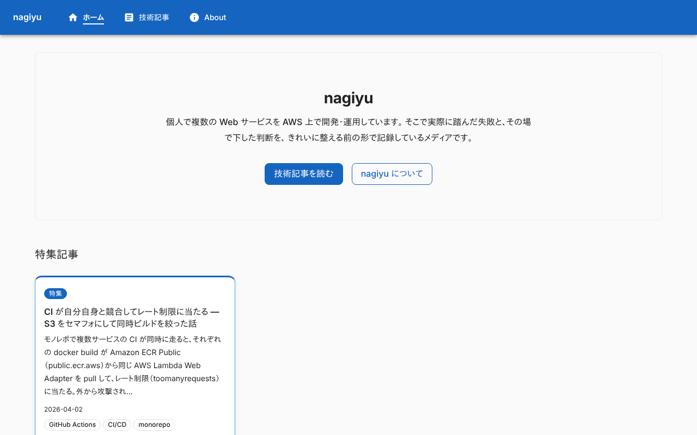
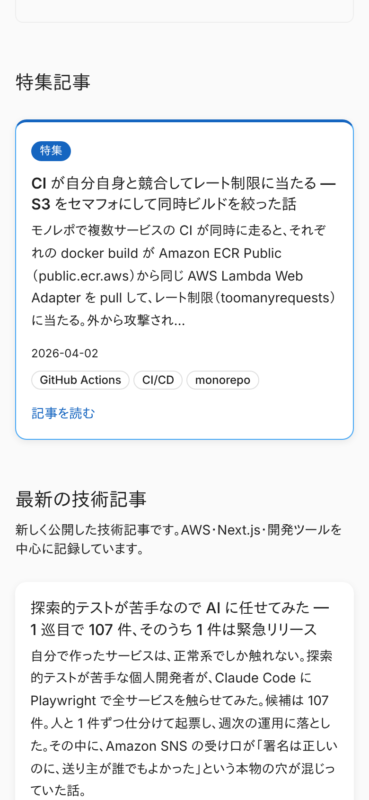
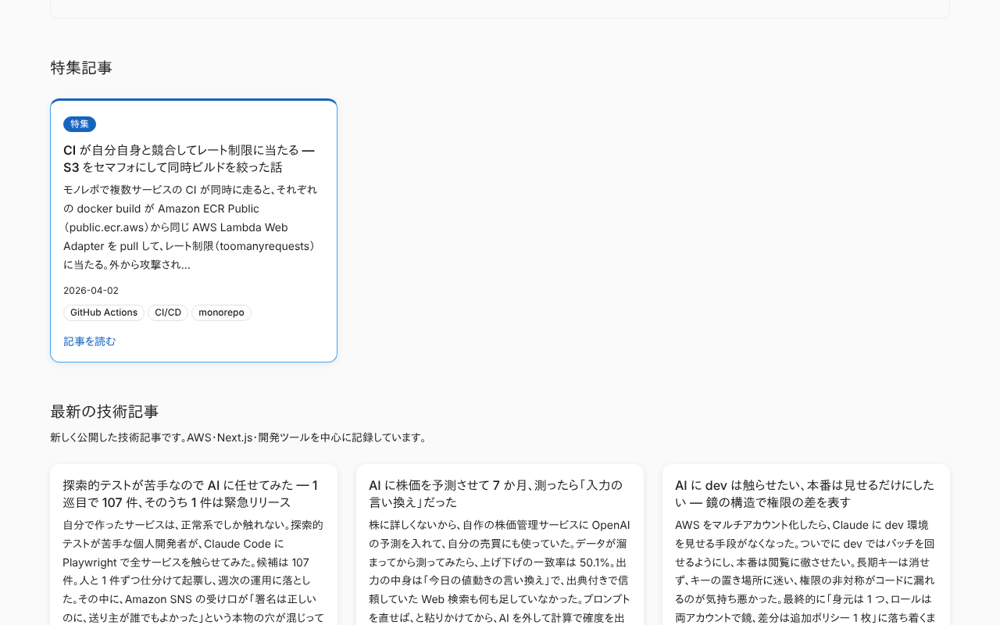
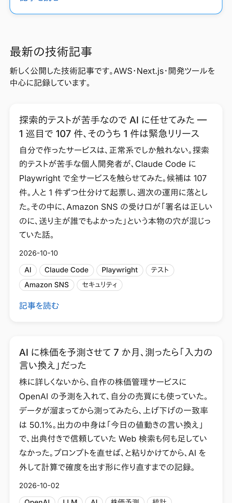
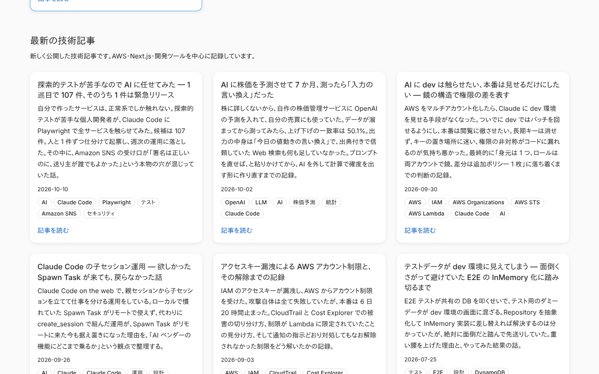
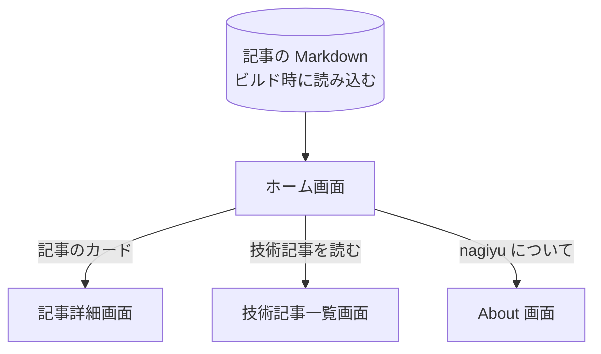

# ホーム画面

サイトが何のメディアかを伝え、特集記事と最新記事から[記事](../term/article.md)へ進ませる、Portal の最初の画面。ログインは要らない。

## 入口

- パスは `/`
- すべての画面のヘッダーのタイトル「nagiyu」と「ホーム」、フッターの「ホーム」から来る
- [404 画面](./not-found.md)の「トップページへ戻る」から来る

## 表示するもの

上から次の順に並ぶ。

| 部分 | 内容 |
|---|---|
| ヒーロー | サイト名「nagiyu」、キャッチコピー、ボタン「技術記事を読む」(`/tech`) と「nagiyu について」(`/about`) |
| 特集記事 | [特集記事](../term/featured.md)のカード。最大 3 件 |
| 最新の技術記事 | 公開日の新しい順に 6 件のカードと、ボタン「すべての技術記事を見る」(`/tech`) |

- 特集記事のカードは、「特集」のバッジ、題名、概要、公開日、[タグ](../term/tag.md)の順。概要は 150 文字を超えると、150 文字で切って `…` を付ける。タグは先頭の 3 つまで
- 最新記事のカードは、題名、概要 (切らない)、公開日、タグ (全部) の順
- カードは全体が `/tech/{slug}` へのリンク。カードの下の「記事を読む」はリンクではなく案内の表示
- カードのグリッドは、スマホ幅で 1 列、広がると 2 列 (最新記事のみ)、さらに広がると 3 列。特集記事は 1 列から 3 列に切り替わる
- 記事の並びはビルド時に決まる ([記事が公開されるまで](../flow/article-publishing.md))
- ページに `WebSite` と `Organization` の構造化データ (JSON-LD) を埋め込む。ページのタイトルは「nagiyu - AWS と個人開発の実運用ノート」、canonical は `https://nagiyu.com`

## 状態

- 特集の記事が 0 件のときは、「特集記事」の枠ごと出さない
- 記事が 0 件のときは、「最新の技術記事」の枠も出さず、ヒーローだけになる
- 読み込み中の表示はない。記事はビルド時に取り込まれる

## 全画面で共通の部分

Portal の全画面は、同じヘッダーとフッターの内側に描かれる。

| 部分 | 内容 |
|---|---|
| ヘッダー | タイトル「nagiyu」(`/` へのリンク) と、ナビゲーション「ホーム」「技術記事」「About」。画面幅が狭いと、ナビゲーションはメニューボタンから開くドロワーに入る |
| フッター | リンクのグループ「メインコンテンツ」(ホーム、技術記事)、「サイト情報」(About、お問い合わせ)、「法的情報」(プライバシーポリシー、利用規約)。バージョンと著作権表記も出る |

- バージョンは環境変数 `APP_VERSION`、なければ `1.0.0`。著作権表記は「© 2026」で、ビルドした年が 2026 年より後なら「© 2026–{ビルドした年}」になる
- Google AdSense のスクリプトは、ビルド時の環境変数 `NAGIYU_ENV` が `prod` と完全に一致するときだけ読み込む。未設定や `dev` では読み込まない
- ログイン・ロールの出し分けはない

## 操作

| 操作 | 結果 |
|---|---|
| 「技術記事を読む」「すべての技術記事を見る」 | [技術記事一覧画面](./tech.md)を開く |
| 「nagiyu について」 | [About 画面](./about.md)を開く |
| 記事のカード | [記事詳細画面](./tech-article.md)を開く |

- API は呼ばない

## 画面の見た目

### 通常表示

ヒーローと、その下の特集記事の入口。

| スマホ | PC |
|---|---|
|  |  |

### 特集記事

特集の記事が 1 件ある例。「特集」のバッジと、上の縁の色が通常のカードと違う。

| スマホ | PC |
|---|---|
|  |  |

### 最新の技術記事

公開日の新しい順に並ぶ。

| スマホ | PC |
|---|---|
|  |  |

## つながり

