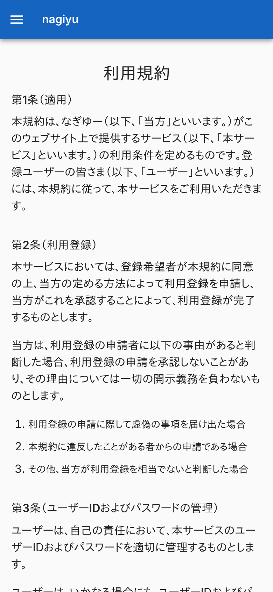
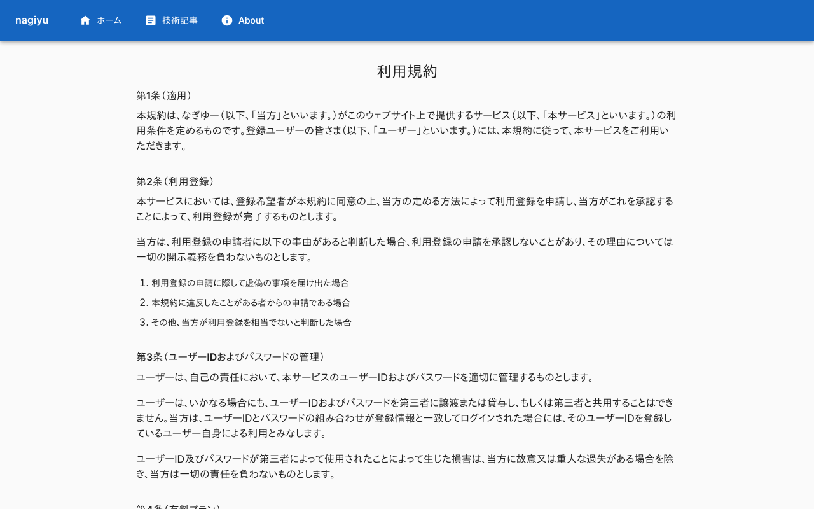
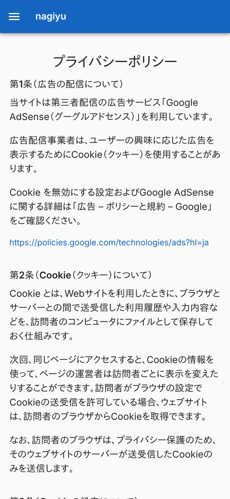
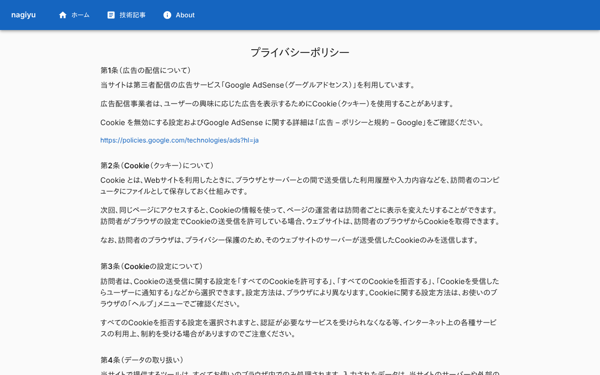

# 利用規約・プライバシーポリシー画面

利用規約 (`/terms`) とプライバシーポリシー (`/privacy`) の 2 画面。どちらも、見出しと条文を並べるだけの同じ作りなので、1 枚にまとめる。ログインは要らない。ヘッダー・フッターは[ホーム画面](./home.md)の「全画面で共通の部分」と同じ。

## 入口

- `/terms` と `/privacy`
- フッターの「利用規約」「プライバシーポリシー」から来る。ヘッダーのナビゲーションにはない
- `/privacy` は、[About 画面](./about.md)の「プライバシーとセキュリティ」からも来る

## 表示するもの

| 画面 | 見出し | 条文 |
|---|---|---|
| `/terms` | 利用規約 | `@nagiyu/ui` の `termSections` |
| `/privacy` | プライバシーポリシー | `@nagiyu/ui` の `privacyPolicySections` |

- 条文は `@nagiyu/ui` が持つデータで、Portal は持たない。ほかのサービスも同じデータを使う。文面を変えるときは `@nagiyu/ui` を変える
- 条は「第 N 条 (題名)」の見出しと、その下の段落・番号付きの項目・リンクで並ぶ。条番号は並び順から振る。段落の中の改行はそのまま改行として出る
- リンクは別タブで開く
- ページのタイトルは、それぞれ「利用規約 - nagiyu」「プライバシーポリシー - nagiyu」。canonical は `https://nagiyu.com/terms`、`https://nagiyu.com/privacy`

## 操作

- 操作はない。条文を読むだけで、API は呼ばない

## 画面の見た目

条文の文面そのものは、カードに写さない。見出しと条の並びが分かる、各ページの先頭を載せる。

### 利用規約

| スマホ | PC |
|---|---|
|  |  |

### プライバシーポリシー

| スマホ | PC |
|---|---|
|  |  |

## つながり

```mermaid
flowchart TD
    F[フッター] --> T[利用規約]
    F --> P[プライバシーポリシー]
    A[About 画面] --> P
    U[(@nagiyu/ui の条文データ)] --> T
    U --> P
```
