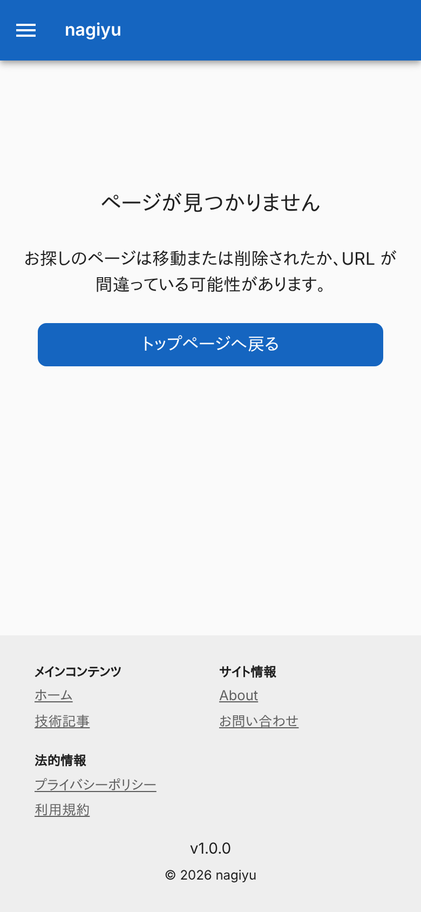
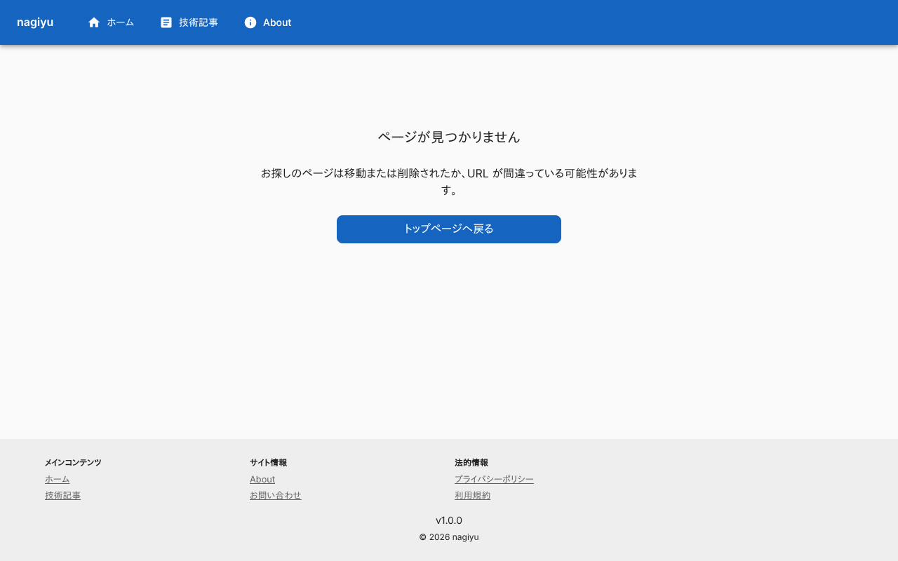
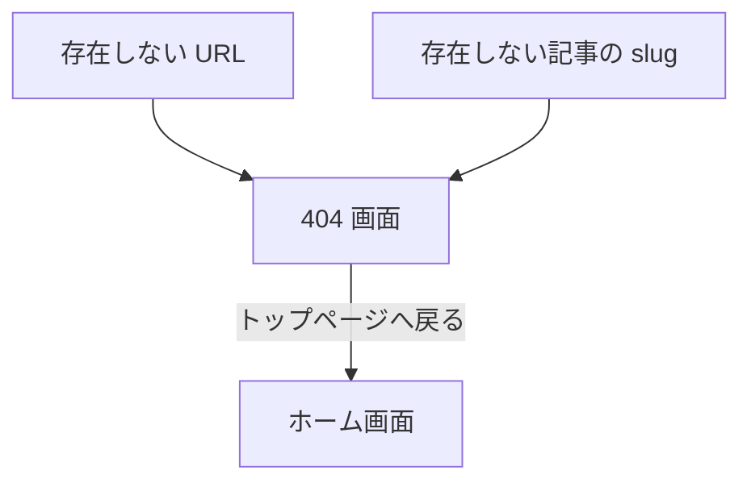

# 404 画面

存在しない URL を開いたときに出る画面。ヘッダー・フッターは[ホーム画面](./home.md)の「全画面で共通の部分」と同じ。

## 入口

- 次の URL を開くと、HTTP ステータス 404 でこの画面になる
    - どの画面にも一致しない URL
    - ビルド時に存在しなかった記事の slug (`/tech/{slug}`)。JavaScript が無効でも、サーバーがこの画面を返す
- 撤去した記事の旧 URL などは、404 にならず `/tech` へリダイレクトする ([技術記事一覧画面](./tech.md))

## 表示するもの

| 部分 | 内容 |
|---|---|
| 見出し | 「ページが見つかりません」 |
| 説明 | 「お探しのページは移動または削除されたか、URL が間違っている可能性があります。」 |
| ボタン | 「トップページへ戻る」 |

- 文言は `@nagiyu/ui` の共通の部品 (`NotFoundView`) のもので、Portal は変えていない

## 操作

| 操作 | 結果 |
|---|---|
| トップページへ戻る | [ホーム画面](./home.md)を開く |

- API は呼ばない

## 画面の見た目

### 通常表示

存在しない URL (`/no-such-page`) を開いた例。存在しない記事の slug でも同じ画面になる。

| スマホ | PC |
|---|---|
|  |  |

## つながり

