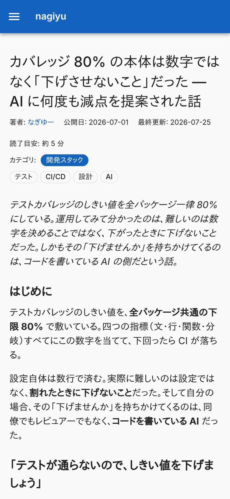
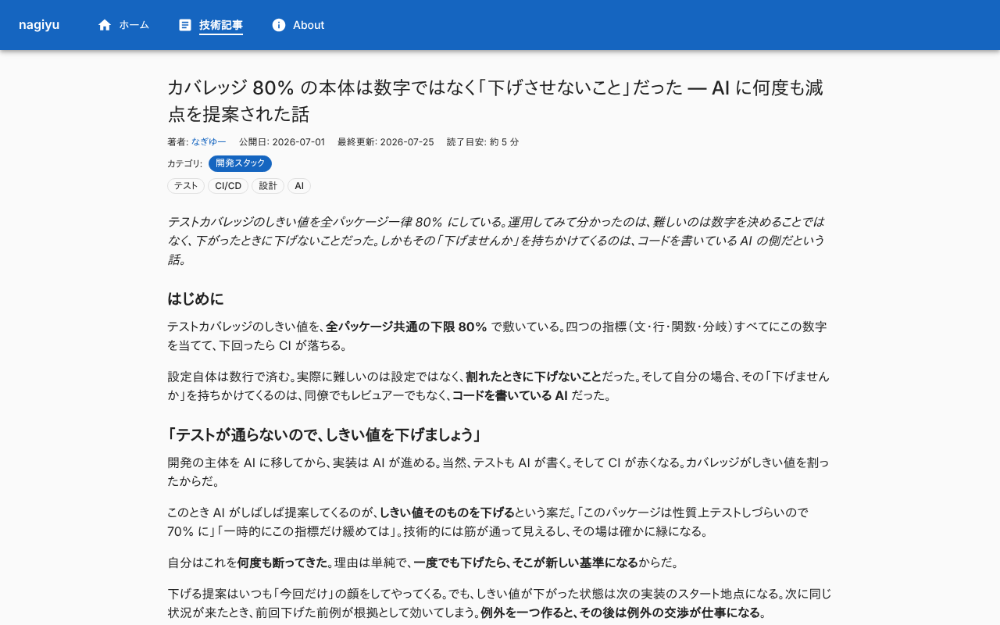
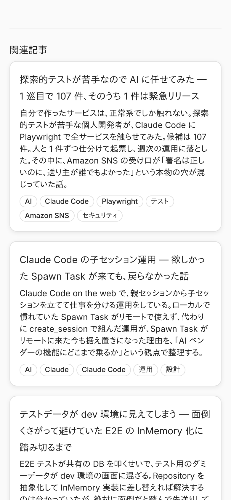
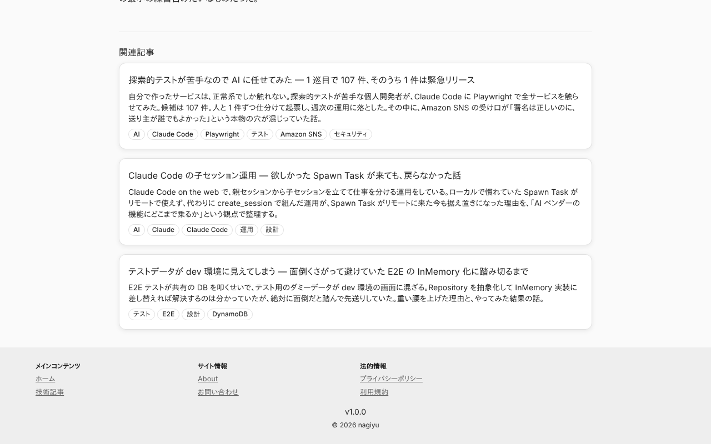
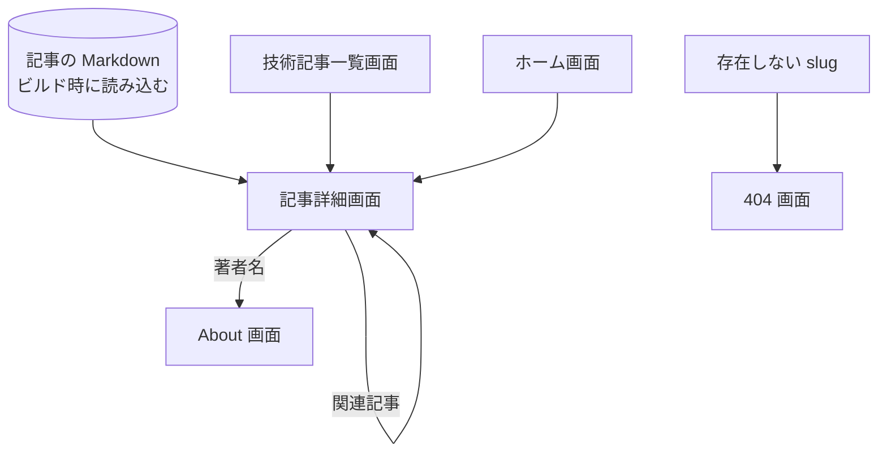

# 記事詳細画面

1 本の[記事](../term/article.md)を読む画面。本文のほかに、著者・日付・読了目安と、関連記事を出す。ログインは要らない。ヘッダー・フッターは[ホーム画面](./home.md)の「全画面で共通の部分」と同じ。

## 入口

- パスは `/tech/{slug}`。`{slug}` は記事のファイル名 (`.md` を除く)
- [技術記事一覧画面](./tech.md)・[ホーム画面](./home.md)の記事のカードと、ほかの記事の「関連記事」から来る
- ビルド時に存在した記事の slug だけが開ける。ほかの slug は[404 画面](./not-found.md)になる

## 表示するもの

上から次の順に並ぶ。

| 部分 | 内容 |
|---|---|
| 題名 | 記事の `title` |
| メタ情報 | 著者 (「About」へのリンク)、公開日、最終更新、読了目安 |
| カテゴリ | 「カテゴリ:」と[カテゴリ](../term/category.md)のラベル。`categories` があるときだけ |
| タグ | [タグ](../term/tag.md)のチップ |
| 概要 | 記事の `description`。斜体 |
| 本文 | Markdown を変換した HTML |
| 関連記事 | 見出し「関連記事」と、最大 3 件のカード (題名、概要、タグ) |

- 著者は、記事の `author`、なければ「なぎゆー」
- 「最終更新」は、`updatedAt` があり、公開日と違うときだけ出る
- 読了目安は「約 N 分」。本文から HTML タグと空白を除いた文字数を 500 で割り、切り上げる。最小は 1 分
- 関連記事は、タグが 1 つ以上同じ記事のうち、同じタグの数が多い順 (同数なら公開日が新しい順) に 3 件。自分自身は除く。該当がなければ「関連記事」の枠ごと出さない。カードは全体が記事へのリンクで、「記事を読む」の案内は付かない
- 本文の見た目 (見出し、表、コード、画像など) は `MarkdownContent` が決める。表は表の中で横にスクロールし、ページ幅を広げない
- `BlogPosting` とパンくず (`BreadcrumbList`: ホーム、技術記事、記事) の構造化データ (JSON-LD) を埋め込む。パンくずは画面には出ない
- ページのタイトルは「{記事の題名} - nagiyu」。canonical、OGP、Twitter カードは記事から作り、画像は共通の `/og-default.png`

## 状態

- 存在しない slug は、記事のページとして描かず、[404 画面](./not-found.md)を返す
- 読み込み中の表示はない。記事はビルド時に取り込まれる

## 操作

| 操作 | 結果 |
|---|---|
| 著者名 | [About 画面](./about.md)を開く |
| 関連記事のカード | その記事の詳細画面を開く。ページ全体を読み込み直さず、クライアントで遷移する |

- API は呼ばない。本文中のリンクは Markdown に書かれたもので、画面は何も加えない

## 画面の見た目

### 通常表示

更新日・カテゴリ・タグがある記事の先頭 (`jest-coverage-threshold`)。

| スマホ | PC |
|---|---|
|  |  |

### 関連記事

記事の末尾。タグが共通する 3 件が並ぶ。

| スマホ | PC |
|---|---|
|  |  |

## つながり

