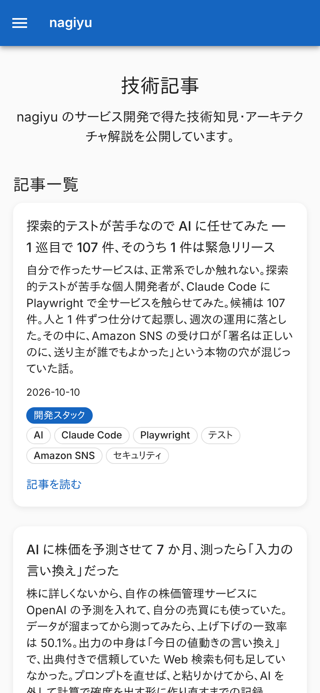
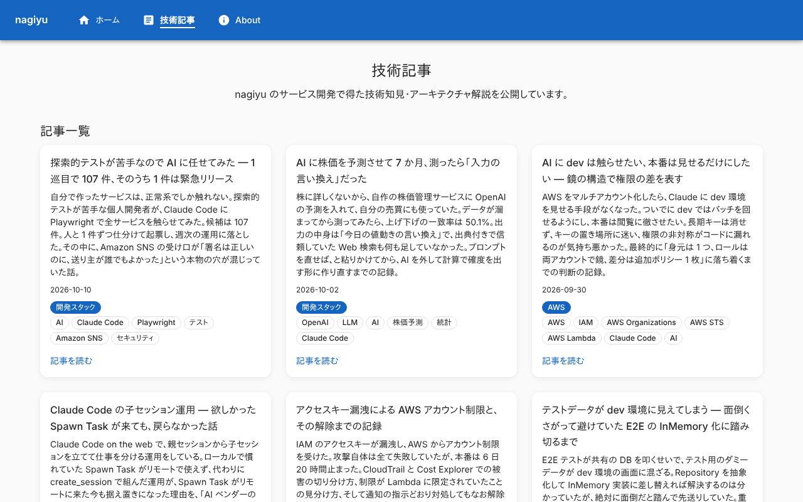
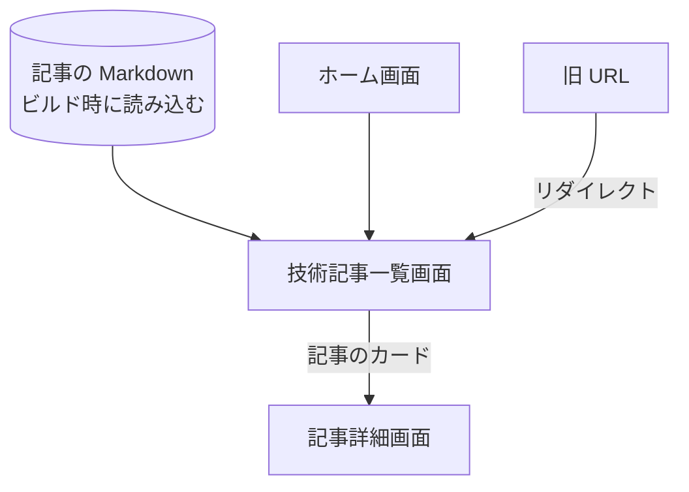

# 技術記事一覧画面

公開している[記事](../term/article.md)をすべて、新しい順に並べる画面。ログインは要らない。ヘッダー・フッターは[ホーム画面](./home.md)の「全画面で共通の部分」と同じ。

## 入口

- パスは `/tech`
- ヘッダーとフッターの「技術記事」、[ホーム画面](./home.md)の「技術記事を読む」「すべての技術記事を見る」から来る
- 次の URL は、ここへリダイレクトする (恒久リダイレクト)
    - 撤去した記事の旧 URL
    - `/services` と配下
    - `/tech/tags/...` と `/tech/category/...`

## 表示するもの

| 部分 | 内容 |
|---|---|
| 見出し | 「技術記事」と、サイトの説明の 1 文 |
| 記事一覧 | 見出し「記事一覧」の下に、記事のカードを公開日の新しい順に並べる |

- カードは、題名、概要 (切らない)、公開日、[カテゴリ](../term/category.md)のラベル (あれば)、[タグ](../term/tag.md)(全部) の順。全体が `/tech/{slug}` へのリンクで、下に「記事を読む」の案内が付く
- カードのグリッドは、スマホ幅で 1 列、広がると 2 列、さらに広がると 3 列
- 絞り込み、検索、ページ分けはない。記事は全件を 1 ページに出す
- ページのタイトルは「技術記事 - nagiyu」。canonical は `https://nagiyu.com/tech`

## 状態

- 記事が 0 件のときは、「記事一覧」の下に「記事はまだありません。」を出す
- 読み込み中の表示はない。記事はビルド時に取り込まれる

## 操作

| 操作 | 結果 |
|---|---|
| 記事のカード | [記事詳細画面](./tech-article.md)を開く |

- API は呼ばない。チップ (カテゴリ・タグ) は押せない

## 画面の見た目

### 通常表示

一覧の先頭。1 枚のカードに、題名、概要、公開日、カテゴリ (塗りつぶし)、タグ (枠線) が並ぶ。

| スマホ | PC |
|---|---|
|  |  |

## つながり

