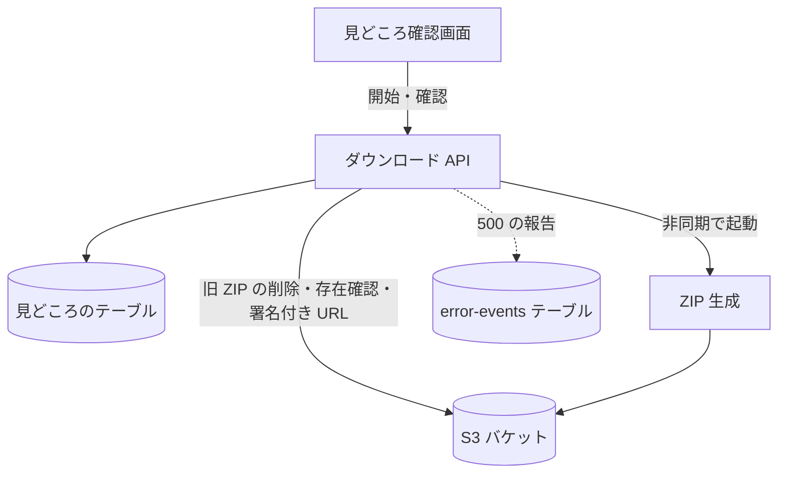

# ダウンロード API

採用した[見どころ](../term/highlight.md)のクリップを ZIP にまとめる処理を始め、できた ZIP の取得先を返す。認証は要らない。

## エンドポイント

| メソッド | パス | 権限 | 役割 |
|---|---|---|---|
| POST | `/api/jobs/{jobId}/download` | なし | ZIP の生成を始める |
| GET | `/api/jobs/{jobId}/download` | なし | ZIP ができていれば、取得先を返す |

## 入力と出力

どちらも本文はない。ZIP の S3 キーは `outputs/{jobId}/clips.zip`。

開始 (`POST`)。

- 出力は 202 で `{ status: 'PROCESSING' }`
- 受け付ける条件は、ジョブに見どころがあり、採用 (`accepted`) したものが 1 件以上あり、採用したものがすべて `GENERATED` であること
- 受け付けると、先にあった ZIP を消し (なければ何もしない)、[ZIP 生成](../batch/zip-generate.md)の Lambda を非同期で起動する。渡すのは `jobId` と、採用した見どころごとの `highlightId`、`order`、`startSec`、`endSec`
- 古い ZIP を消すのに、「ない」以外の理由で失敗したときは、警告のログと、Admin への報告 (warning、題名は「Web API: 旧 ZIP 削除エラー」) を残して、生成は続ける

取得 (`GET`)。

- ZIP が S3 にあるかを調べる。ないときは 202 で `{ status: 'PROCESSING' }`
- あるときは 200 で `{ jobId, fileName, downloadUrl }`。`fileName` は `{jobId}-clips.zip`、`downloadUrl` は ZIP への署名付き URL で、有効 300 秒
- どの ZIP かは区別しない。開始のときに古い ZIP を消すので、開始のあとに見つかる ZIP は、今回のものになる

## エラー

本文は `{ error, message }` ([API のエラー応答](../term/api-error.md))。

| 条件 | 状態 | `error` | `message` |
|---|---|---|---|
| 開始: ジョブに見どころが 1 件もない (ジョブがないときを含む) | 404 | `JOB_NOT_FOUND` | 指定されたジョブが見つかりません |
| 開始: 採用した見どころがない | 400 | `DOWNLOAD_NOT_AVAILABLE` | 採用された見どころがありません |
| 開始: 採用した見どころに `FAILED` がある | 409 | `CLIP_GENERATION_FAILED` | 採用された見どころに生成に失敗したクリップがあります。リトライするか、採用を外してください |
| 開始: 採用した見どころに `PENDING` か `GENERATING` がある | 409 | `CLIP_GENERATION_INCOMPLETE` | 採用された見どころのクリップ生成が完了していません |
| 開始: 想定外の例外 | 500 | `INTERNAL_SERVER_ERROR` | ダウンロードの準備に失敗しました |
| 取得: 想定外の例外 (S3 の確認の失敗で「ない」以外のもの) | 500 | `INTERNAL_SERVER_ERROR` | ダウンロードの準備に失敗しました |

- 失敗したクリップと生成待ちのクリップが両方あるときは、`FAILED` の 409 を返す
- ZIP の生成が失敗しても、この API に伝わる仕組みはない。取得は `PROCESSING` を返し続ける。画面は 300 秒で待つのをやめる ([見どころ確認画面](../screen/highlights.md))

## つながり

