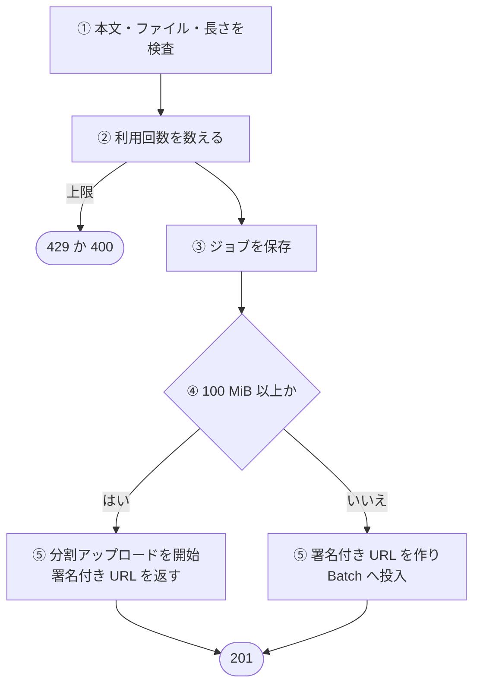
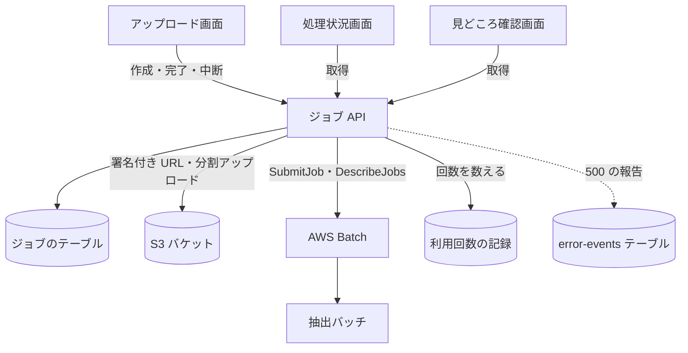

# ジョブ API

[ジョブ](../term/job.md)を作って動画をアップロードする URL を返し、分割アップロードを完了か中断し、ジョブの状態を読む。認証は要らず、ログインしていれば利用の[段](../term/usage-tier.md)が上がる。

## エンドポイント

| メソッド | パス | 権限 | 役割 |
|---|---|---|---|
| POST | `/api/jobs` | なし | 利用回数を数え、ジョブを作り、アップロードの署名付き URL を返す |
| GET | `/api/jobs/{jobId}` | なし | ジョブの状態を返す |
| POST | `/api/jobs/{jobId}/complete-upload` | なし | 分割アップロードを完了し、Batch へ投入する |
| POST | `/api/jobs/{jobId}/abort-upload` | なし | 分割アップロードを中断する |

## 入力と出力

作成 (`POST /api/jobs`)。本文は JSON オブジェクト。

| 項目 | 条件 |
|---|---|
| `fileName` | 必須。文字列。前後の空白を除いて、`.mp4` で終わる (大文字小文字は区別しない) |
| `fileSize` | 必須。数値。1 バイト以上、21,474,836,480 バイト (20 GiB) 以下 |
| `contentType` | 任意。文字列。あれば `video/mp4` |
| `durationSec` | 任意。数値。0 より大きく 86,400 (24 時間) 以下 |
| `aiAnalysis` | 任意。真偽値。[AI 解析](../term/ai-analysis.md)の希望。なければ、あり、残りがなければなし |
| `emotionFilter` | 任意。`any`、`laugh`、`excite`、`touch`、`tension`。なければ `any`。画面は送らない |

- 出力は 201。動画の大きさで形が変わる。入力の S3 キーは `uploads/{jobId}/input.mp4`、`Content-Type` は `video/mp4`

| 大きさ | 出力 | Batch の投入 |
|---|---|---|
| 104,857,600 バイト (100 MiB) 未満 | `{ jobId, uploadUrl, expiresIn: 3600 }`。1 本の `PUT` 用の署名付き URL | 作成と同時に投入する。アップロードの完了は待たない |
| 100 MiB 以上 | `{ jobId, multipart: { uploadId, uploadUrls, chunkSize }, expiresIn: 86400 }`。`chunkSize` は 52,428,800 (50 MiB)。`uploadUrls` は、大きさを `chunkSize` で割って切り上げた数 | しない。完了 (`complete-upload`) のときに投入する |

- 投入するジョブ定義は、ファイルサイズと `durationSec` から選ぶ ([ジョブ定義のサイズ](../term/job-definition-size.md))。ジョブ名は `quick-clip-extract-{jobId}`。起動ごとに渡す環境変数は `BATCH_COMMAND` (`extract`)、`JOB_ID`、`EMOTION_FILTER`、`AI_ANALYSIS`
- ジョブには、数えた利用回数の記録、`aiAnalysis`、段の長さの上限 (`maxDurationSec`) を保存する。有効期限は作成の 24 時間後

完了 (`POST /api/jobs/{jobId}/complete-upload`)。

- 本文は `{ uploadId, parts, emotionFilter? }`。`uploadId` は空でない文字列、`parts` は空でない配列で、各要素が `{ PartNumber, ETag }` (`PartNumber` は 1 以上の整数、`ETag` は空でない文字列)
- S3 の分割アップロードを完了し、ジョブに保存した大きさ、長さ、`aiAnalysis` で Batch に投入する。出力は 200 で `{}`。`emotionFilter` は、ジョブには保存せず、この呼び出しで受けたものを使う

中断 (`POST /api/jobs/{jobId}/abort-upload`)。

- 本文は `{ uploadId }` (空でない文字列)。S3 の分割アップロードを中断する。ジョブがあり、まだ Batch へ投入していなければ、数えた利用回数を戻す。出力は 200 で `{}`。`uploadId` がそのジョブのものかは確かめない

取得 (`GET /api/jobs/{jobId}`)。

- 出力は 200 で `{ jobId, status, originalFileName, fileSize, createdAt, expiresAt }` に、条件つきで `batchStage`、`analysisProgress`、`errorMessage` を足したもの。`status` の求め方と、足す条件は[ジョブとステータス](../term/job.md)にある
- 呼ぶたびに、Batch の `DescribeJobs` で状態を取る。書き込みはしない

## 処理

作成の流れ。

| 手順 | 内容 |
|---|---|
| ① 検査 | 本文の形と型、ファイルの種類、ファイルの大きさ、動画の長さの順に見て、最初に外れたものを返す |
| ② 利用回数 | 回数と長さの上限を見て、回数を 1 つ数える。上限なしの段は数えない。数える記録先が使えないときは、数えずに通す。このとき AI 解析はなしにする ([利用回数の流れ](../flow/usage-metering.md)) |
| ③④⑤ ジョブ以降 | ジョブを作るのに失敗したら、数えた回数を戻す。ジョブができたあとに、例外か、500 以上の応答になったときも戻す |

## エラー

本文は `{ error, message }` ([API のエラー応答](../term/api-error.md))。

| 条件 | 状態 | `error` | `message` |
|---|---|---|---|
| 作成: 本文が JSON のオブジェクトでない、または項目の型が違う (`emotionFilter` が許可外を含む) | 400 | `INVALID_REQUEST` | リクエストが不正です |
| 作成: 拡張子か `contentType` が MP4 でない | 400 | `INVALID_FILE_TYPE` | MP4 形式の動画ファイルのみアップロードできます |
| 作成: `fileSize` が 0 以下か 20 GiB を超える | 400 | `INVALID_FILE_SIZE` | ファイルサイズが不正です |
| 作成: `durationSec` が範囲外 | 400 | `INVALID_DURATION` | 動画の再生時間が不正です |
| 作成: 動画の長さが段の上限を超える | 400 | `DURATION_LIMIT_EXCEEDED` | 動画の長さがご利用の上限を超えています |
| 作成: AI 解析ありの月の回数がない (`aiAnalysis` が `true`) | 429 | `AI_LIMIT_EXCEEDED` | 今月の AI 解析ありの利用回数の上限に達しました |
| 作成: AI 解析なしの月の回数がない (`aiAnalysis` が `false`、または省略して両方ない) | 429 | `NO_AI_LIMIT_EXCEEDED` | 今月の AI 解析なしの利用回数の上限に達しました |
| 作成: 同じ接続元からの 1 日の上限 (未ログインだけ) | 429 | `IP_LIMIT_EXCEEDED` | お使いの接続元からの本日の利用が多すぎるため、時間をおいてお試しください |
| 作成: 分割アップロードの ID が取れない | 500 | `MULTIPART_UPLOAD_ID_NOT_FOUND` | マルチパートアップロード ID の取得に失敗しました |
| 作成: 想定外の例外 | 500 | `INTERNAL_SERVER_ERROR` | ジョブの作成に失敗しました |
| 完了、中断: 本文が不正 (`uploadId` が空、`parts` が空や要素の形が違うなど) | 400 | `INVALID_REQUEST` | リクエストが不正です |
| 完了: ジョブがない | 404 | `JOB_NOT_FOUND` | 指定されたジョブが見つかりません |
| 完了: すでに Batch へ投入している | 409 | `JOB_NOT_PENDING` | ジョブがアップロード完了可能な状態ではありません |
| 完了: 想定外の例外 | 500 | `INTERNAL_SERVER_ERROR` | アップロード完了処理に失敗しました |
| 中断: 想定外の例外 | 500 | `INTERNAL_SERVER_ERROR` | アップロード中断処理に失敗しました |
| 取得: ジョブがない、または**どんな例外でも** | 404 | `JOB_NOT_FOUND` | 指定されたジョブが見つかりません |

- 長さの上限と回数の上限の検査は、ジョブを作る前なので、断られたジョブは残らない
- 「完了」の想定外の例外は、数えた利用回数を戻したうえで 500 にする
- 取得は、Batch への問い合わせの失敗や保存データの異常でも 404 を返し、Admin へ報告しない。ほかの 3 つは、想定外の例外を報告する

## つながり

