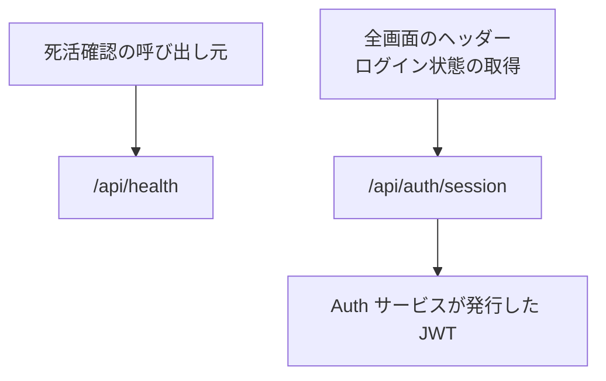

# システム系の API

業務の機能ではない 2 つの API。死活確認と、画面のヘッダーが使う認証セッション。

## エンドポイント

| メソッド | パス | 権限 |
|---|---|---|
| GET | `/api/health` | なし |
| GET | `/api/auth/*` (画面が使うのは `/api/auth/session`) | なし (ログインの状態を返す) |

## 入力と出力

- 死活確認は `{ status: 'ok', service: 'quick-clip', version, timestamp }` を返す。`version` は環境変数 `APP_VERSION`、なければ `1.0.0`。`timestamp` は ISO 8601。DynamoDB、S3、Batch への接続は確かめない
- 認証は next-auth の GET だけを公開する。POST は公開しない (サインアウトは Auth サービスの URL へ遷移する)。Quick Clip には認証の提供元 (プロバイダー) がなく、Auth サービスが発行した JWT を検証するだけ
- ログインしていなくても、すべての画面と API を使える。ログインの有無で変わるのは、利用の[段](../term/usage-tier.md)だけ
- サーバー側の処理がセッションを読むとき、`AUTH_SECRET` が未設定や、壊れた Cookie でセッションの検証が例外になっても、未ログインとして扱い、落とさない
- 環境変数 `SKIP_AUTH_CHECK` が `true` のテスト用の設定では、`/api/auth/session` が認証せずにテスト用のセッションを返す。ロールは、リクエストヘッダ `x-test-user-roles`、環境変数 `TEST_USER_ROLES`、既定の空の順で決まる

## エラー

- どちらも、ここで返すエラーを決めていない
- ログインを要求する画面や API はない。ミドルウェアによるリダイレクトもない

## つながり

