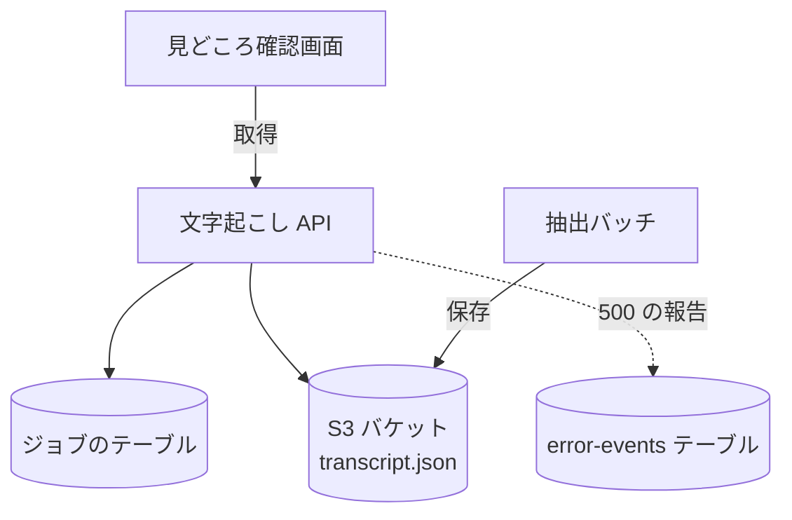

# 文字起こし API

ジョブの[文字起こし](../term/transcript.md)の行を返す。認証は要らない。

## エンドポイント

| メソッド | パス | 権限 |
|---|---|---|
| GET | `/api/jobs/{jobId}/transcript` | なし |

## 入力と出力

- 出力は 200 で `{ segments }`。`segments` は `{ start, end, text }` の配列
- 文字起こしがないときは `{ segments: [] }`。ファイル (`outputs/{jobId}/transcript.json`) がない、本文が空、のときである。AI 解析をしなかったジョブ、文字起こしが 0 行だったジョブがこれにあたる
- ファイルの中身は JSON として読み、並びも内容も検査せずにそのまま返す
- ジョブが処理中でも、ジョブがあればファイルを探す

## エラー

本文は `{ error, message }` ([API のエラー応答](../term/api-error.md))。

| 条件 | 状態 | `error` | `message` |
|---|---|---|---|
| ジョブがない | 404 | `JOB_NOT_FOUND` | 指定されたジョブが見つかりません |
| 想定外の例外 (S3 の失敗で「ない」以外のもの、JSON として読めないなど) | 500 | `INTERNAL_SERVER_ERROR` | 文字起こし情報の取得に失敗しました |

## つながり

