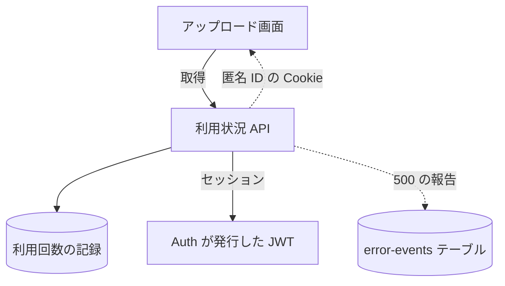

# 利用状況 API

呼んだ利用者の、段と今月の残り回数を返す。ログインしていなくても呼べる。

## エンドポイント

| メソッド | パス | 権限 |
|---|---|---|
| GET | `/api/usage` | なし |

## 入力と出力

- 出力は 200 で、次の形
    - `month`: 日本時間の暦月 (例: `202611`)
    - `tier`: 利用の[段](../term/usage-tier.md)
    - `limits`: `aiPerMonth`、`noAiPerMonth`、`maxDurationSec`。回数の上限なしは `null`
    - `used`: 今月に数えた `ai` と `noAi`
    - `remaining`: 残りの `ai` と `noAi`。上限なしは `null`。上限を超えた分は 0 で止める
- 上限なしの段 (使い放題) は、記録を読まず、`used` を 0 とし、`remaining` を両方 `null` にする
- 数える主体は、ログイン中はユーザー、未ログインは Cookie の匿名 ID。Cookie がない (または UUID の形でない) 未ログインの呼び出しでは、ここで匿名 ID を発行し、`Set-Cookie` で渡す ([利用回数の流れ](../flow/usage-metering.md))
    - Cookie の名前は `qc_anon_id`。有効期間は 365 日で、`Path=/`、`HttpOnly`、`SameSite=Lax`。`NODE_ENV` が `production` のときは `Secure` を付ける。ドメインは指定しない
    - 発行した匿名 ID は、500 を返すときにも Cookie で渡す

## エラー

本文は `{ error, message }` ([API のエラー応答](../term/api-error.md))。

| 条件 | 状態 | `error` | `message` |
|---|---|---|---|
| 想定外の例外 (記録の読み取りの失敗など) | 500 | `INTERNAL_SERVER_ERROR` | 利用状況の取得に失敗しました |

- 画面は、500 や形の違う応答を受けると、残りの表示と AI 解析のスイッチを出さずに続ける ([アップロード画面](../screen/upload.md))

## つながり

