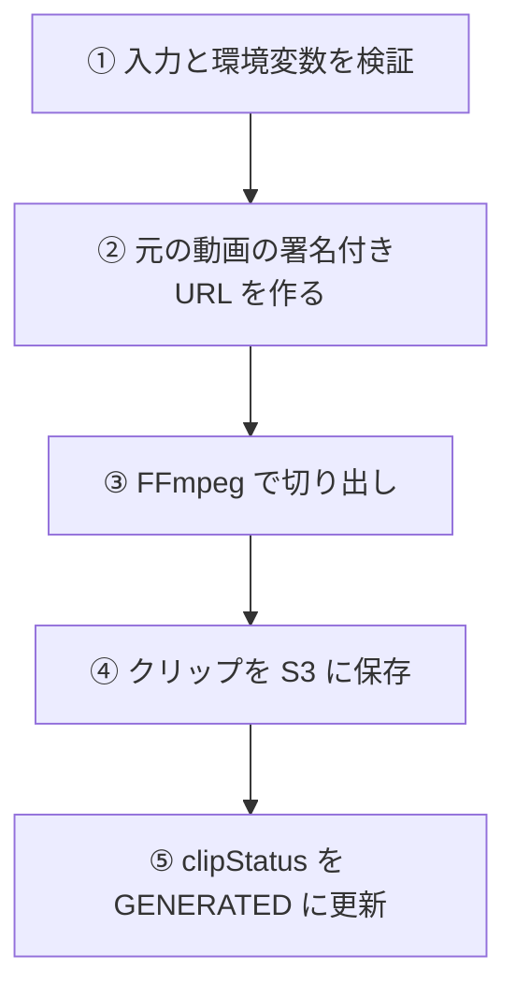
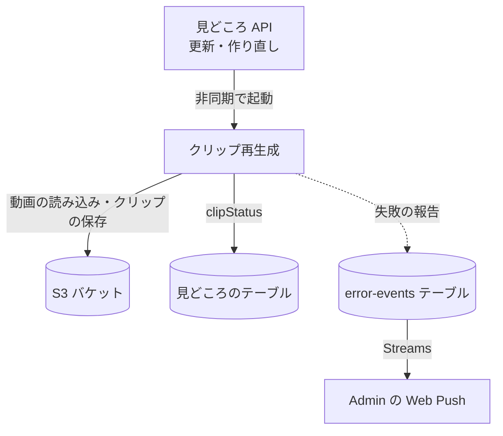

# クリップ再生成 (clip-regenerate)

利用者が見どころの開始・終了を変えたとき、またはリトライしたときに、元の動画から[クリップ](../term/highlight.md)を切り出し直す Lambda。1 回の起動で 1 つの見どころを処理する。

## 起点

- スケジュールはない。[見どころ API](../api/highlights.md) が、見どころの更新 (開始か終了を含むもの) と、作り直し (`regenerate`) のときに、結果を待たずに (非同期で) 起動する
- 入力は `{ jobId, highlightId, startSec, endSec }`。`jobId` と `highlightId` が空、`startSec` と `endSec` が数値でない、`startSec` が負、`endSec` が `startSec` 以下、のどれかなら例外 (入力値が不正です)
- 環境変数 `DYNAMODB_TABLE_NAME`、`S3_BUCKET`、`AWS_REGION` が必須。なければ例外
- 関数の設定は、メモリ 2,048 MB、一時ストレージ 10,240 MiB、タイムアウト 300 秒。非同期起動の再試行は 0 回

## 処理

| 手順 | 内容 |
|---|---|
| ② 元の動画 | `uploads/{jobId}/input.mp4` への、有効 3,600 秒の署名付き URL。動画はダウンロードせず、FFmpeg が URL から読む |
| ③ 切り出し | `ffmpeg -ss {startSec} -t {endSec - startSec} -i {URL} -c copy` (再エンコードなし)。出力は `/tmp/quick-clip/clip/{リクエストごとの UUID}/{jobId}/{highlightId}.mp4` |
| ④ 保存 | `outputs/{jobId}/clips/{highlightId}.mp4` に上書きする |
| ⑤ 更新 | 見どころの `clipStatus` を `GENERATED` にする。ほかの項目は変えない |

- 終わると、作業用のディレクトリを消す。成功でも失敗でも消す
- 入力の動画が 24 時間で消えていると、③ の読み込みが失敗して `FAILED` になる

## 失敗したとき

- ② 〜 ⑤ のどこかで例外になると、次を行う。入力や環境変数の検証の失敗は、これに入らない (`clipStatus` は変わらず、報告もしない)

| 順 | 内容 | 報告 |
|---|---|---|
| 1 | Admin へ報告する | error。題名は「QuickClip クリップ再生成に失敗しました」。`jobId`、`highlightId`、クリップの S3 キーつき |
| 2 | 見どころの `clipStatus` を `FAILED` にする | なし |
| 3 | 例外を投げ直す | なし |

- 再試行しないので、失敗した見どころは `FAILED` のまま残る。利用者が画面のリトライを押すまで、変わらない ([見どころ API](../api/highlights.md))
- Lambda が強制終了されるとこの処理は走らず、`GENERATING` のまま残る。API が 360 秒を過ぎたものを `FAILED` にする ([見どころとクリップの状態](../term/highlight.md))
- Lambda の失敗を拾う CloudWatch Alarm や EventBridge のルールは、quick-clip のインフラには定義されていない。報告できるのは、アプリが例外を受けられたときだけ
- 報告の書き込みに失敗しても、例外は伝えない。ログだけを残す

## つながり

