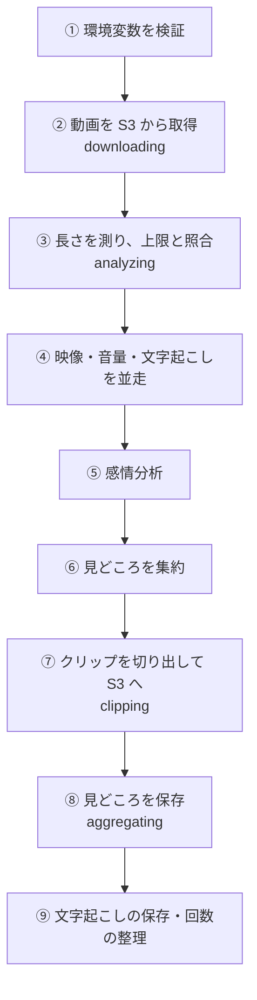
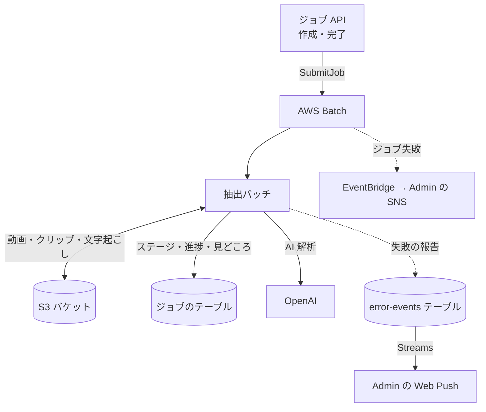

# 抽出バッチ (extract)

S3 に置かれた動画を分析して[見どころ](../term/highlight.md)を決め、クリップを切り出して S3 に書き、見どころを保存するコンテナ。1 回の起動で 1 [ジョブ](../term/job.md)を処理する。

## 起点

- スケジュールはない。[ジョブ API](../api/jobs.md) が、AWS Batch にジョブを 1 件投入して起動する。100 MiB 未満の動画は作成のときに、それ以上は分割アップロードの完了のときに投入する
- 起動ごとに渡す値は、環境変数の 4 つ。ほかは[ジョブ定義](../term/job-definition-size.md)が持つ

| 環境変数 | 出どころ | 内容 |
|---|---|---|
| `BATCH_COMMAND`、`JOB_ID` | 投入時の指定 | 前後の空白を除いて読む。`BATCH_COMMAND` は `extract` だけ。`JOB_ID` は英数字、`_`、`-` だけ。外れると起動時に例外 |
| `EMOTION_FILTER` | 投入時の指定 | `any`、`laugh`、`excite`、`touch`、`tension`。未設定か空白なら `any`。許可外なら例外 |
| `AI_ANALYSIS` | 投入時の指定 | `true` か `false`。未設定か空白なら `true`。ほかの値は例外 |
| `DYNAMODB_TABLE_NAME`、`S3_BUCKET`、`AWS_REGION` | ジョブ定義 | 必須。なければ、足りない名前をまとめて起動時に例外 |
| `OPENAI_API_KEY` | ジョブ定義 | 空なら、[AI 解析](../term/ai-analysis.md)をしない |
| `ERROR_EVENTS_TABLE_NAME` | ジョブ定義 | エラー履歴の報告先。なければ報告だけができない |

- 実行基盤は Fargate の Batch。ジョブ定義は 3 サイズで、試行は 1 回 (再試行しない)

## 処理

ステージ (`downloading`、`analyzing`、`clipping`、`aggregating`) は、②、③、⑦、⑧ の開始でジョブに書く。画面はこれを段階の名前として出す。

| 手順 | 内容 |
|---|---|
| ② 取得 | `uploads/{JOB_ID}/input.mp4` を `/tmp/quick-clip/{JOB_ID}/input.mp4` に保存する。S3 に見つからなければ、3 秒おきにやり直す。ほかの失敗は「動画ファイルのダウンロードに失敗しました」の前置きで例外 |
| ③ 長さ | ジョブを読む (なければ例外)。FFmpeg の出力から動画の長さを読む。読めなければ 10 秒とする。ジョブに `maxDurationSec` があり、長さがそれを超えていれば、文字起こしの前に止める (下の「失敗したとき」)。続ける場合は、解析の内訳 (`analysisProgress`) の初期値を書く |
| ④ 映像 | 10 分ごとのチャンクに分け、4 並列で FFmpeg の場面転換 (`scene` が 0.2 を超えるフレーム) を取る。1 点が (秒、場面転換の強さ)。暗転と白転 (`blackdetect`、画素のしきい値 0.10、継続時間の下限なし) の区間にある点は捨てる |
| ④ 音量 | 10 分ごとのチャンクに分け、4 並列で FFmpeg の `astats` から、フレームごとの RMS を取る。振幅 (`10^(RMS/20)`) を強さとする。秒が取れないものは捨てる |
| ④ 文字起こし | [AI 解析](../term/ai-analysis.md)のときだけ。音声を 16 kHz の mono、32 kbps の MP3 にして `whisper-1` (日本語) で行にする ([文字起こし](../term/transcript.md))。24 MiB を超えるときは、2,621 秒ごとに分けて並列で送り、行の時刻に区切りの位置を足す。1 回の呼び出しは、タイムアウト 600 秒、再試行 3 回 (間隔は 1 秒から倍ずつ) |
| ⑤ 感情分析 | 文字起こしが 1 行以上あるときだけ。50 行ごとに分け、3 並列で `gpt-5.6-luna` に渡す。1 回の呼び出しは、タイムアウト 600 秒、再試行 3 回 (タイムアウトは再試行しない)。感情フィルターが `any` なら 4 つの感情の最大値、それ以外はその感情の値を強さとし、一番高い感情を `dominantEmotion` にする |
| ⑥ 集約 | 次の手順で見どころを決める。`order` は開始時刻の昇順で 1 から振る |
| ⑦ 切り出し | 見どころをすべて並列で、`ffmpeg -ss {開始} -t {長さ} -i {入力} -c copy` (再エンコードなし) で切り出し、`outputs/{JOB_ID}/clips/{highlightId}.mp4` に保存する。1 件でも失敗すれば例外 |
| ⑧ 保存 | 見どころを、採否 `unconfirmed`、クリップの状態 `GENERATED`、期限はジョブと同じで保存する。すでにあれば上書きする |
| ⑨ 後始末 | 文字起こしが 1 行以上あれば、`outputs/{JOB_ID}/transcript.json` に保存する。AI 解析ありで数えたのに、AI 解析をしなかったか途中で飛ばしたジョブは、利用回数を AI 解析なしの 1 回に付け替える ([利用回数の流れ](../flow/usage-metering.md)) |

⑥ 集約の手順。

1. 映像、音量、(あれば) 感情の候補を、それぞれ強さの降順に並べる
2. 映像、音量、感情の順に、1 件ずつ取る。感情の候補がないときは、映像と音量を交互に取る。候補が尽きた根拠は飛ばす
3. 取った点の前後 10 秒 (動画の範囲内) を区間にする。すでに採った区間と少しでも重なれば、1 つにまとめる。まとめた区間は、範囲を広げ、強さは大きいほうを採り、根拠は別なら `both`、`dominantEmotion` は強いほうの区間のものにする。接するだけ (終了と開始が同じ) では重ならない
4. 採った件数が 20 件になるか、候補が尽きるまで繰り返す。開始時刻の昇順に並べる

- 文字起こしと感情分析が失敗してもジョブは失敗にしない ([AI 解析](../term/ai-analysis.md))。映像と音量の分析が失敗したときは、ジョブが失敗する
- 解析の進み具合は、完了のたびに DynamoDB のジョブへ書く。文字起こしと感情分析は、チャンクが 2 つ以上のときだけ、完了数と全体数を添える

## 上限

- 見どころは 20 件まで
- 入力が S3 に見つからないとき、3 秒おきに最大 600 回 (30 分) 待つ。100 MiB 未満の動画は、アップロードの完了を待たずに投入するため、この待ちがある
- ジョブ定義のタイムアウトで、Batch が止める ([ジョブ定義のサイズ](../term/job-definition-size.md))

## 失敗したとき

処理 (②〜⑨) のどこかで例外になると、次を行う。

| 順 | 内容 | 報告 |
|---|---|---|
| 1 | 数えた利用回数を戻す。失敗しても処理を妨げない | 戻せなければ報告 (warning、題名は「QuickClip 利用回数を整えられませんでした」) |
| 2 | ジョブの `errorMessage` に例外のメッセージを保存する | なし |
| 3 | 動画の長さの超過なら、ここで終わる。成功として終了する (終了コード 0) | なし |
| 4 | それ以外は、例外を投げ直す | 抽出の失敗を報告 (error、題名は「QuickClip 抽出処理が失敗しました」。`jobId` と `command` つき) |

- 動画の長さの超過は、利用者の側の理由で、障害ではない。メッセージは「動画の長さがご利用の上限を超えているため、処理できませんでした」。Batch は成功で終えるが、`errorMessage` があるので、画面は失敗として見せる ([ジョブとステータス](../term/job.md))
- 例外を投げ直したあと、起動の骨格がもう一度報告 (critical、題名は「QuickClip バッチ処理が失敗しました」) し、終了コード 1 でプロセスを終える。このため、1 回の失敗につき、アプリの報告が 2 件 (error と critical) 残る。起動時の検証の失敗 (環境変数の不足など) は、後者だけで、`errorMessage` は保存しない
- 終了コードが 1 になった Batch ジョブは `FAILED` になり、インフラの EventBridge のルールが検知して、Admin の集約 SNS に流す。Admin には `batch-event` (critical) の履歴も残る ([エラー通知の経路](../../admin/flow/error-notification.md))
- タイムアウトによる停止など、プロセスが即死する失敗は、例外の処理に入らない。`errorMessage` は保存されず、数えた利用回数も戻らない。報告は Batch の失敗を拾うルールだけが行う
- 文字起こしの失敗は、ログだけで飛ばす。感情分析の失敗は、報告 (warning、題名は「QuickClip 感情分析に失敗しスキップしました」) を残して飛ばす。`transcript.json` の保存の失敗は、警告のログだけで続ける
- 報告の書き込みに失敗しても、例外は伝えない。ログだけを残す

## つながり

