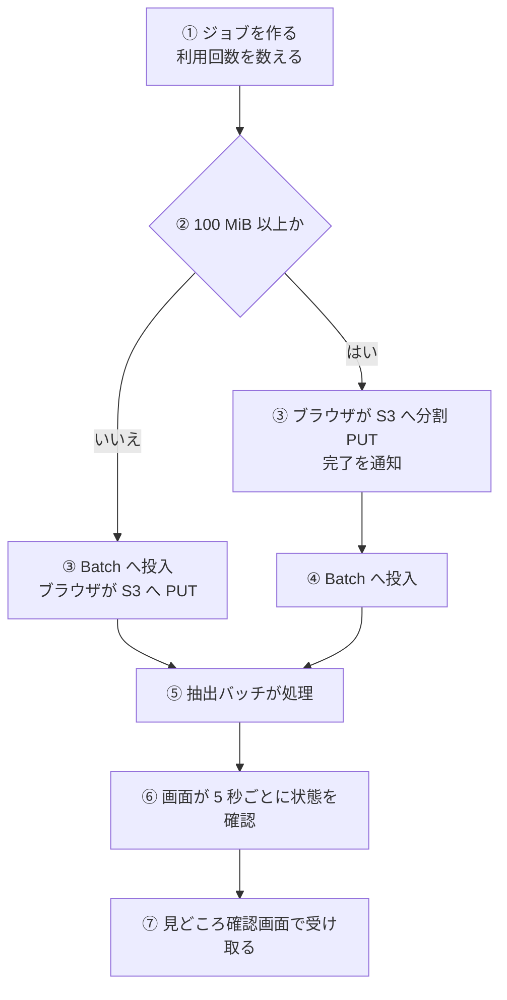
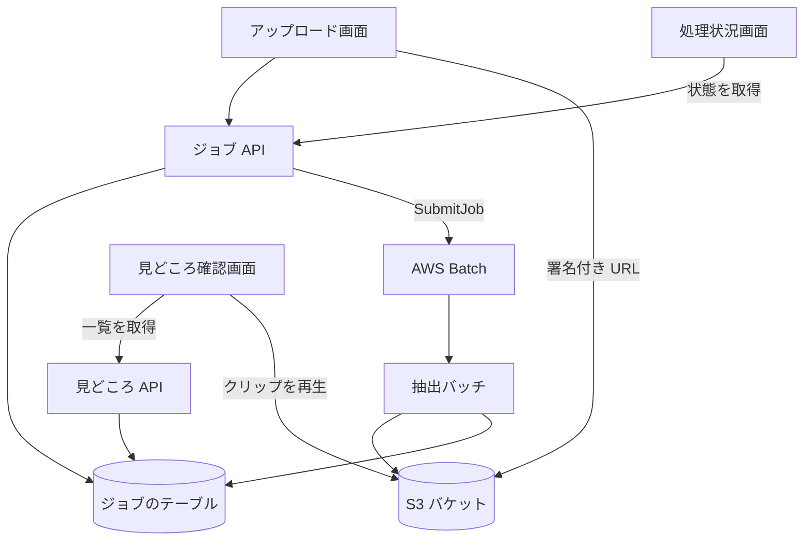

# 見どころを受け取るまでの経路

利用者が動画をアップロードしてから、見どころとクリップを受け取れる状態になるまでの流れ。動画の転送は、サーバー (Lambda) を通さず、ブラウザと S3 の間で直接行う。

## 起点

- 利用者が[アップロード画面](../screen/upload.md)で MP4 (20 GiB 以下) を選び、「アップロードして処理開始」を押す
- 結果は、利用者が[処理状況画面](../screen/job-status.md)で見る。完了を利用者に知らせる仕組み (通知) はない。タブを閉じても処理は続き、URL を控えておけば、あとで同じ画面を開ける

## 経路

1. **作成**: 画面が `POST /api/jobs` を呼ぶ。API は検査し、利用回数を数え、ジョブを保存して、アップロード用の署名付き URL を返す ([ジョブ API](../api/jobs.md)、[利用回数の流れ](./usage-metering.md))
2. **アップロード**
    - 100 MiB 未満: ブラウザが URL へ 1 回の `PUT` を行う。Batch への投入は、作成のときに済んでいる。投入された Batch が先に動き出すので、S3 に動画が届くまで、入力を取りに行って待つ ([抽出バッチ](../batch/extract.md))
    - 100 MiB 以上: 50 MiB ずつに分け、すべてを並列で `PUT` する。進捗は完了した数で出す。成功したら `complete-upload` で完了を伝え、API が S3 の分割アップロードを完了して Batch に投入する。1 つでも失敗したら `abort-upload` で中断する
3. **投入**: ファイルサイズと動画の長さから[ジョブ定義のサイズ](../term/job-definition-size.md)を選び、Batch に 1 件投入する。成功すると、画面は `/jobs/{jobId}` に移る
4. **処理**: [抽出バッチ](../batch/extract.md)が、取得、解析、切り出し、保存の順に進め、段階と解析の内訳をジョブに書く。見どころは、クリップを S3 に置いたあとに保存するので、見どころが見えるときは、全クリップが `GENERATED` になっている
5. **確認**: 処理状況画面が `GET /api/jobs/{jobId}` を 5 秒ごとに呼ぶ。API は Batch の状態から `PENDING`、`PROCESSING`、`COMPLETED`、`FAILED` を求めて返す ([ジョブとステータス](../term/job.md))。完了後も止めない。`COMPLETED` で広告が終わると (広告がなければすぐ)、「見どころを確認する」が出る
6. **受け取り**: 見どころ確認画面が、ジョブが `COMPLETED` と確かめてから、復旧と一覧と文字起こしの API を呼ぶ ([見どころ API](../api/highlights.md))。見どころとクリップの署名付き URL (有効 3,600 秒) を受け取る

## 届く先

- **見どころ確認画面**: 見どころの一覧、プレビューするクリップ、文字起こし。ここから採否と開始・終了の調整、ZIP のダウンロードへ進む
- **S3 バケット**: クリップ (`outputs/{jobId}/clips/{highlightId}.mp4`) と文字起こし。ブラウザが署名付き URL で直接読む

## 失敗・取りこぼしのとき

- 利用者が分割アップロードをやめたり、転送に失敗したりしたとき (Batch に投入する前) は、API が数えた利用回数を戻す
- 100 MiB 未満で、アップロードに失敗したときは、投入済みの Batch が入力を最大 30 分待ち、見つからなければ失敗する (`FAILED`)。利用回数は、Batch が失敗するときに戻る。画面は、アップロードの失敗のメッセージを出して、そのまま残る
- Batch が失敗すると、ジョブは `FAILED` になり、画面は `errorMessage` か「処理に失敗しました」を出す。このとき利用回数は戻り、Admin のエラー履歴にも残る ([抽出バッチ](../batch/extract.md))
- 動画の長さが段の上限を超えていたときは、Batch は成功で終えるが、ジョブは `FAILED` として見せる。申告された長さで通った動画が、実際には長かったときの安全網
- 作成から 24 時間で、ジョブと見どころは DynamoDB の TTL で、S3 のファイル (動画、クリップ、文字起こし、ZIP) は S3 のライフサイクルで、消える。消えたあとは、画面が「指定されたジョブが見つかりません」を出す
- 見どころ確認画面は、ジョブが処理中か失敗のときは、一覧を取らず、処理状況画面への案内だけを出す

## つながり

