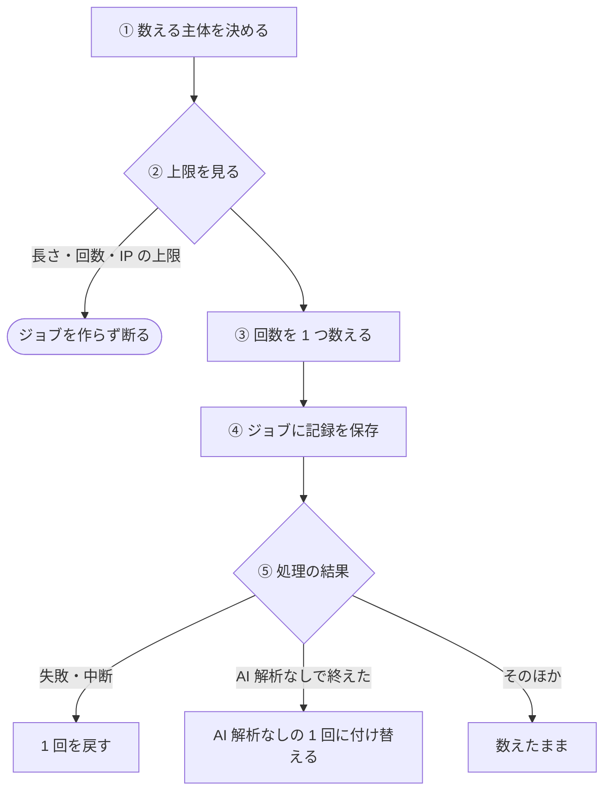
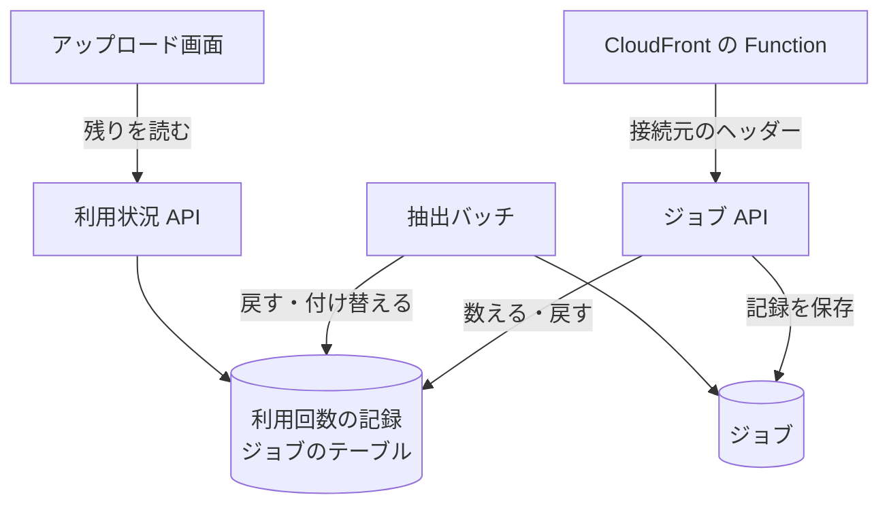

# 利用回数の数え方と戻し

ジョブを作るときに、月の回数を 1 つ数え、処理に失敗したときなどに戻す流れ。費用がかかる処理 (Batch と [AI 解析](../term/ai-analysis.md)) の使いすぎを、利用の[段](../term/usage-tier.md)ごとの上限で抑える。

## 起点

- 利用者が「アップロードして処理開始」を押すと、`POST /api/jobs` が回数を数える ([ジョブ API](../api/jobs.md))
- 残りは、アップロード画面が開くときに `GET /api/usage` で読む ([利用状況 API](../api/usage.md))。残りを読むだけで、数えない

## 経路

1. **主体**: ログイン中はユーザー ID (`USER#{ID}`)、未ログインは Cookie `qc_anon_id` の匿名 ID (`ANON#{ID}`)。Cookie がなければ、UUID を新しく発行して、レスポンスで渡す。端末の情報からの推定は使わない
2. **上限**
    - 動画の長さ: ブラウザが申告した長さが、段の上限を超えていれば断る (400)。申告がなければ判定しない
    - 月の回数: AI 解析ありとなしを別々に数える。上限なしの段 (使い放題) は、数えず、記録も残さない
    - 接続元 (未ログインだけ): 同じ接続元から、日本時間の 1 日に作れるジョブは 20 件まで
3. **数える**: 月の記録 (キー `USAGE#{主体}`、`MONTH#{YYYYMM}`、属性 `AiCount`、`NoAiCount`) に、上限を超えないときだけ 1 を足す。上限が 0 回なら通さない。どちらを数えるかは次のとおり

| `aiAnalysis` | 数え方 |
|---|---|
| `false` | AI 解析なしだけ。なければ断る |
| `true` | AI 解析ありだけ。なければ断る |
| 省略 | AI 解析あり。なければ AI 解析なし。両方なければ断る |

4. **記録**: 数えた主体、月、種類、AI 解析なしの月の上限を、ジョブに保存する。戻すときの手がかりになる
5. **結果**: 次の表のとおり。戻しと付け替えは、ジョブの戻し済み・付け替え済みの印を、条件つきの書き込みで先に付けられた側だけが行う。API と Batch が重なっても、二重には戻らない。戻す対象の月は、数えた月

| 事象 | 扱い |
|---|---|
| ジョブを作る前の失敗 | 戻す (ジョブの印は介さない) |
| 作成の応答が 500 以上、または例外 | 戻す |
| 分割アップロードの完了の失敗 | 戻す |
| 分割アップロードの中断 (Batch へ投入する前のジョブだけ) | 戻す |
| Batch の処理の失敗 (理由を問わない。動画の長さの超過を含む) | 戻す |
| AI 解析ありで数えたのに、AI 解析をしなかったか途中で飛ばした | AI 解析ありを戻し、AI 解析なしを 1 つ数える。AI 解析なしの上限に達していれば、戻すだけ |

- 戻しは、記録が残っていて、0 を超えているときだけ 1 を引く。0 未満にならず、記録を新しく作らない
- 戻す処理の失敗は、元の処理を妨げず、Admin へ報告する (warning)

## 接続元の数え方

- 接続元は、専用のヘッダー `x-nagiyu-viewer-ip` で取る。CloudFront の viewer-request の Function が、利用者の IP を毎回書き込み、利用者が送った同名のヘッダーは上書きする。ヘッダーがなければ、接続元の上限は数えない
- IPv6 は先頭 64 ビットにまとめる。IPv4 を写した IPv6 (`::ffff:a.b.c.d`) は IPv4 にする
- IP はそのまま保存しない。日ごとに作る乱数 (塩) との HMAC-SHA256 で記録する。塩は日付ごとに 1 つ (`USAGE_SALT#{日付}`)、接続元の数は日付ごとのアイテム (`USAGE_IP#{日付}`) に持つ
- 回数を数えたあとに接続元を確かめる。断った申し込みが、接続元の数を使わないようにするため。接続元で断るときは、数えた回数を戻す

## 届く先

- **アップロード画面**: 断られたときのメッセージと、ログインやプランへの案内。数えたあとの残りは、`GET /api/usage` で読み直す ([アップロード画面](../screen/upload.md))
- **ジョブ**: 数えた記録。戻しと付け替えの手がかりになる ([ジョブとステータス](../term/job.md))

## 失敗・取りこぼしのとき

- 記録先 (DynamoDB) の障害で数えられないときは、報告 (error、題名は「Web API: 利用回数の確認エラー (バイパス)」) して、数えずに通す。このとき AI 解析はなしにする
- 月の記録は、翌月末から 7 日後に TTL で消える。日ごとの記録 (塩と接続元) は、その日の終わりから 1 日後に消える。DynamoDB の削除は遅れることがあるので、削除を前提にした判定はしない
- Batch のプロセスが即死する失敗 (タイムアウトなど) は、戻す処理に入らず、回数は戻らない ([抽出バッチ](../batch/extract.md))
- Lambda の Function URL を CloudFront を通さずに直接呼ばれると、接続元のヘッダーを偽れる。未ログインの AI 解析ありは 0 回なので、費用が増えるのは Batch の分に限られる

## つながり

