# 見どころ確認画面

抽出された[見どころ](../term/highlight.md)をプレビューして、採否を決め、開始・終了を調整し、採用したクリップを ZIP でダウンロードする画面。左に選んだ見どころの詳細、右に見どころの一覧を置く。対象は PC で、スマートフォンには対応しない。

## 入口

- パスは `/jobs/{jobId}/highlights`
- [処理状況画面](./job-status.md)の「見どころを確認する」から来る。URL を直接開くこともできる
- ログインは要らず、ジョブ ID を知っていれば開ける。ジョブは作成の 24 時間後に消える

## 表示の条件

画面を開くと、先に[ジョブ API](../api/jobs.md) でジョブの状態を 1 回だけ読み、次のように分ける。ステータスは[ジョブとステータス](../term/job.md)にある。

| ジョブ | 表示 |
|---|---|
| 完了 (`COMPLETED`) | 見どころの一覧と文字起こしを読み、下の「表示するもの」を出す |
| 処理待ち、処理中 | 「まだ処理が終わっていません」と、「処理状況を確認する」のボタン。一覧は読まない |
| 失敗 | 「処理に失敗しました」と、「処理状況を確認する」のボタン。一覧は読まない |
| ない | 「指定されたジョブが見つかりません」だけ。一覧は読まない |
| 取得に失敗した | 「ジョブ情報の取得に失敗しました」だけ。一覧は読まない |

## 表示するもの

| 部分 | 内容 |
|---|---|
| 見出し | 「見どころ確認画面」 |
| 有効期限 | ジョブの応答に期限があれば、「データの有効期限: YYYY/MM/DD HH:mm:ss」。日本時間 |
| エラー | 操作や取得に失敗したあとだけ |
| 左のパネル | 選んだ見どころの詳細。何も選んでいないときは、破線の枠に「クリップを選択してください」 |
| 右のパネル | 見どころの一覧 |

左のパネルは、上から次の順に並ぶ。

| 部分 | 内容 |
|---|---|
| プレビュー | クリップの状態で変わる (下の「状態」) |
| 番号と根拠 | 「#番号 | 抽出の根拠」。根拠は、モーション、音量、感情、両方 |
| 文字起こし | 見どころの区間に重なる[文字起こし](../term/transcript.md)の行。重なる行がなければ出さない。高さは 160px までで、あふれたらスクロール |
| 採否ステータス | 「未確認」「使える」「使えない」のラジオ |
| 開始・終了 | 時刻の入力欄が 2 つ。「分:秒」(1 時間以上は「時:分:秒」) で出す。秒以下は切り捨てる |
| リトライ | クリップの状態が失敗のときだけ |

右のパネルは、上から次の順に並ぶ。

| 部分 | 内容 |
|---|---|
| 生成の進捗 | クリップの生成が終わっていない見どころがあるときだけ。回る輪と「N / M 件生成済」。N は生成済みの数、M は見どころの数 |
| 列設定 | アイコンのボタン。押すと、オプション列を出し入れするチェックボックスが開く |
| 一覧 | 高さ 480px までで、あふれたらスクロール。見出しは固定 |
| 採用数 | 「採用中の見どころ: N 件」 |
| ZIP ダウンロード | 採用が 1 件以上で、採用したクリップがすべて生成済みのときだけ押せる |
| ダウンロードできない理由 | 次の「状態」を参照 |

一覧の列。

| 列 | 内容 | 出し入れ |
|---|---|---|
| No. | `#番号` | 常に出す |
| 開始〜終了 | 「分:秒〜分:秒」。秒以下は切り捨てる | 常に出す |
| 採否 | チップ。未確認 (灰)、使える (緑)、使えない (赤)。クリップを作り直している最中は回る輪、失敗は警告のアイコンを足す | 常に出す |
| 抽出根拠 | モーション、音量、感情、両方 | 初めは出さない。列設定で出し入れする。画面を開き直すと初めに戻る |

- 一覧は番号の昇順。行をクリックすると、その見どころが左に出て、行が強調される。一覧を取り直しても、選んだ見どころは変わらない

## 状態

- 一覧を読む間は、回る輪と「見どころを取得しています...」を出す
- 読めて 0 件のときは、「見どころが検出されませんでした」を出す。読めなかったときは、これを出さず、エラーだけを出す
- 一覧の取得に失敗したときは、「見どころ一覧の取得に失敗しました」を出す。次に取得に成功すると消える。ほかの操作のエラーは消さない
- 文字起こしは、読めなくても何も出さず、続ける

左のプレビューは、選んだ見どころのクリップの状態で変わる ([見どころとクリップの状態](../term/highlight.md))。

| クリップの状態 | プレビュー |
|---|---|
| 生成済み (`GENERATED`) | 動画のプレイヤー (操作つき)。クリップへの署名付き URL を使う |
| 切り出し前、作り直し中 (`PENDING`、`GENERATING`) | 回る輪と「クリップ生成中...」 |
| 失敗 (`FAILED`) | 赤い枠に「クリップ生成に失敗しました」。下に「リトライ」を出す |

- 生成が終わっていない (`PENDING` か `GENERATING` の) 見どころがある間は、一覧を 3 秒ごとに取り直して、状態を追う。すべて終わる (`GENERATED` か `FAILED` になる) と止まる。取り直しの前に、止まった作り直しを失敗にする API を呼ぶ ([見どころ API](../api/highlights.md))
- 作り直しの最中 (`GENERATING`) と、更新やリトライを送っている最中は、その見どころの開始・終了の入力欄と「リトライ」を操作できなくする。採否は変えられる
- 開始・終了の入力欄を離れたとき、次のどれかなら、何も送らない
    - 表示の文字列が変わっていない
    - 読んだ値が、今の値と同じ
    - 時刻として読めない。読めるのは、「分:秒」「時:分:秒」と、コロンのない秒の数値 (小数も可)。分と秒は 60 未満でなければならない。「分:秒」の形では 59 分まで
    - 開始が 0 秒未満、終了が 1 秒未満
- 読めないときと、範囲外のときは、入力を元の値に戻す
- 採用した見どころに生成が終わっていないものがあるときは、「ZIP ダウンロード」を押せなくし、下に理由を出す。失敗と生成待ちの両方があるときは、失敗の理由を出す

| 条件 | 理由 |
|---|---|
| 採用した見どころに失敗がある | 生成に失敗したクリップが採用されています。リトライするか、採用を外してください |
| 採用した見どころに生成待ち、作り直し中がある | クリップの生成が終わるまでお待ちください |

- ダウンロードを準備している間は、ボタンがスピナーになり、押せない

## 操作

| 操作 | 結果 |
|---|---|
| 一覧の行をクリック | 左に、その見どころを出す |
| 採否のラジオ | `PATCH` で採否を変える ([見どころ API](../api/highlights.md))。成功すると、一覧にもすぐ反映する。失敗すると「見どころの更新に失敗しました」 |
| 開始か終了の入力欄を離れる | 値が変わっていれば、次の順に進む。クリップが作り直しになり、採否は未確認に戻る |
| 「リトライ」 | `POST .../regenerate` で作り直す。失敗すると「クリップの再生成に失敗しました」 |
| 列設定 | 開いたチェックボックスで、オプション列 (抽出根拠) を出し入れする。外をクリックすると閉じる |
| 「ZIP ダウンロード」 | 次の手順でダウンロードする |
| 「処理状況を確認する」 | `/jobs/{jobId}` ([処理状況画面](./job-status.md)) へ移る |

開始・終了を変えたときの手順。

1. 開始が終了以上になるときは、何も送らず、「開始時刻は終了時刻より小さくしてください」を出して、入力を戻す
2. 開始と終了の両方を `PATCH` で送る。受け付けられると、クリップは `GENERATING` になり、一覧が追いかける。採否が使える、使えないだったものは未確認になる
3. すでに作り直し中で 409 が返ったときは、一覧を取り直して実際の状態に合わせ、「クリップを作り直している最中のため、変更できません」を出す。取り直しに失敗したときは、その失敗のメッセージを残す
4. それ以外の失敗は、「見どころの更新に失敗しました」を出して、入力を戻す

ZIP のダウンロードの手順。

1. [ダウンロード API](../api/download.md) の `POST /api/jobs/{jobId}/download` で、ZIP の生成を始める
2. 3 秒待ってから、`GET /api/jobs/{jobId}/download` で確かめる。できていなければ (202)、3 秒おきに繰り返す。300 秒たってもできなければ、あきらめる
3. できたら、返された URL を `{jobId}-clips.zip` のファイル名のリンクとして開き、ブラウザにダウンロードさせる
4. 開始か確認が失敗したとき、300 秒たったときは、「ダウンロードの開始に失敗しました」を出す

## 画面の見た目

### 通常表示

見どころを選ぶ前。全クリップが生成済みで、採否はまちまち。

| PC |
|---|
| 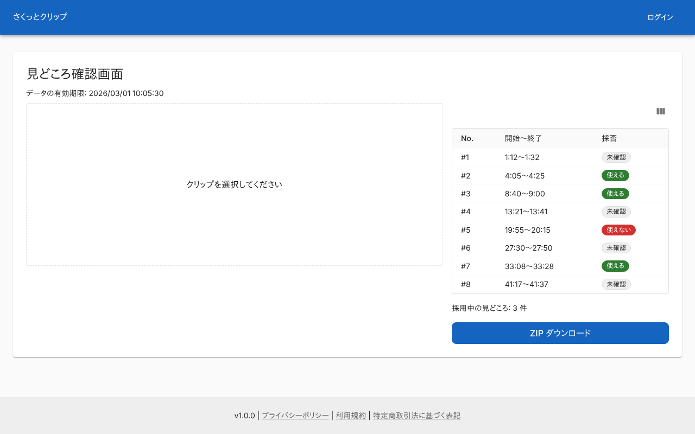 |

### 見どころを選んだ状態

左にプレビューと文字起こし、採否、開始・終了を出す。選んだ行が強調される。

| PC |
|---|
| 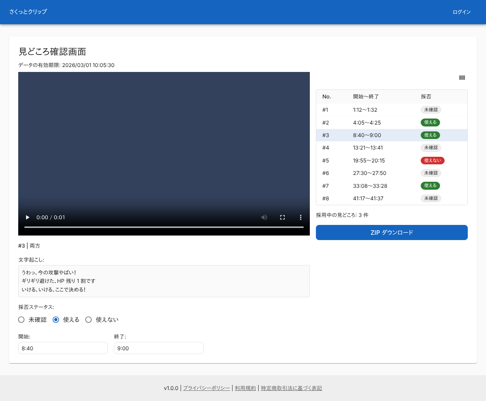 |

### 列設定で抽出根拠を出した状態

列設定を開き、「抽出根拠」の列を足した。

| PC |
|---|
| 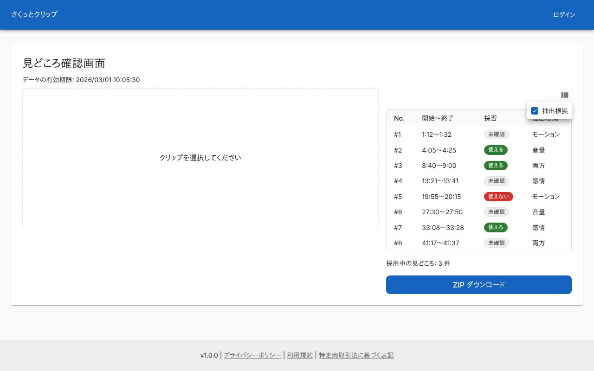 |

### 開始が終了以上の時刻を入れたとき

「開始時刻は終了時刻より小さくしてください」を出し、入力は元の値に戻る。

| PC |
|---|
| 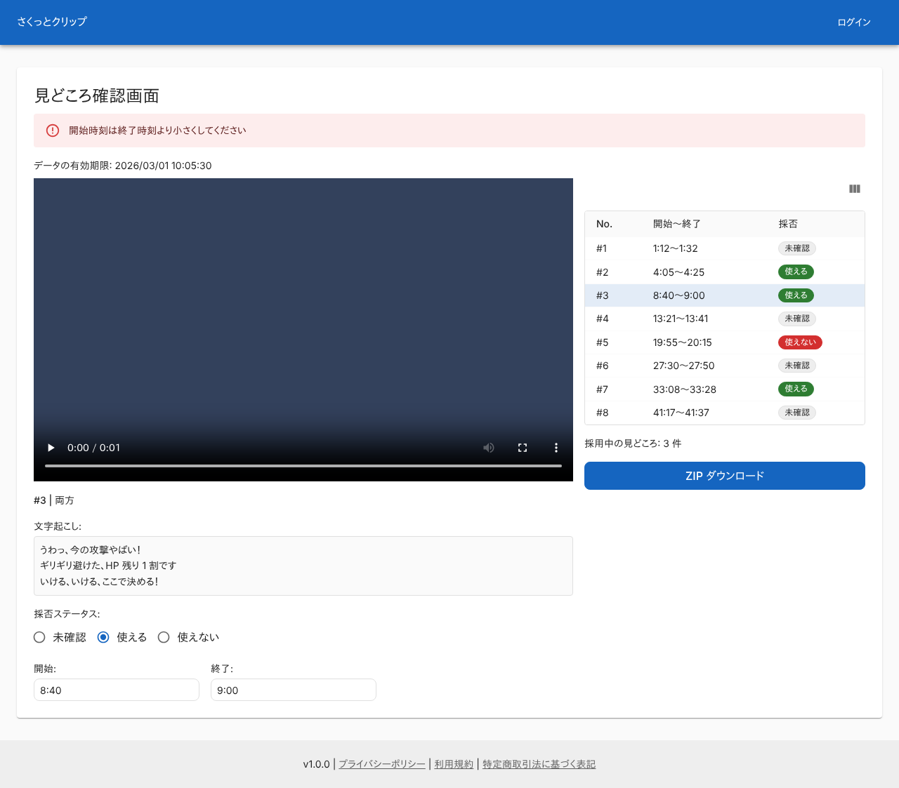 |

### クリップを作り直している最中

プレビューが「クリップ生成中...」になり、開始・終了の入力を止める。一覧の上に生成済みの数を出し、採用したクリップに生成待ちがあるので「ZIP ダウンロード」は押せない。

| PC |
|---|
| 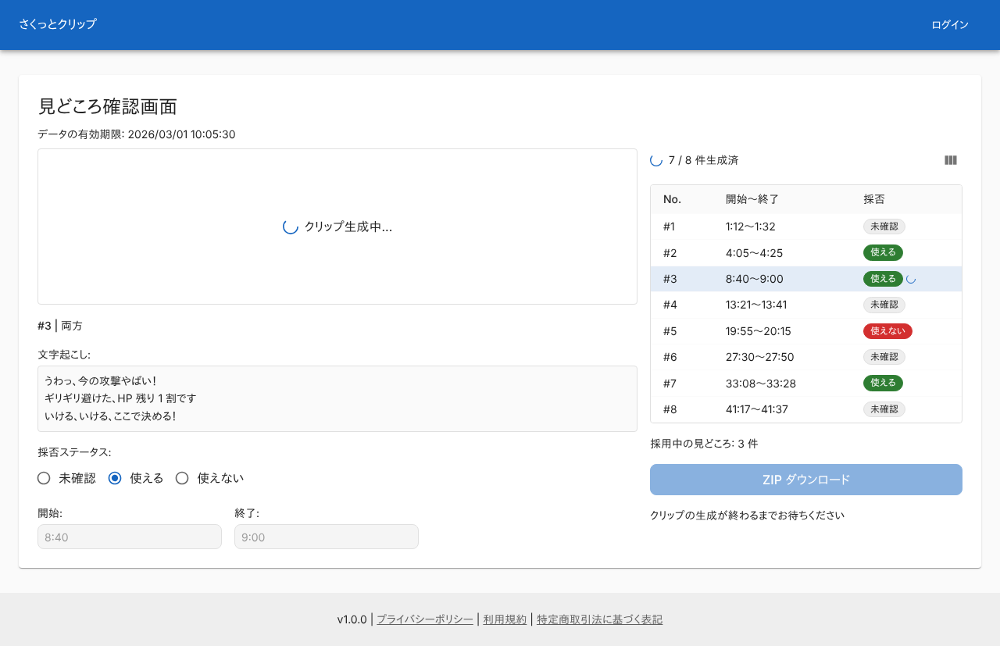 |

### クリップの作り直しに失敗したとき

「リトライ」を出し、採用中なので「ZIP ダウンロード」を止めて理由を出す。

| PC |
|---|
| 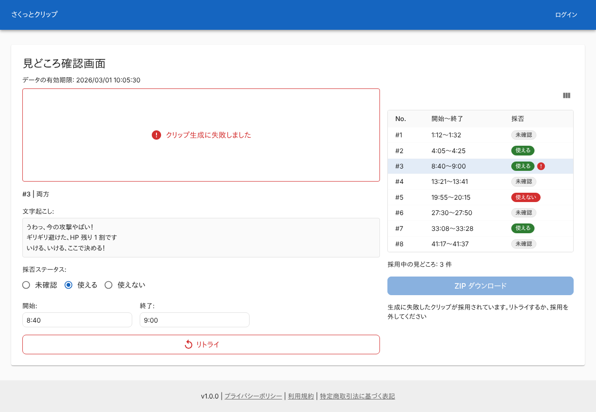 |

### ZIP を準備している状態

ボタンがスピナーになる。ZIP の作成が終わらない例。

| PC |
|---|
| 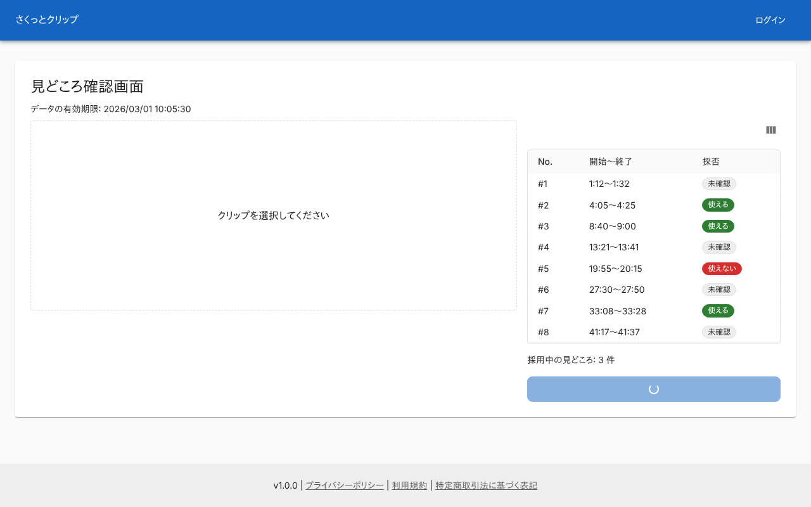 |

### 見どころが 0 件

| PC |
|---|
| 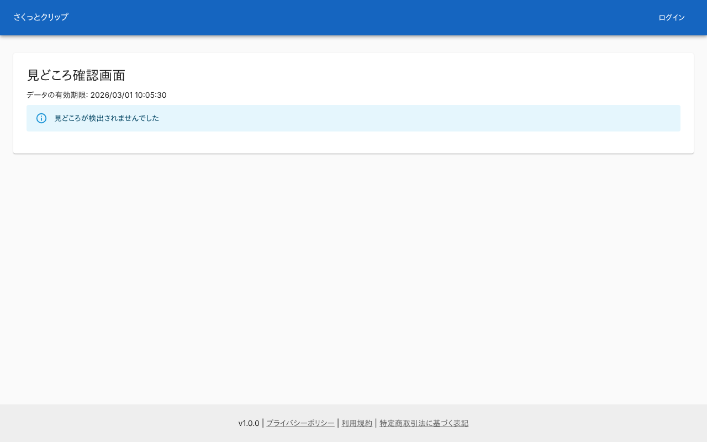 |

### 一覧の取得に失敗したとき

| PC |
|---|
| 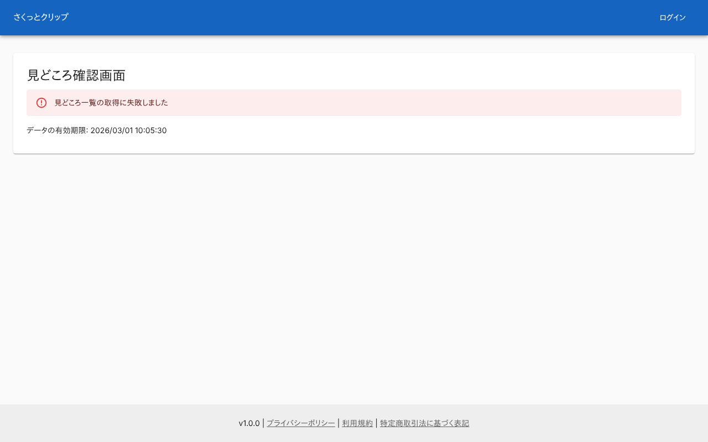 |

### 処理がまだ終わっていないとき

一覧は読まず、処理状況画面へ案内する。

| PC |
|---|
| 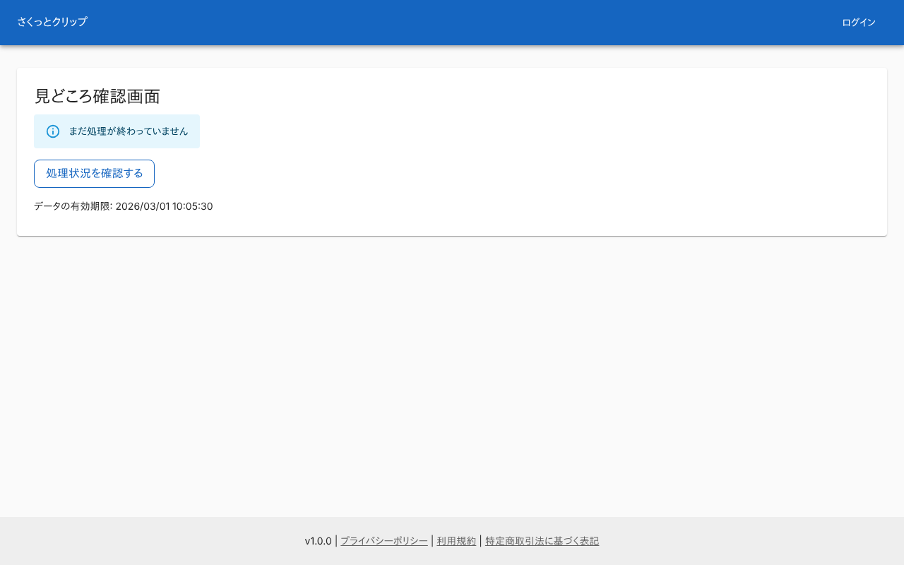 |

### 処理に失敗したとき

| PC |
|---|
| 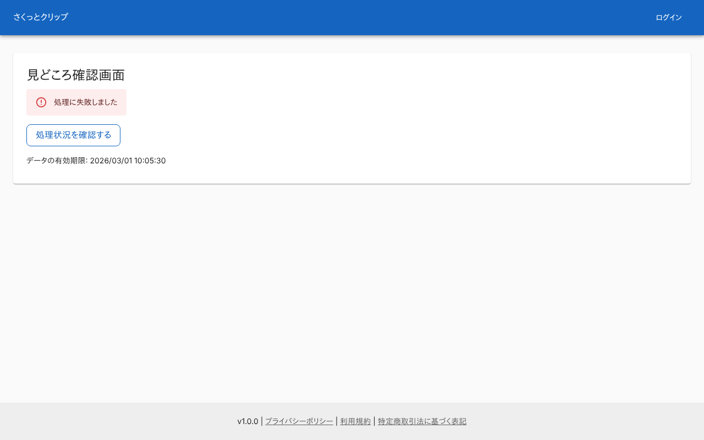 |

### 指定したジョブがない

| PC |
|---|
| 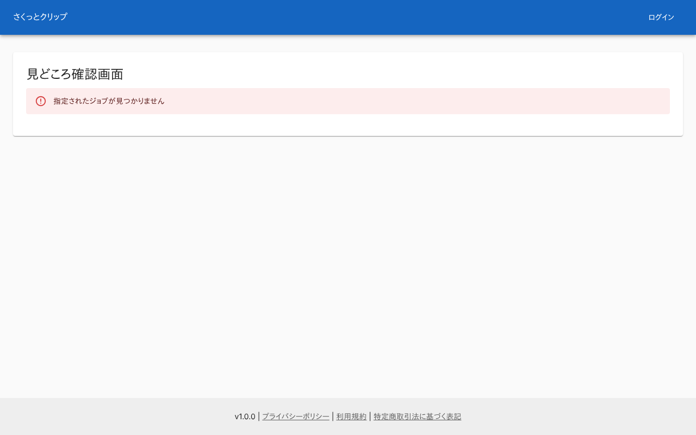 |

## つながり

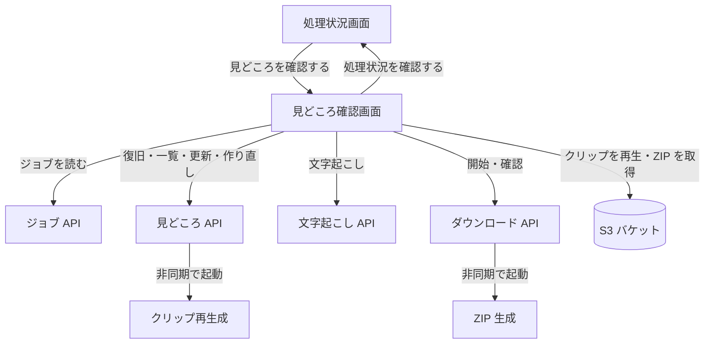
