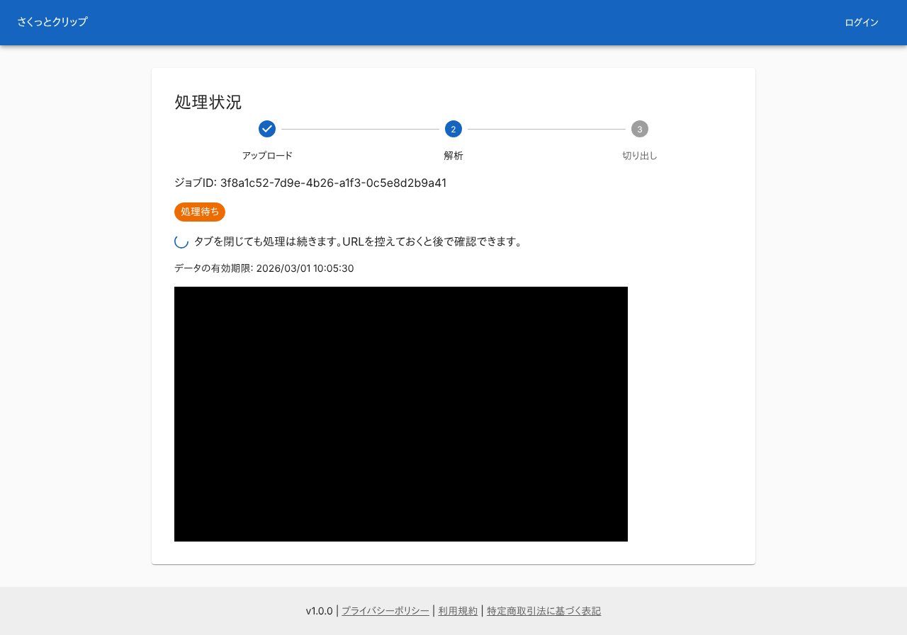
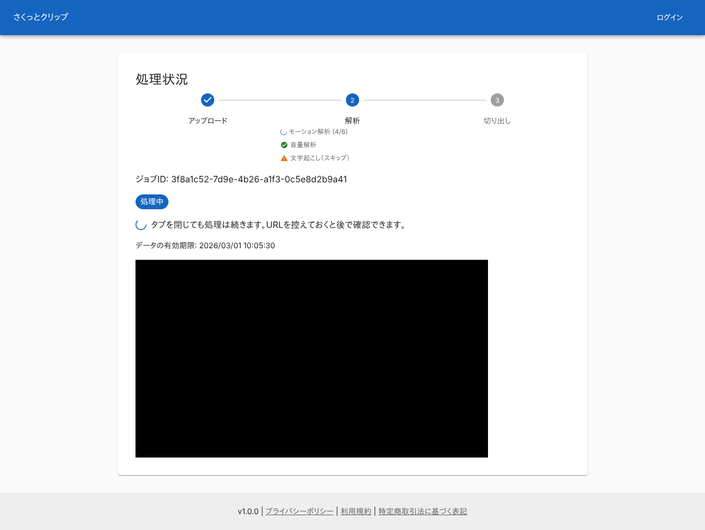
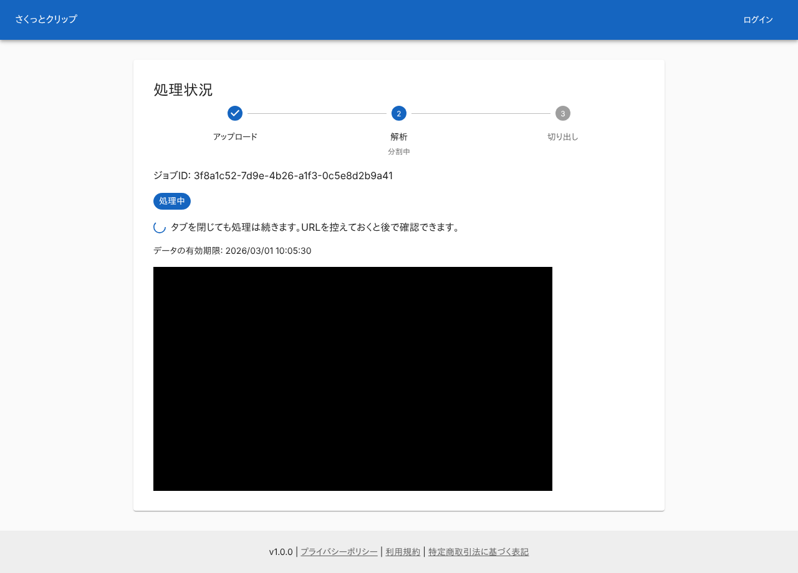
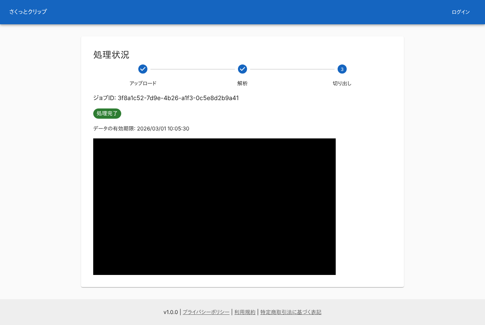
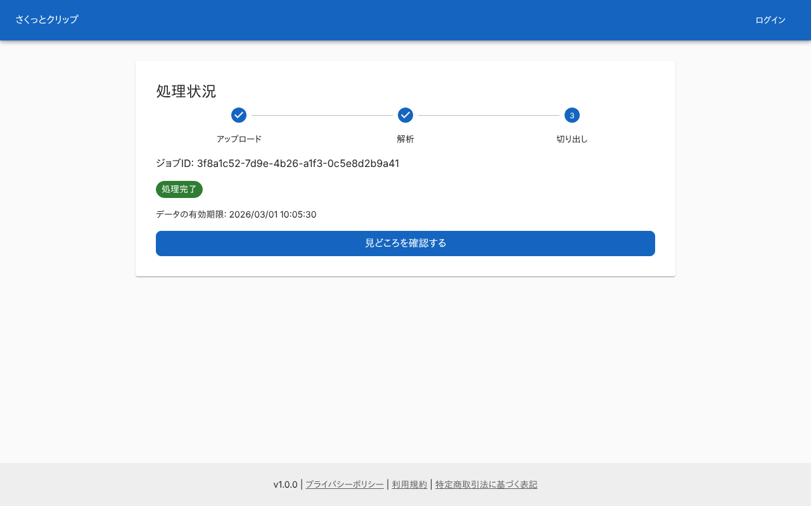
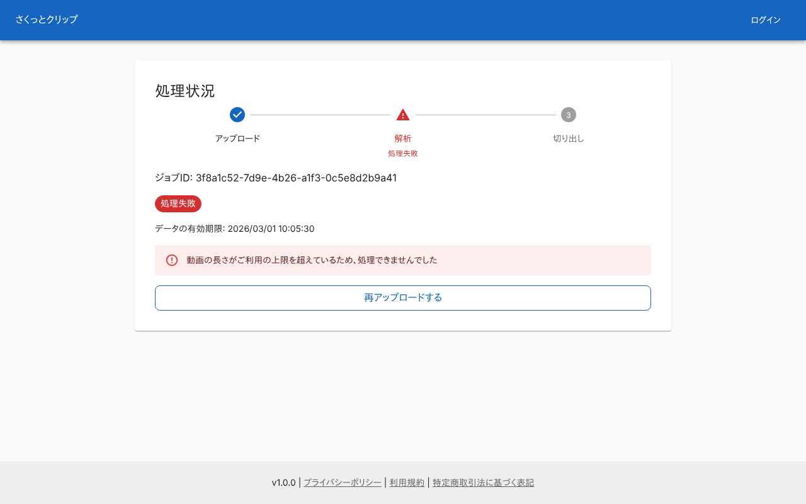
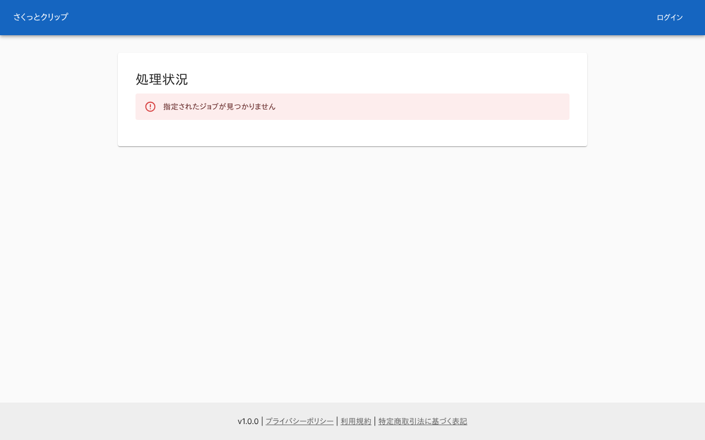
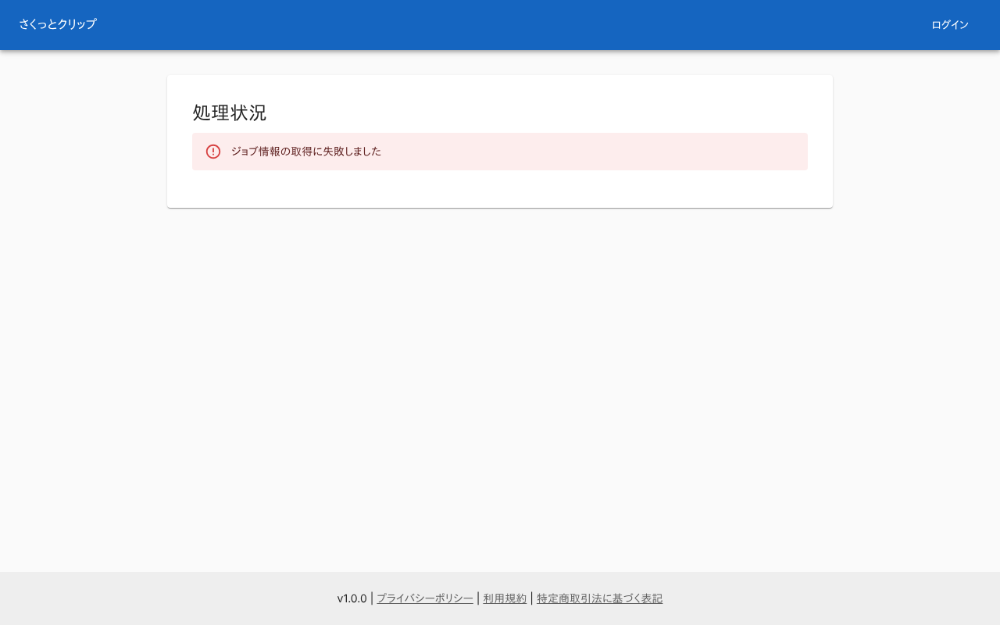
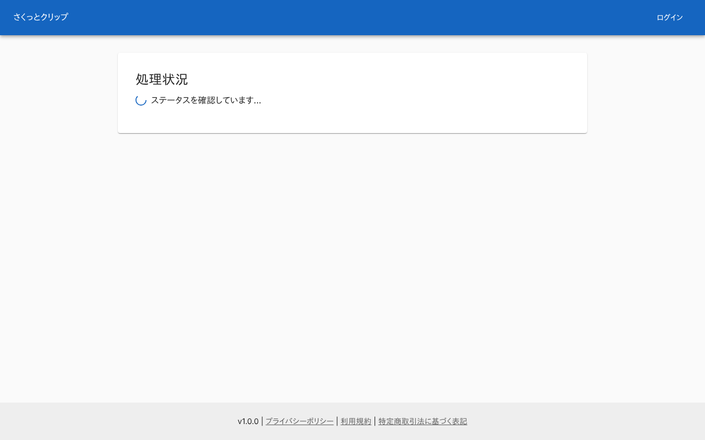
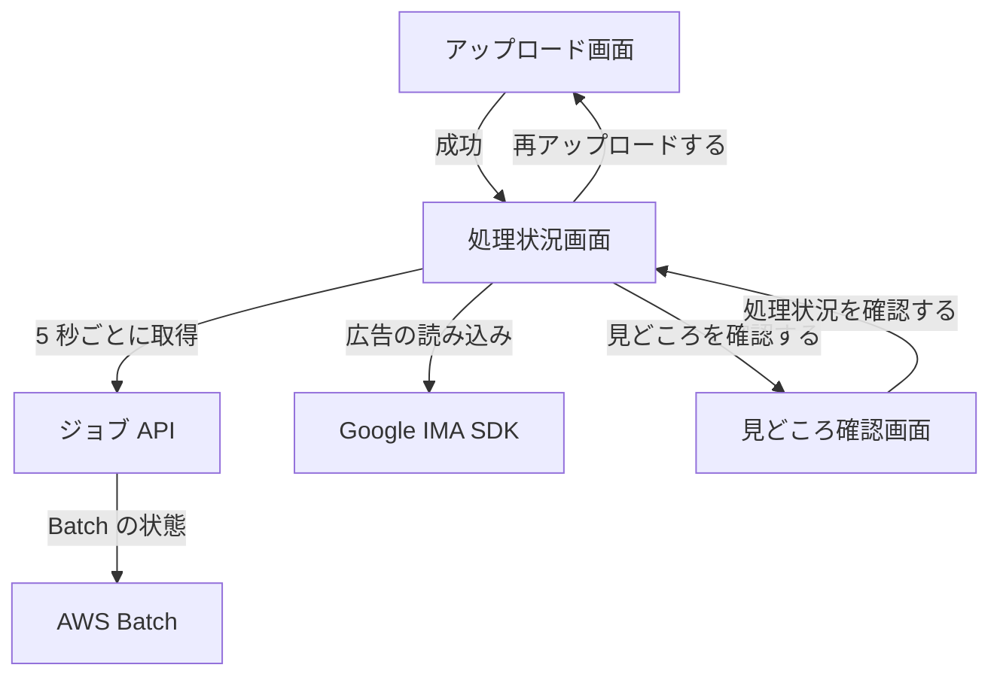

# 処理状況画面

[ジョブ](../term/job.md)の処理の進み具合を見て、完了したら[見どころ確認画面](./highlights.md)へ進む画面。処理の待ち時間に動画広告を出す。ログインは要らず、ジョブ ID を知っていれば開ける。

## 入口

- パスは `/jobs/{jobId}`
- [アップロード画面](./upload.md)で依頼すると、自動でここに移る。URL を控えておけば、タブを閉じたあとでも開ける
- [見どころ確認画面](./highlights.md)の「処理状況を確認する」から来る
- ジョブは作成の 24 時間後に消える。それ以降は、ジョブがないときの表示になる

## 表示するもの

| 部分 | 内容 |
|---|---|
| 見出し | 「処理状況」 |
| 段階 | 「アップロード」「解析」「切り出し」の 3 つ。下の「段階」を参照 |
| ジョブ ID | 「ジョブID: 」に続けて、ジョブ ID の全体 |
| ステータス | チップ。処理待ち (橙)、処理中 (青)、処理完了 (緑)、処理失敗 (赤) |
| 待機の案内 | 処理待ちと処理中のときだけ。スピナーと「タブを閉じても処理は続きます。URLを控えておくと後で確認できます。」 |
| 有効期限 | 常に出す。「データの有効期限: YYYY/MM/DD HH:mm:ss」。日本時間 |
| エラー | 処理失敗のときだけ。ジョブの `errorMessage`。なければ「処理に失敗しました」 |
| 広告 | 処理失敗でなく、広告がまだ終わっていないとき。下の「広告」を参照 |
| 見どころを確認する | 処理完了で、広告が終わっているとき |
| 再アップロードする | 処理失敗のときだけ |

### 段階

- 「アップロード」は、常に済んだものとして出す。進んでいる段階は、処理完了なら「切り出し」、それ以外は「解析」
- 処理失敗のときは、「解析」を赤い警告にし、「処理失敗」を添える
- 処理中で、バッチの段階がわかっているときは、「解析」の下に出す。解析の内訳がなければ段階の名前を出す

| 段階 | 名前 |
|---|---|
| `downloading` | ダウンロード中 |
| `analyzing` | 解析中 |
| `clipping` | 分割中 |
| `aggregating` | 集計中 |

- 解析 (`analyzing`) で内訳があるときは、名前の代わりに項目を並べる。「モーション解析」「音量解析」、あれば「文字起こし」「感情分析」。文字起こしと感情分析は、[AI 解析](../term/ai-analysis.md)をするときだけある
    - 実行中は回る輪を付ける。チャンクが 2 つ以上なら「(終わった数/全体の数)」を添える
    - 終わったものは緑のチェック
    - 失敗して飛ばしたものは橙の警告で、「(スキップ)」を添える

### 広告

- 広告は、Google の IMA SDK で出す。16:9 の黒い枠 (幅は 640px まで) で、広告はこの中に入る
- 広告の URL (`NEXT_PUBLIC_VAST_TAG_URL`) は、ビルドのときに決まる。空なら広告は出さず、すぐ終わったものとして扱う
- 次のどれかになると、広告が終わったものとして枠を消す。広告の完了、スキップ、すべての広告の完了、広告のエラー、SDK の読み込みの失敗 (広告ブロッカーを含む)、SDK の読み込みが 10 秒で終わらないとき
- 広告は、ジョブのステータスにかかわらず出す。処理が先に終わっても、広告が終わるまで「見どころを確認する」は出ない。広告が先に終わっても、処理中の表示はそのまま
- 処理が失敗すると、広告の枠は消え、広告が終わったかにかかわらず出さない

## 状態

- 開いた直後は、「ステータスを確認しています...」を出す。最初の応答が返るまで
- ジョブは、開いたときから 5 秒ごとに [ジョブ API](../api/jobs.md) の `GET /api/jobs/{jobId}` で取り直す。完了や失敗のあとも止めない
- 取得に失敗したときは、エラーを出す。ジョブを一度表示したあとに失敗しても、表示は残り、エラーが加わる。次の取得が成功すると、エラーは消える

| 条件 | メッセージ |
|---|---|
| API が 404 | 指定されたジョブが見つかりません |
| それ以外の応答の失敗、通信の失敗 | ジョブ情報の取得に失敗しました |

## 操作

| 操作 | 結果 |
|---|---|
| 「見どころを確認する」 | `/jobs/{jobId}/highlights` ([見どころ確認画面](./highlights.md)) へ移る |
| 「再アップロードする」 | `/` ([アップロード画面](./upload.md)) へ移る |

## 画面の見た目

### 処理待ち

Batch の投入後、動き出す前。広告の枠が出る。広告は、撮影のために、何も返さない代役に差し替えている。

| PC |
|---|
|  |

### 解析中

モーションの解析が終わり、音量と文字起こしが続いている。

| PC |
|---|
|  |

### 文字起こしを飛ばした状態

文字起こしが失敗して、飛ばされた。

| PC |
|---|
|  |

### クリップの切り出し中

解析の内訳は出ず、段階の名前だけを出す。

| PC |
|---|
|  |

### 処理が終わり、広告が続いている状態

「見どころを確認する」はまだ出ない。

| PC |
|---|
|  |

### 処理完了

広告が終わっている (広告の読み込みに失敗したときも同じ)。「見どころを確認する」を出す。

| PC |
|---|
|  |

### 処理失敗

エラーと「再アップロードする」を出す。動画の長さが上限を超えた例。

| PC |
|---|
|  |

### 指定したジョブがない

| PC |
|---|
|  |

### 取得に失敗したとき

| PC |
|---|
|  |

### 読み込み中

最初の応答が返らない。

| PC |
|---|
|  |

## つながり

