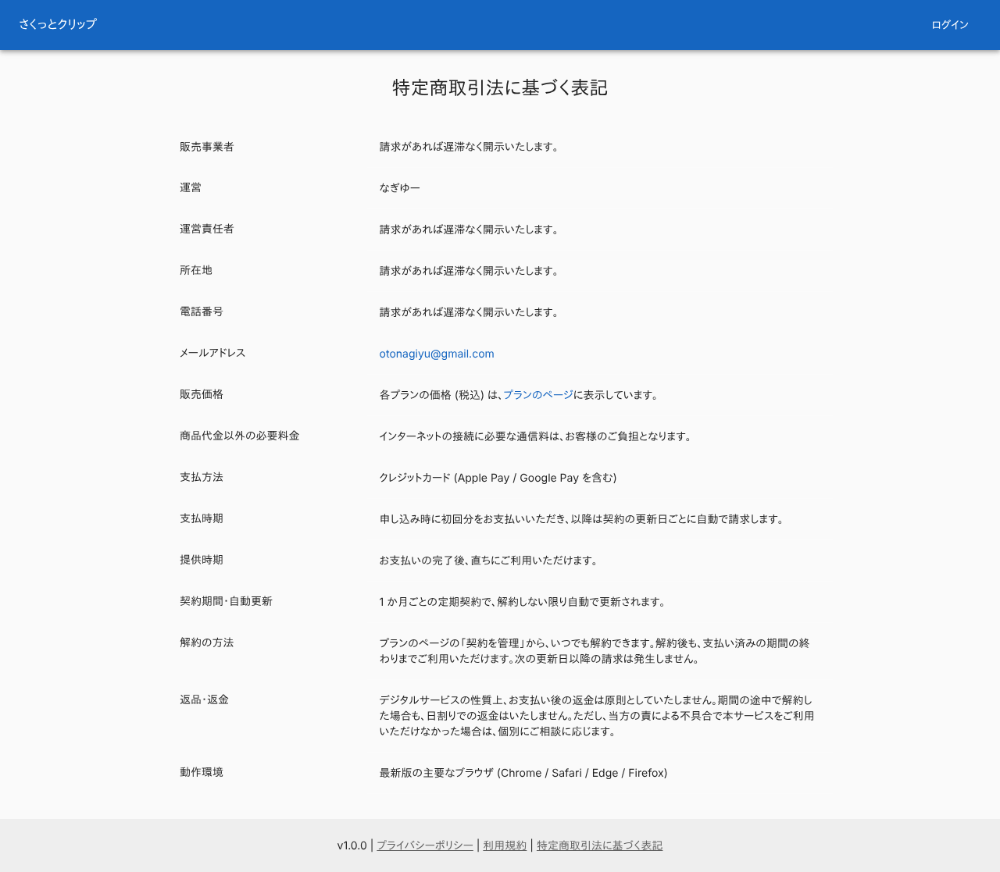
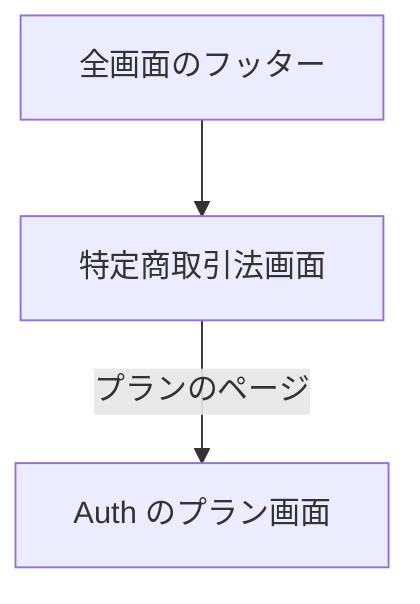

# 特定商取引法画面

有料プランの販売に必要な「特定商取引法に基づく表記」を載せた公開ページ。Auth の同名の画面と、同じ共通の表を使う。

## 入口

- パスは `/legal/tokushoho`。ログインなしで開ける
- 全画面のフッターの「特定商取引法に基づく表記」から来る。ブラウザのタブの題名は「特定商取引法に基づく表記 | さくっとクリップ」

## 表示するもの

- 見出し「特定商取引法に基づく表記」(中央寄せ) と、項目名と内容の表。表は共通の部品 (`CommercialTransactionsTable`) で描き、項目の文面は共通ライブラリが持つ。内容は [Auth の同名の画面](../../auth/screen/tokushoho.md)と同じ
- 表の中の「プランのページ」は、Auth サービスのプラン画面 (`{NEXT_PUBLIC_AUTH_URL}/plans`。末尾の `/` は除く) へのリンク ([プラン画面](../../auth/screen/plans.md))。連絡先は `mailto:` のリンク
- 狭い画面では、項目名と内容を縦に積む

## 操作

| 操作 | 結果 |
|---|---|
| 「プランのページ」 | Auth サービスのプラン画面を開く |
| メールアドレス | メールの作成を開く |

## 画面の見た目

### 通常表示

項目名と内容の表。

| PC |
|---|
|  |

## つながり

