# アップロード画面

動画 (MP4) を選び、[AI 解析](../term/ai-analysis.md)をするかを決めて、見どころの抽出を依頼する画面。ログインしなくても使える。対象は PC で、スマートフォンには対応しない。

## 入口

- パスは `/`
- ヘッダーのタイトル「さくっとクリップ」と、[処理状況画面](./job-status.md)の「再アップロードする」から来る

## 表示するもの

上から次の順に並ぶ。

| 部分 | 内容 |
|---|---|
| 見出し | 「さくっとクリップ」と「動画をアップロードして見どころ抽出を開始します。」 |
| 注意 | 常に出す。「アップロード中はタブを閉じないでください。」「データは 24 時間で自動削除されます。」 |
| ファイル選択欄 | 破線の枠。「ドラッグ&ドロップ または クリックして動画ファイルを選択」と「MP4 形式に対応」。クリックか、Enter・Space でファイル選択を開く。ドラッグ中は枠の色と背景が変わる |
| 選択中 | ファイルを選んだあとだけ。「選択中: ファイル名 (サイズ)」。サイズは 1 MB 未満なら KB、それ以上は MB で、小数 1 桁 |
| 長さの警告 | 動画が段の上限より長いときだけ。下の「状態」を参照 |
| エラー | 検証や依頼に失敗したあとだけ |
| 利用回数 | 残りを読めたときだけ。AI 解析のスイッチ、「今月の残り」、回数が尽きたときの案内 |
| 進捗 | 依頼の最中だけ。進捗バーと、「アップロード中... N%」か「処理開始中...」 |
| アップロードして処理開始 | ファイルを選ぶまで押せない。選んでいる AI 解析の回数が尽きているときも押せない |

「今月の残り」は、[利用の段](../term/usage-tier.md)の残り回数で、「今月の残り: AI 解析あり 1 回 / なし 3 回」の形。両方とも上限がないときは「今月の残り: 無制限」。

## 状態

- 初めは、ファイルもエラーもなく、「アップロードして処理開始」は押せない
- 画面を開くと `GET /api/usage` で残りを読む。読めたときは、残りと AI 解析のスイッチを出す。スイッチの初めの値は、AI 解析ありの残りがあればオン、なければオフ。初めの値を入れるのは、初めて残りを読めたときだけ。上限で断られた後などの読み直しでは、利用者が選んだ値を残し、AI 解析ありの残りがなくなったときだけオフにする。読めなかった (失敗や、形が想定と違う) ときは、残りもスイッチも出さず、AI 解析の希望も送らない。サーバーが決める
- AI 解析ありの残りがないとき、スイッチはオフで操作できない
- 今の選択 (スイッチの値) で送ると回数で断られるとき、「アップロードして処理開始」を押せなくする。AI 解析ありを選んでいて AI 解析ありの残りが 0、または AI 解析なしを選んでいて AI 解析なしの残りが 0 のとき。上限がない (null) 種類は止めない。残りを読めなかったときは止めず、サーバーに任せる。送信の操作でも同じ判定で何もせずに戻る
- 回数が尽きたときは、スイッチの下に理由 (文言) を出す。誘導のボタン (「ログインする」「プランを見る」) は画面に 1 組だけで、長さの警告かサーバーのエラーでボタンが出る状態なら、そちら (エラー表示の下) に出し、ここには出さない。どちらでも出ない状態 (エラーが無い、接続元の上限など案内なしのエラー) のときだけ、この理由の下に出す。下の表の案内は、ここに出すときのもの

| 状況 | 理由 | 案内 |
|---|---|---|
| 未ログイン、AI 解析あり・なしとも 0 | 今月の利用回数を使い切りました。ログインすると回数が増え、AI 解析も月 1 回お試しできます | 「ログインする」 |
| ログイン済み、AI 解析あり・なしとも 0 | 今月の利用回数 (AI 解析あり・なし) を使い切りました | 「プランを見る」 (一番上の段 (プロ、使い放題) には出さない) |
| 未ログイン、AI 解析ありだけ 0 | ログインすると AI 解析を月 1 回お試しできます | 「ログインする」 |
| ログイン済み、AI 解析ありだけ 0 | 今月の AI 解析の回数を使い切りました | 「プランを見る」 (一番上の段には出さない) |
| AI 解析なしだけ 0、スイッチがオフ | 今月の AI 解析なしの回数を使い切りました。AI 解析ありなら使えます | ログイン済みなら「プランを見る」 (一番上の段には出さない) |

AI 解析なしだけ 0 でスイッチがオンのときは、送れるので案内を出さない。スイッチをオンに戻せばボタンも押せる。

- ファイルを選ぶと、次の順に検証する。最初に外れた条件のメッセージを出す。外れても、選んだファイルは「選択中」に残り、「アップロードして処理開始」は押せない

| 順 | 条件 | メッセージ |
|---|---|---|
| 1 | 拡張子が `.mp4` (前後の空白と大文字小文字は問わない)。MIME タイプがわかるときは `video/mp4` | MP4 形式の動画ファイルのみアップロードできます |
| 2 | サイズが 1 バイト以上、21,474,836,480 バイト (20 GiB) 以下 | ファイルサイズが不正です |

- 検証を通ると、ブラウザで動画の長さを読む (読めないとき、または 5 秒かかるときは、長さなしにする)。残りを読めていて、長さが段の上限を超えていれば、「この動画は N 分で、ご利用の上限 (M 分) を超えています」を出し、「アップロードして処理開始」を押せなくする。N は動画の長さを切り上げた分、M は上限の分。ボタンは、エラー表示の下に、一番上の段でなければ「プランを見る」、未ログインなら「ログインする」も出す (サーバーのエラーのボタンと重なるときは、種類ごとに合わせて 1 組にする)。長さを読めなかったときは、判定せず、サーバーに任せる
- 選び直すと、エラーと案内は消え、新しいファイルで検証し直す
- 依頼の最中は、ボタンがスピナーになって押せなくなり、AI 解析のスイッチも操作できない。タブを閉じる、再読み込みをするときは、ブラウザの確認を出す (画面遷移までの間)
- 依頼に失敗すると、エラーを出して依頼の最中でなくなり、ボタンは押せる状態に戻る

| 失敗 | メッセージ |
|---|---|
| ジョブの作成 ([ジョブ API](../api/jobs.md)) が失敗した | API が返した `message`。なければ「アップロード処理の開始に失敗しました」 |
| 上限で断られた (`AI_LIMIT_EXCEEDED`、`NO_AI_LIMIT_EXCEEDED`、`IP_LIMIT_EXCEEDED`、`DURATION_LIMIT_EXCEEDED`) | API の `message`。あわせてエラー表示の下にボタン (接続元の上限だけは案内なし)。断られた時点の残りを読み直す |
| 動画の送信 (S3 への `PUT`) が失敗した | 動画ファイルのアップロードに失敗しました |
| 分割アップロードの完了が失敗した | アップロード完了処理に失敗しました |
| 分割の指定が不正 (分割の大きさが整数でない、URL の数が合わない) | アップロードパラメータが不正です |
| 応答にアップロード先がない | アップロード処理の開始に失敗しました |
| 通信など、想定外の例外 | 予期しないエラーが発生しました |

## 操作

| 操作 | 結果 |
|---|---|
| ファイルを選ぶ、ドロップする | 上の順で検証し、通れば動画の長さを読む |
| AI 解析のスイッチ | オンとオフを切り替える。何も呼ばない |
| 「アップロードして処理開始」 | 次の手順で依頼する。すべて成功すると `/jobs/{jobId}` ([処理状況画面](./job-status.md)) に移る |
| 「ログインする」「プランを見る」 | Auth サービスのサインイン画面、プラン画面へ移る。戻り先は、今の画面の URL |

依頼の手順。

| 段 | 呼ぶもの |
|---|---|
| ① ジョブを作る | [ジョブ API](../api/jobs.md) の `POST /api/jobs`。ファイル名、サイズ、MIME タイプ (空でなければ)、動画の長さ (読めていれば)、AI 解析の希望 (残りを読めていれば) を送る |
| ② 動画を S3 へ送る | 応答が `uploadUrl` のときは、その URL へ 1 回の `PUT` (進捗はバイト数)。`multipart` のときは、返された大きさで分け、すべての URL へ並列で `PUT` する (進捗は終わった数。ETag を使う) |
| ③ 完了を伝える | 分割したときだけ。`POST /api/jobs/{jobId}/complete-upload` に、`uploadId` と各部分の ETag を送る。② が失敗したときは、先に `POST /api/jobs/{jobId}/abort-upload` を呼ぶ。中断の失敗は、利用者には出さない |

- 動画を送るときの `Content-Type` は、ファイルの種類にかかわらず `video/mp4`
- 進捗は、バーと、「アップロード中... N%」の文で出す。100% になると、文は「処理開始中...」になる

## 画面の見た目

### 通常表示

ログイン済みの無料の段。ファイルを選ぶ前で、「アップロードして処理開始」は押せない。

| PC |
|---|
| 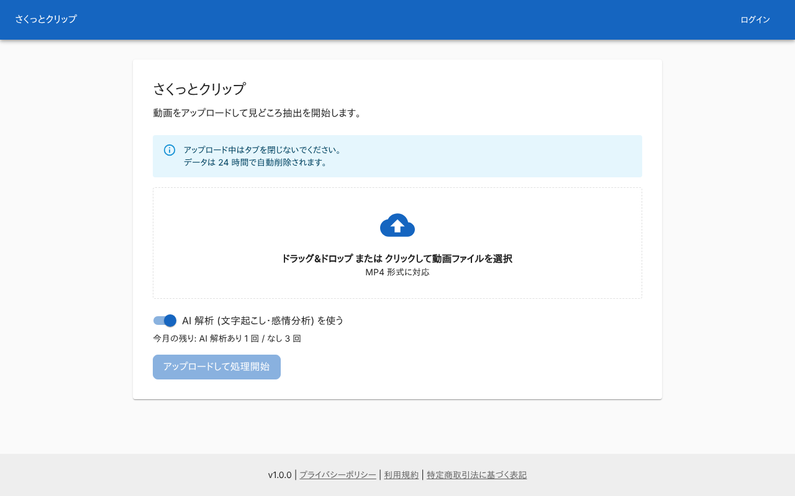 |

### ファイルを選んだ状態

「選択中」にファイル名とサイズを出し、「アップロードして処理開始」が押せる。

| PC |
|---|
| 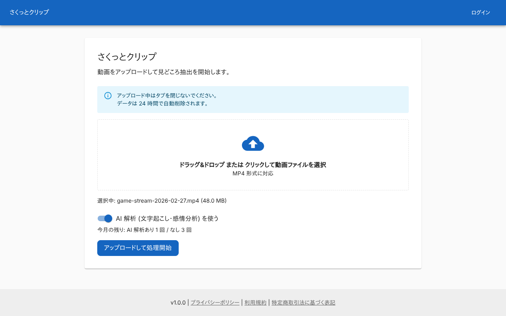 |

### AI 解析をオフにした状態

スイッチをオフにした例。AI 解析なしの回数を使う。

| PC |
|---|
| 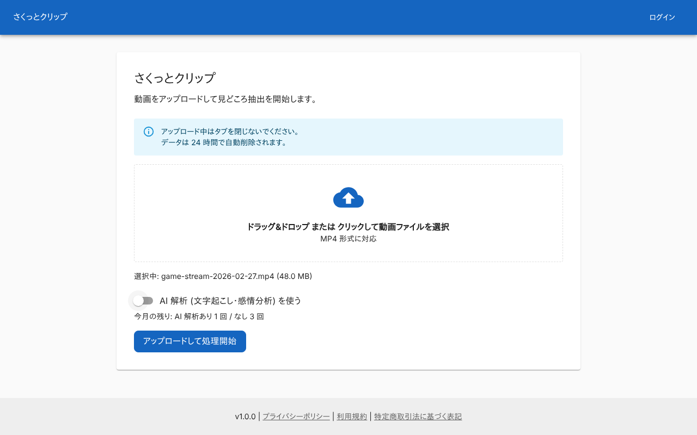 |

### 未ログイン

AI 解析ありの上限が 0 回なので、スイッチを選べない。ログインを案内する。

| PC |
|---|
| 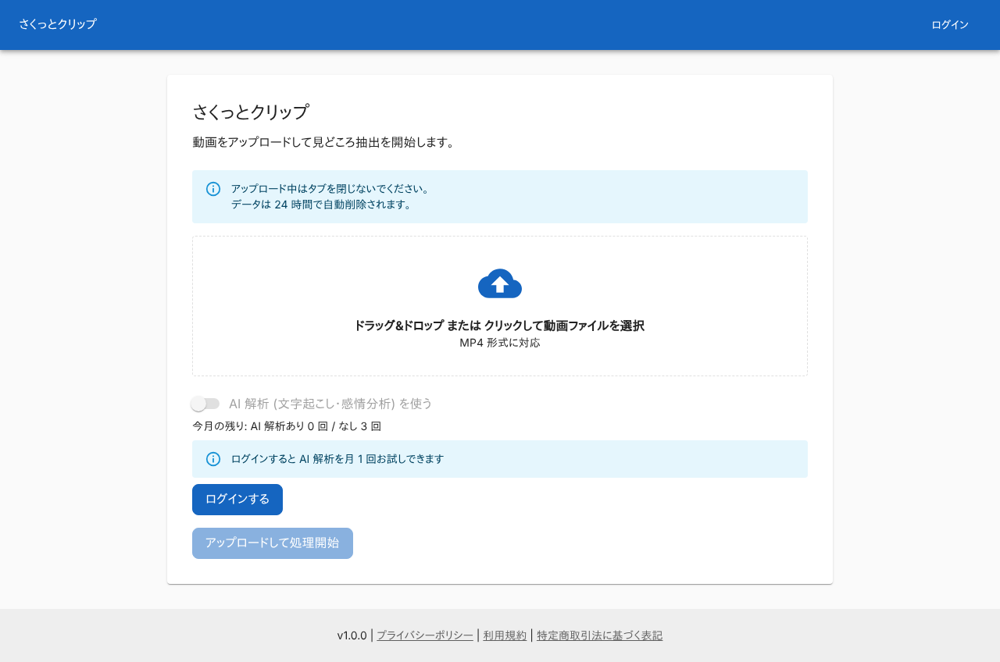 |

### AI 解析ありを使い切った状態

スイッチを選べない。プランの画面を案内する。

| PC |
|---|
| 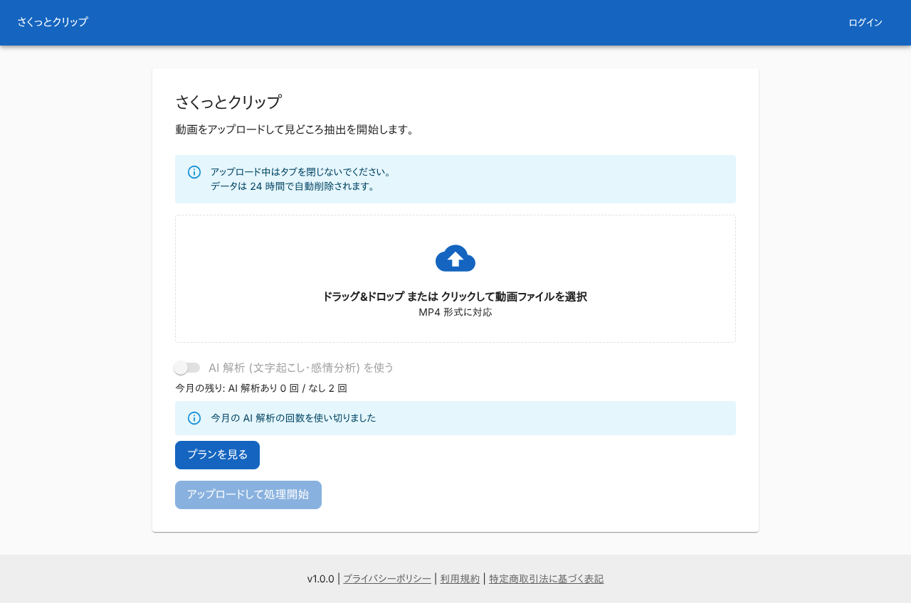 |

### 残りを取得できなかった状態

残りの表示と AI 解析のスイッチを出さない。

| PC |
|---|
| 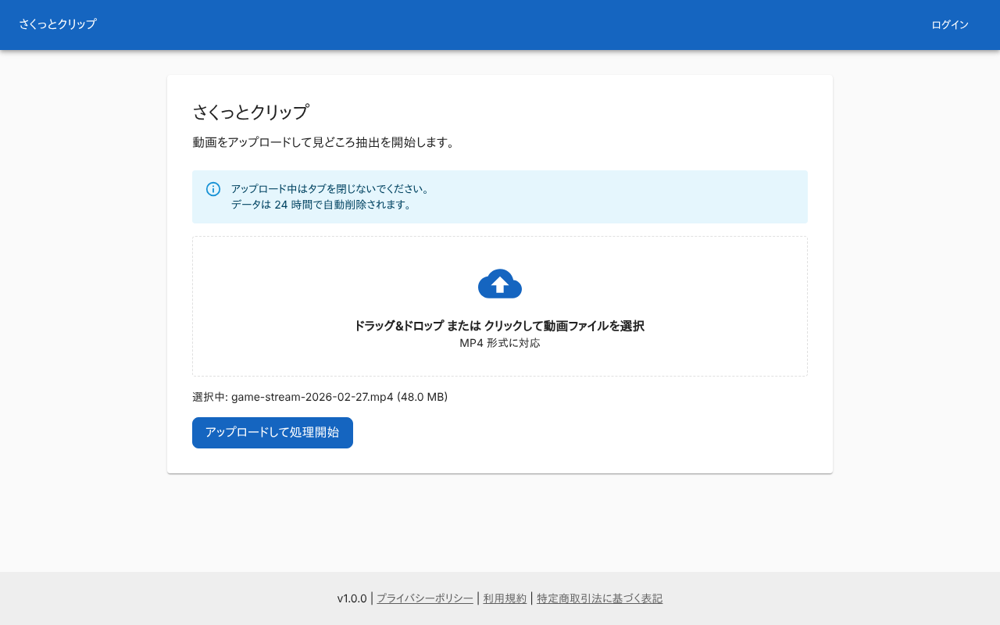 |

### MP4 でないファイルを選んだとき

「MP4 形式の動画ファイルのみアップロードできます」を出す。

| PC |
|---|
| 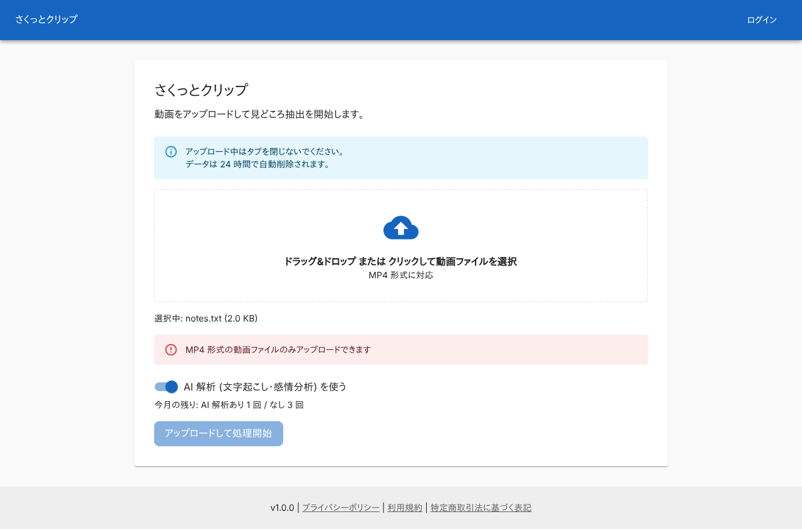 |

### 20 GiB を超えるファイルを選んだとき

「ファイルサイズが不正です」を出す。

| PC |
|---|
|  |

### 動画が段の上限より長いとき

無料の段 (120 分) で、150 分の動画を選んだ例。プランの画面を案内する。

| PC |
|---|
| 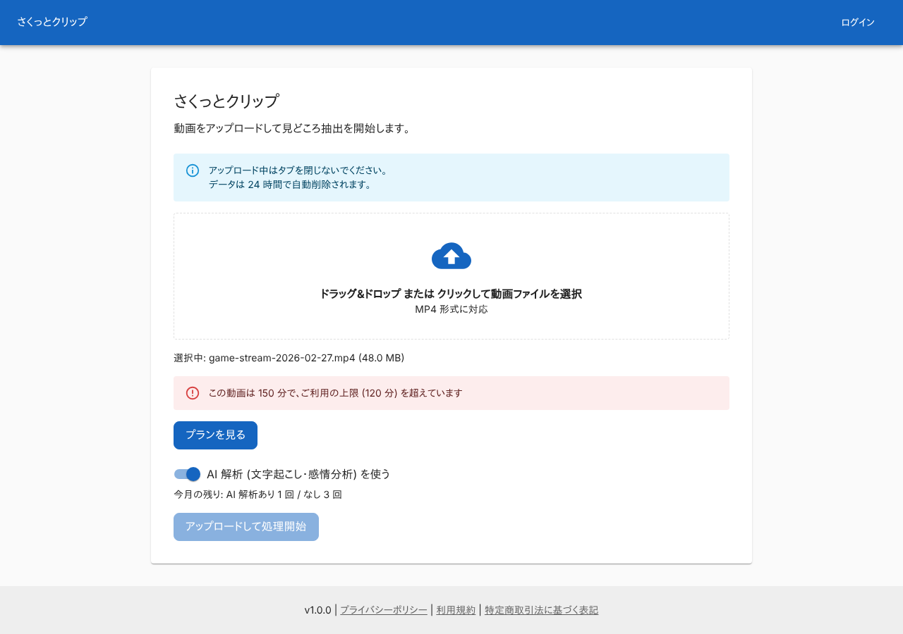 |

### アップロード中

ボタンがスピナーになる。分割アップロードで、4 つのうち 2 つが終わった例。

| PC |
|---|
| 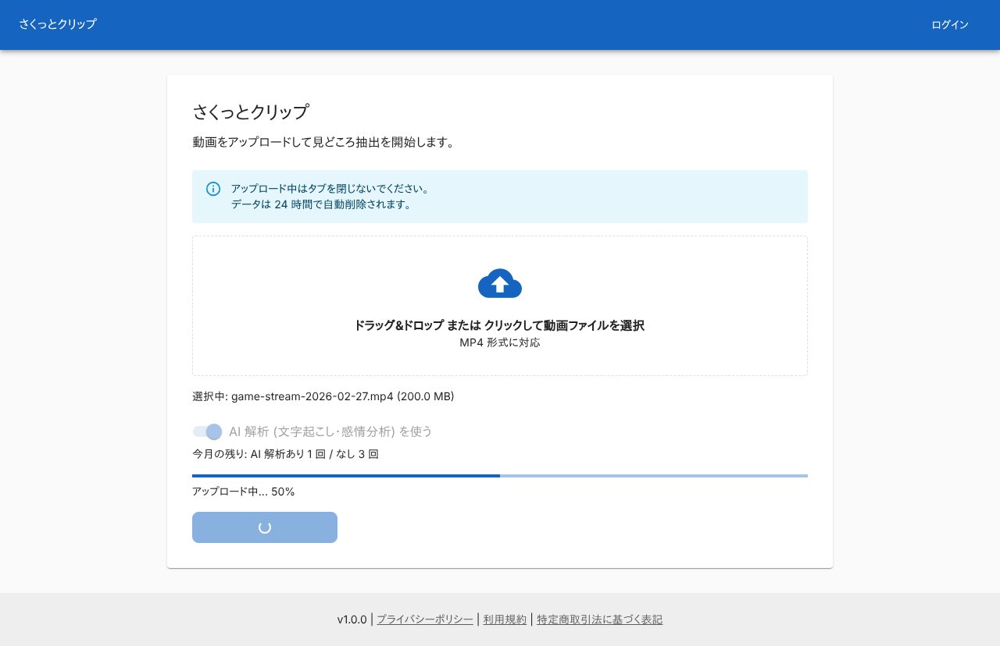 |

### ジョブの作成に失敗したとき

API が返した「ジョブの作成に失敗しました」を出す。選んだファイルは残る。

| PC |
|---|
| 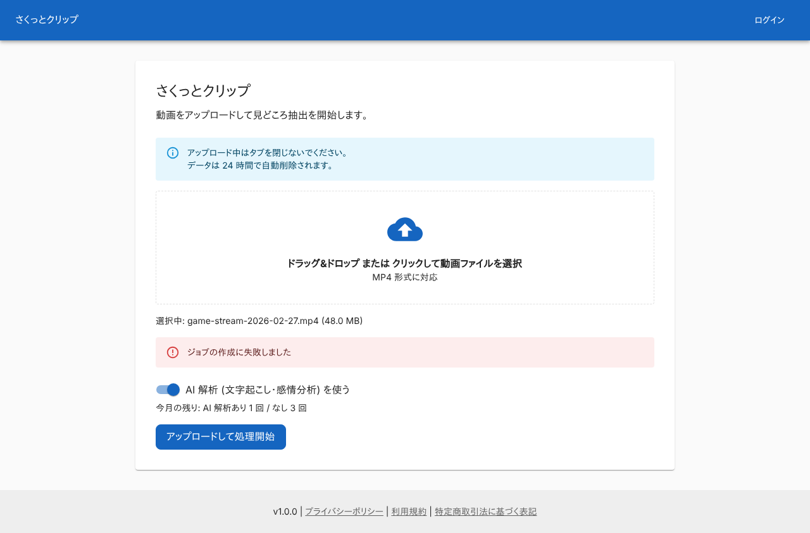 |

### 今月の回数の上限で断られたとき

API が返したメッセージを出し、プランの画面を案内する。

| PC |
|---|
| 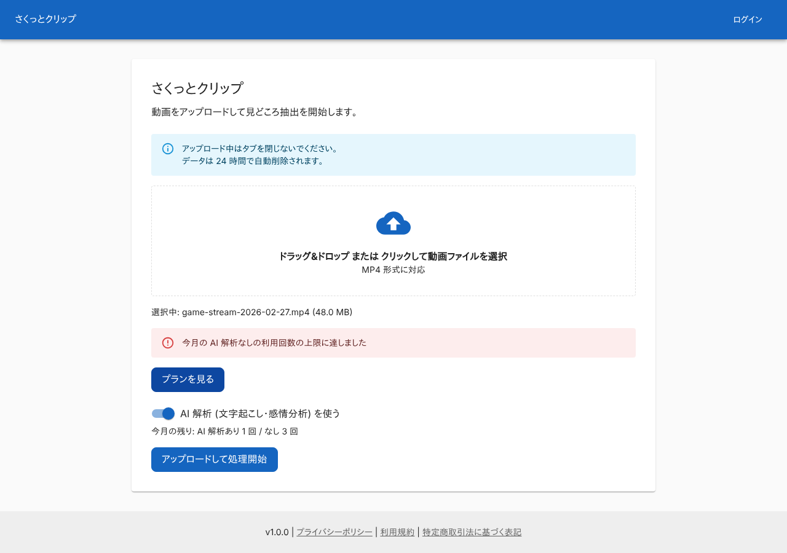 |

### S3 へのアップロードに失敗したとき

「動画ファイルのアップロードに失敗しました」を出す。

| PC |
|---|
| 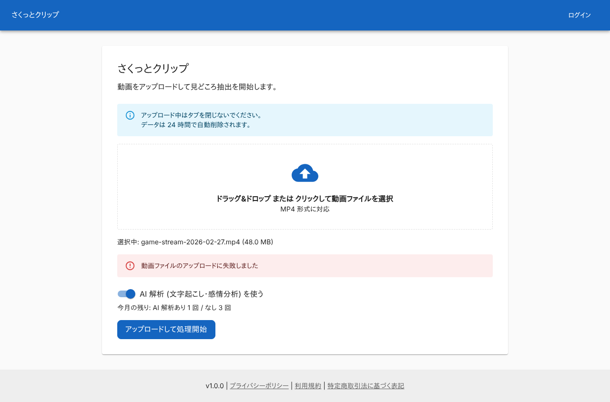 |

## つながり

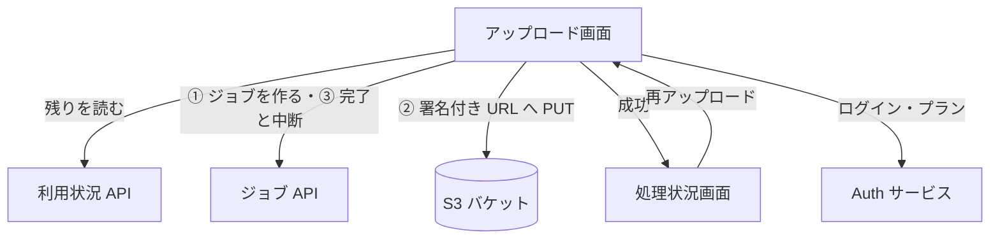
