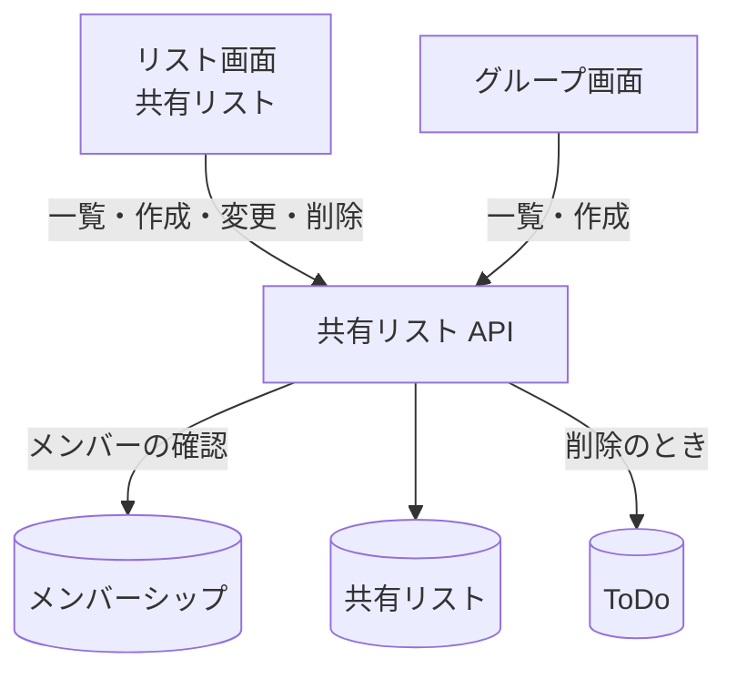

# 共有リスト API

グループの[共有リスト](../term/shared-list.md)の一覧、作成、名前の変更、削除。

## エンドポイント

| メソッド | パス | 権限 |
|---|---|---|
| GET | `/api/groups/{groupId}/lists` | グループの承認済みメンバー |
| POST | `/api/groups/{groupId}/lists` | 同上 |
| PUT | `/api/groups/{groupId}/lists/{listId}` | 同上 |
| DELETE | `/api/groups/{groupId}/lists/{listId}` | 同上 |

オーナーとメンバーで違いはない ([グループの立場](../term/group-role.md))。

## 入力と出力

- 一覧は `{ data: { lists: [...] } }`。作成の古い順。リストは `listId`、`groupId`、`name`、`createdBy`、`createdAt`、`updatedAt`
- 作成と変更の入力は `{ name }`。前後の空白を除いて 1〜100 文字。作成は 201 でリストを `{ data: リスト }` で返す (`createdBy` は自分の ID、リスト ID はランダムな UUID)。変更は 200 で更新後のリストを返す
- 削除は 204 で本文はない。リストの ToDo を先に消してからリストを消す
- 1 グループが持てる数に上限はない

## エラー

| 条件 | 状態 | `error` |
|---|---|---|
| 未ログイン | 401 | `UNAUTHORIZED` |
| パスの ID が空 | 400 | `VALIDATION_ERROR` |
| 本文が不正、`name` が空白だけ・100 文字超 | 400 | `VALIDATION_ERROR` (文言は「リスト名は1〜100文字で入力してください」。本文が不正なときは既定の文言) |
| 承認済みのメンバーでない (招待中・拒否済み・メンバーシップなしを含む) | 403 | `FORBIDDEN` |
| リストがない (変更・削除) | 404 | `NOT_FOUND` |

- 形は[API のエラー応答](../term/api-error.md)。

## つながり

