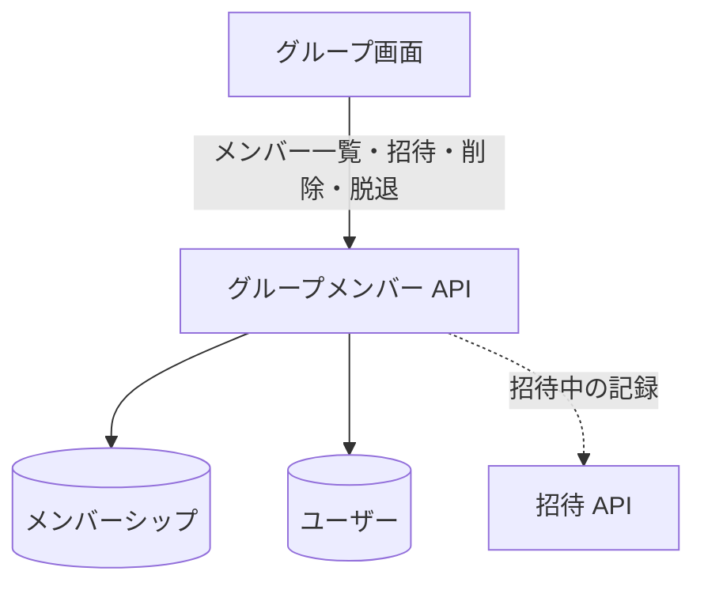

# グループメンバー API

グループのメンバーを読む、招待する、外す (オーナー)、自分から抜ける (メンバー)。

## エンドポイント

| メソッド | パス | 権限 |
|---|---|---|
| GET | `/api/groups/{groupId}/members` | 承認済みのメンバー |
| POST | `/api/groups/{groupId}/members` | グループのオーナー |
| DELETE | `/api/groups/{groupId}/members/{userId}` | 自分自身なら本人、ほかの人ならオーナー |

## 入力と出力

- 一覧は `{ data: { members: [...] } }`。承認済みのメンバーだけを返し、各メンバーは `userId`、`name`、`email`、`image` (なければ null)、`role`、`joinedAt` (応答の日時、なければ作成の日時)。利用者の登録が見つからないメンバーは除く。並びは決めていない
- 招待の入力は、`userId` と `email` のどちらか一方だけ (前後の空白は除く。両方、またはどちらもなしは 400)
    - メールアドレスは完全一致で探す。大文字と小文字は区別しない ([招待](../term/invitation.md))
    - 201 で `{ groupId, inviteeUserId, inviteeName, status: 'PENDING', createdAt }` を返す
    - 期限は招待の 24 時間後。拒否済み、または期限切れの記録がある相手には、記録を招待中に戻して期限を付け直す
    - 確認の順は、グループの有無、自分が承認済みか、オーナーか、招待先の有無、人数の上限、重複、すでにメンバーか
- 削除は 204 で本文はない
    - `userId` が自分: 抜ける。メンバーシップがあれば状態を問わず消す。オーナーは抜けられない
    - `userId` が別の人: 自分のメンバーシップの立場がオーナーであること。相手のメンバーシップを消す

## エラー

| 条件 | 状態 | `error` |
|---|---|---|
| 未ログイン | 401 | `UNAUTHORIZED` |
| パスの ID が空、招待の本文が不正 | 400 | `VALIDATION_ERROR` |
| 承認済みのメンバーでない (一覧・招待) | 403 | `FORBIDDEN` |
| オーナーでない (招待・ほかの人の削除) | 403 | `OWNER_ONLY` |
| オーナーが自分を抜けようとした | 403 | `OWNER_CANNOT_LEAVE` |
| グループがない (招待)、メンバーシップがない (削除) | 404 | `NOT_FOUND` |
| 招待先がいない | 404 | `USER_NOT_FOUND` (メールアドレスなら「このメールアドレスのユーザーは登録されていません」) |
| 承認済みと期限内の招待中を合わせて 5 名以上 | 409 | `MEMBER_LIMIT_EXCEEDED` |
| 期限内の招待がすでにある | 409 | `ALREADY_INVITED` |
| すでに承認済みのメンバー | 409 | `ALREADY_MEMBER` |

- 形は[API のエラー応答](../term/api-error.md)。

## つながり

