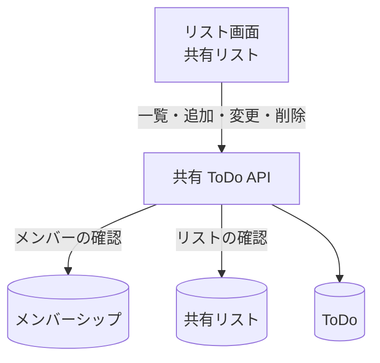

# 共有 ToDo API

グループの[共有リスト](../term/shared-list.md)の中の ToDo の一覧、作成、変更、削除。

## エンドポイント

| メソッド | パス | 権限 |
|---|---|---|
| GET | `/api/groups/{groupId}/lists/{listId}/todos` | グループの承認済みメンバー |
| POST | `/api/groups/{groupId}/lists/{listId}/todos` | 同上 |
| PUT | `/api/groups/{groupId}/lists/{listId}/todos/{todoId}` | 同上 |
| DELETE | `/api/groups/{groupId}/lists/{listId}/todos/{todoId}` | 同上 |

オーナーとメンバーで違いはない ([グループの立場](../term/group-role.md))。

## 入力と出力

- 一覧は `{ data: { todos: [...] } }`。並べ替えず、保存先が返した順のまま返す ([個人 ToDo API](./personal-todos.md) は作成の古い順に並べる)。ToDo の項目は個人と同じ
- 作成の入力は `{ title }`。前後の空白を除いて 1〜200 文字。201 で ToDo を返す。`createdBy` は自分の ID
- 変更の入力は `{ title?, isCompleted? }`。どちらか 1 つ以上が必要で、`title` は文字列 (1〜200 文字)、`isCompleted` は真偽値。完了にすると完了した人 (`completedBy`) に自分の ID を入れ、未完了に戻すと消す
- 削除は 204 で本文はない
- ToDo の作成・一覧・変更・削除は、先にグループのリストがあることを確かめる

## エラー

| 条件 | 状態 | `error` |
|---|---|---|
| 未ログイン | 401 | `UNAUTHORIZED` |
| パスの ID が空 | 400 | `VALIDATION_ERROR` |
| 本文が不正、`title` が空白だけ・200 文字超 (作成。文言は「ToDoのタイトルは1〜200文字で入力してください」)、変更の項目の型の誤りや、どちらもない | 400 | `VALIDATION_ERROR` |
| 承認済みのメンバーでない | 403 | `FORBIDDEN` |
| グループにそのリストがない、ToDo がない | 404 | `NOT_FOUND` |

- 形は[API のエラー応答](../term/api-error.md)。

## つながり

