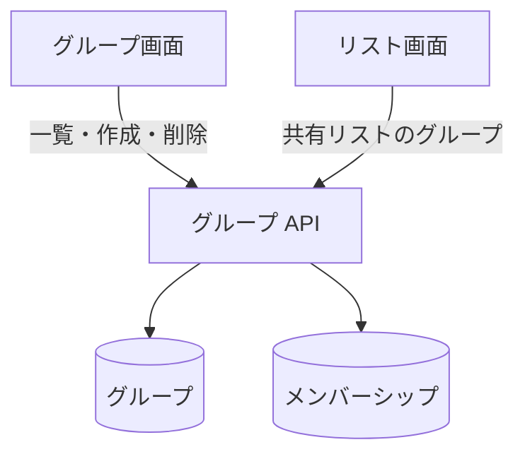

# グループ API

自分が参加しているグループの一覧、グループの作成、名前の変更、削除。

## エンドポイント

| メソッド | パス | 権限 |
|---|---|---|
| GET | `/api/groups` | ログインしていること |
| POST | `/api/groups` | ログインしていること |
| PUT | `/api/groups/{groupId}` | グループのオーナー |
| DELETE | `/api/groups/{groupId}` | グループのオーナー |

## 入力と出力

- 一覧は `{ data: { groups: [...], currentUserId } }`。承認済みのメンバーシップがあるグループだけを返し、各グループは `groupId`、`name`、`ownerUserId`、`createdAt`、`updatedAt` に、自分がオーナーか (`isOwner`。メンバーシップの立場で決める) を足したもの。並びは決めていない
- 作成と変更の入力は `{ name }`。前後の空白を除いて 1〜100 文字
- 作成は 201 で、グループを `{ data: グループ }` で返す。グループ ID はランダムな UUID。作った利用者を、承認済みのオーナーとして登録する
- 変更は 200 で、更新後のグループを返す。変えられるのは名前だけ
- 削除は 204 で本文はない。グループの全メンバーシップと、グループ自身を消す。グループの共有リストと ToDo は消さない (どこからも読めなくなるが、データは残る)
- オーナーかどうかは、グループの `ownerUserId` と自分の ID の一致で決める ([グループの立場](../term/group-role.md))

## エラー

| 条件 | 状態 | `error` |
|---|---|---|
| 未ログイン | 401 | `UNAUTHORIZED` |
| 本文が JSON のオブジェクトでない、`name` が文字列でない、空白だけ、または 100 文字を超える | 400 | `VALIDATION_ERROR` |
| グループがない (変更・削除) | 404 | `NOT_FOUND` |
| オーナーでない (変更・削除) | 403 | `OWNER_ONLY` |

- 形は[API のエラー応答](../term/api-error.md)。グループがないかの確認は、オーナーの確認より先に行う

## つながり

名前の変更 (`PUT`) を呼ぶ画面は今はない。
