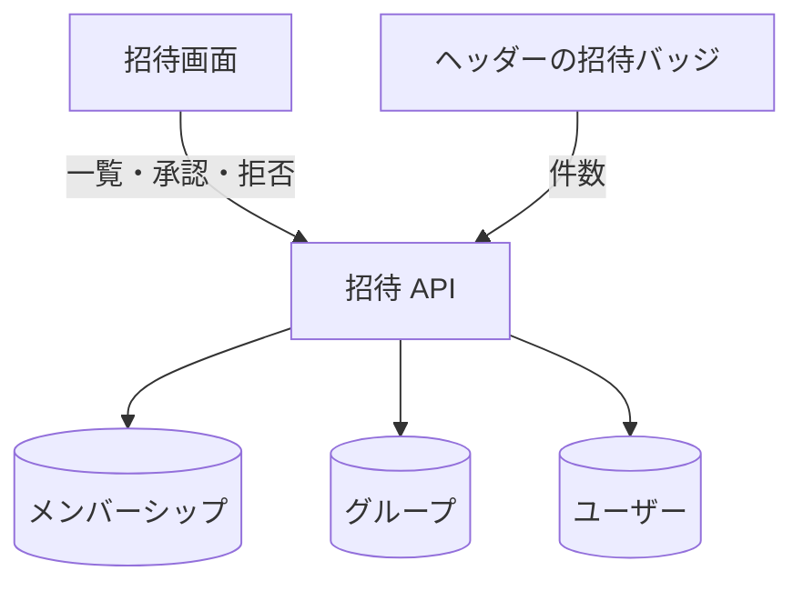

# 招待 API

自分に届いている[招待](../term/invitation.md)の一覧と、承認・拒否。

## エンドポイント

| メソッド | パス | 権限 |
|---|---|---|
| GET | `/api/invitations` | ログインしていること |
| PUT | `/api/invitations/{groupId}` | ログインしていること (自分への招待だけが対象) |

## 入力と出力

- 一覧は `{ data: { invitations: [...] } }`。自分宛ての招待中のうち、期限が切れていないものを返す。各招待は `groupId`、`groupName`、`inviterUserId`、`inviterName`、`createdAt` (記録を作った日時)。グループや招待者が見つからなければ、名前は空の文字列になる
- 応答の入力は `{ action: 'ACCEPT' | 'REJECT' }`
    - 200 で `{ data: { groupId, status: 'ACCEPTED' | 'REJECTED', updatedAt } }` を返す
    - 承認すると、承認済みのメンバーシップになる。拒否は拒否済みになる。どちらも応答の日時を残し、期限は外す
    - 承認のときは、承認済みのメンバーが 5 名に達していないこと。招待中の人は数えない

## エラー

| 条件 | 状態 | `error` |
|---|---|---|
| 未ログイン | 401 | `UNAUTHORIZED` |
| パスの `groupId` が空、本文が不正、`action` が `ACCEPT` でも `REJECT` でもない | 400 | `VALIDATION_ERROR` |
| 自分への招待の記録がない | 404 | `NOT_FOUND` |
| すでに応答している (招待中でない) | 409 | `ALREADY_RESPONDED` |
| 期限が切れている | 409 | `INVITATION_EXPIRED` |
| 承認のとき、承認済みがすでに 5 名 | 409 | `MEMBER_LIMIT_EXCEEDED` |

- 形は[API のエラー応答](../term/api-error.md)。

## つながり

