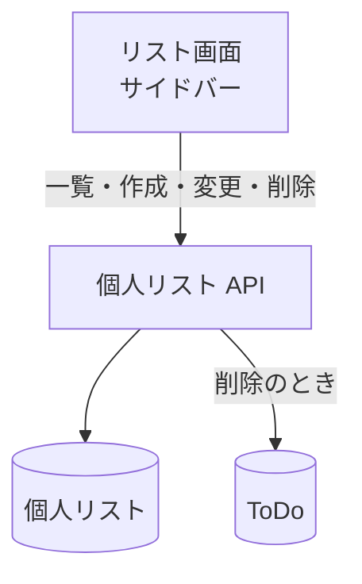

# 個人リスト API

自分の[個人リスト](../term/personal-list.md)の一覧、取得、作成、名前の変更、削除。

## エンドポイント

| メソッド | パス | 権限 |
|---|---|---|
| GET | `/api/lists` | ログインしていること |
| POST | `/api/lists` | ログインしていること |
| GET | `/api/lists/{listId}` | リストの持ち主 |
| PUT | `/api/lists/{listId}` | リストの持ち主 |
| DELETE | `/api/lists/{listId}` | リストの持ち主 |

## 入力と出力

- 一覧は `{ data: { lists: [...] } }`。デフォルトのリストが先頭、残りは作成の古い順。リストは `listId`、`userId`、`name`、`isDefault`、`createdAt`、`updatedAt`
- 作成と変更の入力は `{ name }`。前後の空白を除いて 1〜100 文字
- 作成は 201 で、リストを `{ data: リスト }` で返す (デフォルトではない)。1 人 100 件まで
- 取得と変更は 200 でリストを返す
- 削除は 204 で本文はない。リストの ToDo を先に消してからリストを消す。デフォルトのリストは削除できない
- 持ち主かどうかは、自分の ID と ID で引いたリストが一致するかで決める。他人のリストは「ない」ものとして扱う

## エラー

| 条件 | 状態 | `error` |
|---|---|---|
| 未ログイン | 401 | `UNAUTHORIZED` |
| 本文が不正、`name` が文字列でない、空白だけ、100 文字を超える | 400 | `VALIDATION_ERROR` |
| デフォルトのリストを削除しようとした | 400 | `DEFAULT_LIST_NOT_DELETABLE` |
| リストが自分のものとして見つからない | 404 | `NOT_FOUND` |
| 100 件に達している (作成) | 409 | `PERSONAL_LIST_LIMIT_EXCEEDED` |

- 形は[API のエラー応答](../term/api-error.md)。

## つながり

