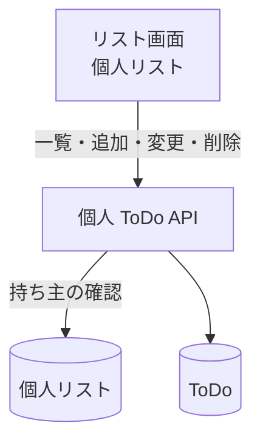

# 個人 ToDo API

自分の[個人リスト](../term/personal-list.md)の中の ToDo の一覧、作成、変更、削除。

## エンドポイント

| メソッド | パス | 権限 |
|---|---|---|
| GET | `/api/lists/{listId}/todos` | リストの持ち主 |
| POST | `/api/lists/{listId}/todos` | リストの持ち主 |
| PUT | `/api/lists/{listId}/todos/{todoId}` | リストの持ち主 |
| DELETE | `/api/lists/{listId}/todos/{todoId}` | リストの持ち主 |

## 入力と出力

- 一覧は `{ data: { todos: [...] } }`。作成の古い順 (同時刻は ID の順)。ToDo は `todoId`、`listId`、`title`、`isCompleted`、`createdBy`、`completedBy` (完了しているときだけ)、`createdAt`、`updatedAt`
- 作成の入力は `{ title }`。前後の空白を除いて 1〜200 文字。201 で ToDo を `{ data: ToDo }` で返す。`createdBy` は自分の ID
- 変更の入力は `{ title?, isCompleted? }`。どちらか 1 つ以上が必要で、`title` は文字列 (1〜200 文字)、`isCompleted` は真偽値。完了にすると完了した人 (`completedBy`) に自分の ID を入れ、未完了に戻すと消す
- 削除は 204 で本文はない
- 持ち主かどうかの確認は、操作で違う。一覧と作成は、リストが自分のものとして見つからなければ 404。変更と削除は 403

## エラー

| 条件 | 状態 | `error` |
|---|---|---|
| 未ログイン | 401 | `UNAUTHORIZED` |
| 本文が不正、`title` が文字列でない・空白だけ・200 文字超 (作成)、変更の項目の型の誤りや、どちらもない | 400 | `VALIDATION_ERROR` |
| リストが自分のものとして見つからない (一覧・作成) | 404 | `NOT_FOUND` |
| リストが自分のものとして見つからない (変更・削除) | 403 | `FORBIDDEN` |
| ToDo がない (変更・削除) | 404 | `NOT_FOUND` |

- 形は[API のエラー応答](../term/api-error.md)。

## つながり

