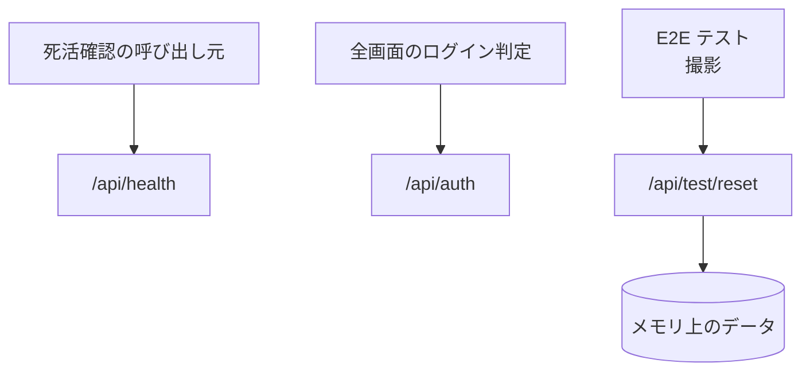

# システム系の API

業務の機能ではない 3 つの API。死活確認、認証セッション、テスト用のデータ初期化。

## エンドポイント

| メソッド | パス | 権限 |
|---|---|---|
| GET | `/api/health` | なし |
| GET | `/api/auth/*` (画面が使うのは `/api/auth/session`) | なし (ログインの状態を返す) |
| POST | `/api/test/reset` | ログインしていること (テスト用の設定のときだけ動く) |
| DELETE | `/api/test/reset` | 同上 |

## 入力と出力

- 死活確認は `{ status: 'ok', service: 'share-together', version, timestamp }` を返す。`version` は環境変数 `APP_VERSION`、なければ `1.0.0`
- 認証は next-auth の GET だけを公開する。POST は公開しない。サインアウトは Cookie の発行元である Auth が受ける。環境変数 `SKIP_AUTH_CHECK` が `true` のテスト用の設定では、認証せずにテスト用のセッションを返す
- テスト用の初期化は、環境変数 `USE_IN_MEMORY_DB` が `true` のときだけ動き、メモリ上のデータを空にする
    - POST は本文の `users`、`groups`、`memberships`、`personalLists`、`groupLists`、`todos` をこの順に登録し直す。本文がなければ空にするだけ
    - DELETE は空にするだけ
    - 成功は `{ data: { success: true } }`

## エラー

| 条件 | 状態 | `error` |
|---|---|---|
| テスト用の設定でない (初期化) | 404 | `NOT_FOUND` |
| 未ログイン (初期化) | 401 | `UNAUTHORIZED` |
| 初期化の失敗 | 500 | `INTERNAL_SERVER_ERROR` |

- 初期化の失敗は Admin へ報告しない (形は[API のエラー応答](../term/api-error.md)の報告の対象外)

## つながり

