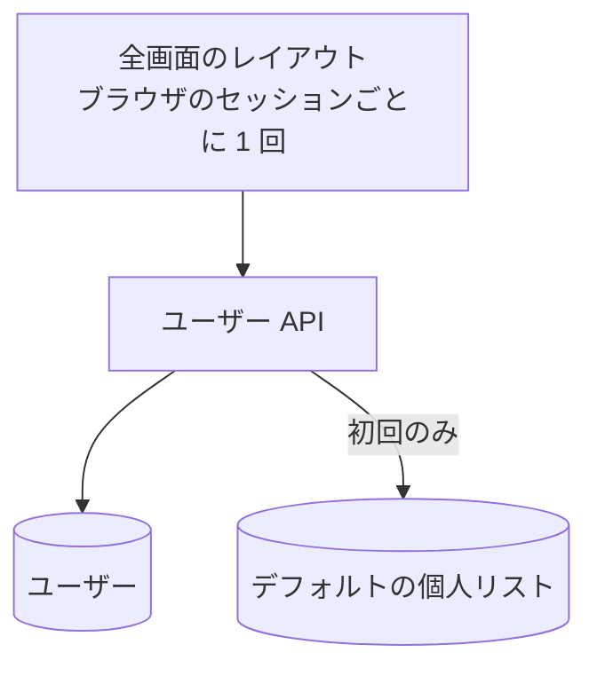

# ユーザー API

ログイン中の利用者を、Share Together の利用者として登録する。初めてなら、デフォルトの個人リストも作る。

## エンドポイント

| メソッド | パス | 権限 |
|---|---|---|
| POST | `/api/users` | ログインしていること (ロールは問わない) |

## 入力と出力

- 本文は読まない。セッションの利用者 ID、メールアドレス、名前、画像を使う
- 初めての利用者 (ID の登録がない): ユーザーを作り、デフォルトの[個人リスト](../term/personal-list.md) (名前は「デフォルトリスト」) を作る。ユーザーの `defaultListId` はそのリストの ID (ランダムな UUID)
- 登録済みの利用者: メールアドレス、名前、画像を、セッションの値で更新する。リストは作らない
- どちらも 200 で、ユーザー (`userId`、`email`、`name`、`image`、`defaultListId`、`createdAt`、`updatedAt`) を `{ data: ユーザー }` で返す
- メールアドレスで利用者を探す[招待](../api/group-members.md)は、ここで登録したメールアドレスを使う

## エラー

| 条件 | 状態 | `error` |
|---|---|---|
| 未ログイン | 401 | `UNAUTHORIZED` |
| セッションに ID、メールアドレス、名前のいずれかがない | 400 | `VALIDATION_ERROR` |
| 想定外の失敗 | 500 | `INTERNAL_SERVER_ERROR` |

- 形は[API のエラー応答](../term/api-error.md)。

## つながり

