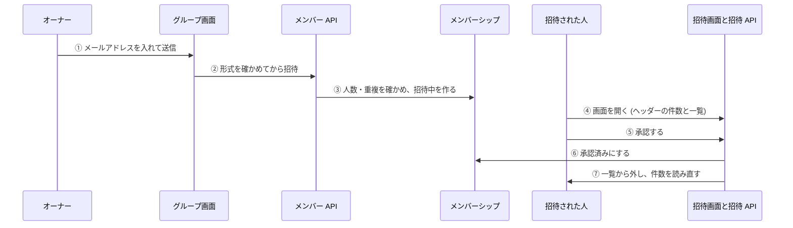
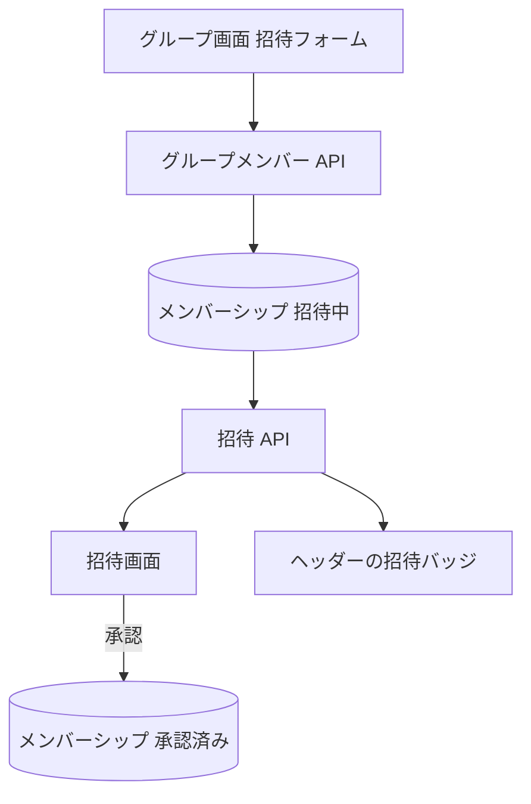

# 招待から参加までの経路

グループのオーナーが人を招待し、招待された人が承認してメンバーになるまでの流れ。通知はメールを送らず、招待された人が画面を開いたときに読む。

## 起点

- オーナーが[グループ画面](../screen/groups.md)の招待フォームに、相手のメールアドレスを入れて送る

## 経路

| 段階 | 内容 |
|---|---|
| ② 送信 | 画面は形式 (`xxx@yyy.zzz` の並び) だけを確かめる。不正なら API は呼ばない。API は、オーナーであること、相手が登録済みであること、人数と重複を確かめる ([メンバー API](../api/group-members.md)) |
| ③ 招待中の記録 | 招待の日時から 24 時間後を期限にした、招待中のメンバーシップを作る。拒否済みや期限切れの記録があれば上書きする ([招待](../term/invitation.md)) |
| ④ 受け取り | 相手が画面を開いたときに読む。画面の中で自動では更新しない (ページを開き直す)。期限切れのものは出さない |
| ⑤⑥ 承認 | 承認済みのメンバーがすでに 5 名なら 409 で止まる。承認すると記録の期限は外れ、承認済みのメンバーになる。拒否なら拒否済みになる |
| ⑦ 反映 | 承認も拒否も、成功すると一覧から外し、ヘッダーの招待の件数を読み直す |

- 承認した人は、次にグループ画面かリスト画面を開くと、そのグループが出る。招待画面は、グループ画面へ移さない
- 相手のメールアドレスが登録されていない (一度もサービスを開いていない) と、招待できない (404 `USER_NOT_FOUND`)

## 届く先

- 承認済みのメンバーシップ。承認した人が、グループの共有リストと ToDo を操作できるようになる ([グループの立場](../term/group-role.md))
- 招待された人の招待の件数 (ヘッダーのバッジ)

## 失敗・取りこぼしのとき

| 失敗 | 結果 |
|---|---|
| 人数が上限 (送信時: 承認済みと期限内の招待中で 5 名以上) | 招待できない (409 `MEMBER_LIMIT_EXCEEDED`)。画面は、承認済みが 5 名になると入力と送信を押せなくする |
| 同じ相手に期限内の招待がある、すでにメンバー | 409 (`ALREADY_INVITED`、`ALREADY_MEMBER`) |
| 承認のとき、承認済みがすでに 5 名 | 409 `MEMBER_LIMIT_EXCEEDED`。招待は残り、あとで再び承認できる |
| 承認・拒否のとき、期限が切れていた | 409 `INVITATION_EXPIRED`。画面は一覧から外す |
| すでに応答していた | 409 `ALREADY_RESPONDED`。画面は固定の失敗の文言を出し、カードを残す |

## つながり

