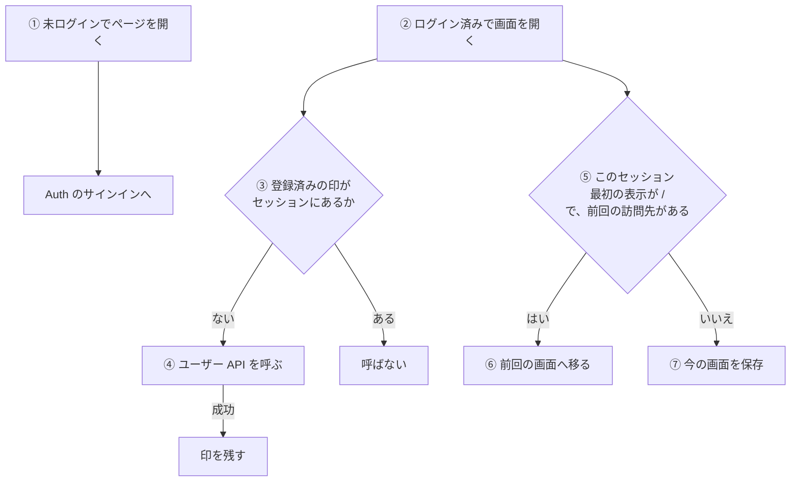
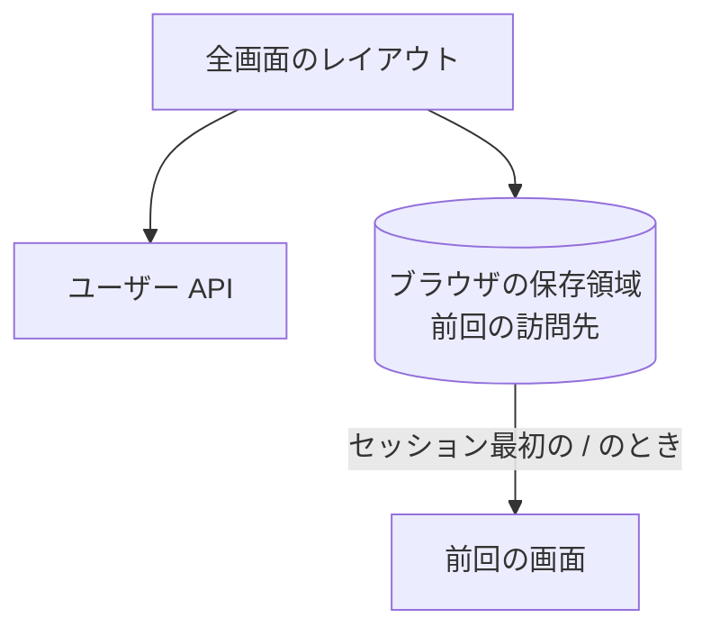

# 起動時の流れ (利用者登録と前回の画面の復元)

ログイン後に画面を開いたときに、全画面のレイアウトが行う 2 つの処理。利用者の登録と、前回開いていた画面への復元。

## 起点

- どの画面でも、レイアウトが描かれたとき (ブラウザのセッションごと。タブや PWA のウィンドウを閉じるまで)

## 経路

| 段階 | 内容 |
|---|---|
| ① 未ログイン | ミドルウェアが Auth のサインインへ送る。戻り先は開いたパスとクエリ。`/api` は対象外で、API は 401 を返す |
| ③④ 登録 | 画面ごとに、ブラウザのセッションに印があるかを見る。なければ [ユーザー API](../api/users.md) を呼び、成功したら印を残す。失敗した場合は印を残さず、次の画面の表示で再び呼ぶ。失敗は `console.error` に出すだけで、利用者には知らせない |
| ⑤⑥ 復元 | セッションの最初の表示で、パスが `/` で、保存された前回の訪問先が `/` 以外ならそこへ移る (履歴は置き換える)。移るときは保存しない |
| ⑦ 保存 | それ以外のとき、パスとクエリを 1 つの文字列にして、ブラウザに保存する (`/` で始まるものだけ)。リスト画面のクエリ (`scope`、`groupId`、`listId`) も含めて保存するので、選んでいたリストへ戻れる |

- 保存先はブラウザ (端末ごと)。ほかの端末やブラウザには引き継がれない
- 復元は、`/` を一度描いてから移る。トップ画面が一瞬見える
- 2 回目以降の `/` (ヘッダーのタイトルを押すなど) では移らない

## 届く先

- ユーザー API が作る利用者とデフォルトの個人リスト ([個人リスト](../term/personal-list.md))
- 前回の訪問先 (ブラウザの保存領域)

## つながり

