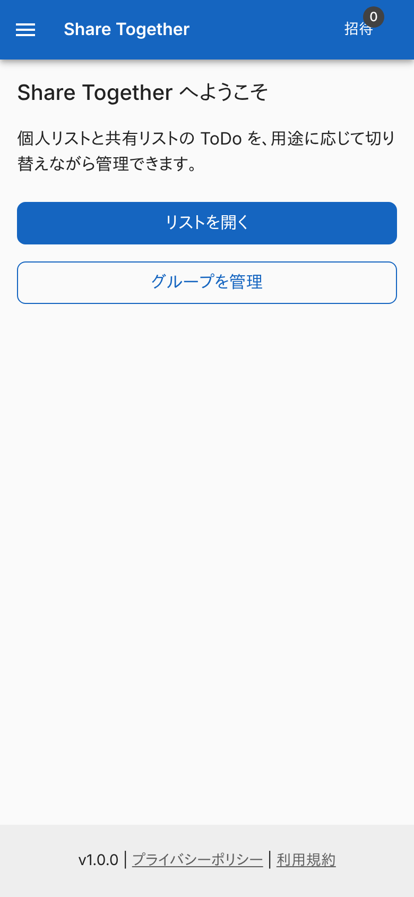
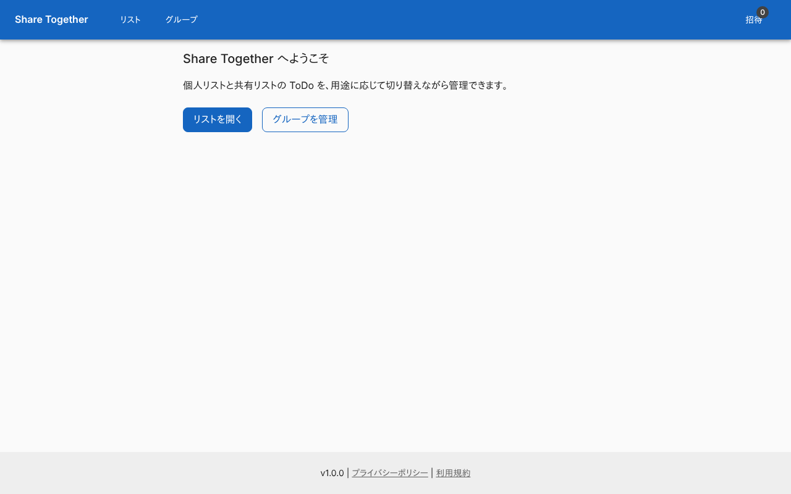
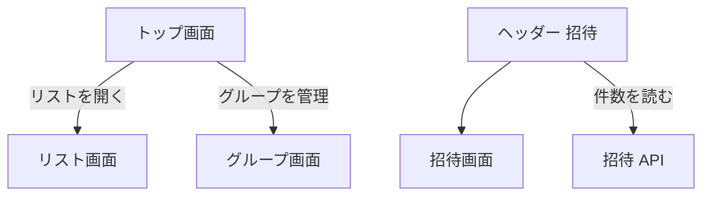

# トップ画面

Share Together の入口。リスト画面とグループ画面への 2 つのボタンだけを置く。全画面に共通のヘッダーもここで説明する。

## 入口

- パスは `/`。ヘッダーのタイトルから来る
- ブラウザのセッションの最初の表示が `/` で、前回の訪問先が残っていれば、この画面を描いたあとにその画面へ移る ([起動時の流れ](../flow/session-start.md))

## 表示するもの

| 部分 | 内容 |
|---|---|
| 見出しと説明 | 「Share Together へようこそ」と、個人リストと共有リストを切り替えて管理できる旨の説明 |
| 「リストを開く」 | [リスト画面](./lists.md) (`/lists`) へのリンク |
| 「グループを管理」 | [グループ画面](./groups.md) (`/groups`) へのリンク |

全画面に共通のヘッダーとフッターがある。

| 部分 | 内容 |
|---|---|
| ナビゲーション | 「リスト」(`/lists`)、「グループ」(`/groups`) |
| 「招待」 | [招待画面](./invitations.md) (`/invitations`) へのリンク。バッジに未処理の招待の件数を出す。0 件でも 0 を出す |
| アカウント | 共通のヘッダーが持つ。サインアウトは Auth のサインアウトへ送る |
| フッター | バージョン (環境変数 `APP_VERSION`、なければ 1.0.0)、プライバシーポリシー、利用規約 |

- 招待の件数は、画面を開くたびに[招待 API](../api/invitations.md) から読む。招待画面で承認か拒否をすると、その場で読み直す
- 件数の取得に失敗しても何も出さず、直前の件数 (最初は 0) のままにする
- ログインしていない利用者は、どの画面もサインインへ送られる (画面を開く前のミドルウェアの判定)

## 操作

| 操作 | 結果 |
|---|---|
| 「リストを開く」 | `/lists` へ移る |
| 「グループを管理」 | `/groups` へ移る |
| ヘッダーの「招待」 | `/invitations` へ移る |

## 画面の見た目

### 通常表示

見出し、2 つのボタン、ヘッダーの招待バッジを出す。

| スマホ | PC |
|---|---|
|  |  |

## つながり

