# 招待画面

自分に届いている[招待](../term/invitation.md)を一覧し、承認か拒否で応える画面。

## 入口

- パスは `/invitations`。ヘッダーの「招待」から来る ([トップ画面](./home.md))

## 表示するもの

招待ごとに 1 枚のカードを並べる。

| 部分 | 内容 |
|---|---|
| グループ名 | 招待されたグループの名前。グループが見つからなければ空 |
| 「招待中」 | 状態を示すチップ |
| 招待者 | 招待した人の名前。見つからなければ空 |
| 招待日時 | 日本時間の `yyyy/MM/dd HH:mm` |
| 「承認」「拒否」 | 応答のボタン |

期限が切れた招待は、一覧にもヘッダーの件数にも出ない ([招待 API](../api/invitations.md))。

## 状態

- 読み込み中は「読み込み中...」を出す
- 0 件のときは「招待はありません。」
- 取得に失敗すると、「招待一覧の取得に失敗しました。」の通知を出す。このとき一覧は空のままなので、「招待はありません。」も出る (失敗と 0 件を区別しない)
- 通知は 4 秒で消える

## 操作

| 操作 | 結果 |
|---|---|
| 「承認」 | [招待 API](../api/invitations.md) へ承認を送る。応答を待つ間、そのカードの 2 つのボタンは押せず、「承認」に読み込みの表示が付く。成功すると、そのカードを一覧から外し、「「{グループ名}」への参加を承認しました。」を通知する |
| 「拒否」 | 「招待を拒否」の確認ダイアログ (「「{グループ名}」への招待を拒否しますか？」) を出す。「拒否」で確定すると拒否を送り、成功すればカードを外して「「{グループ名}」への招待を拒否しました。」を通知する。「キャンセル」なら何もしない |

- 承認と拒否が成功すると、ヘッダーの招待の件数を読み直す
- 失敗したときの扱いは、原因で変わる

| 原因 (API のエラー) | 通知 | カード |
|---|---|---|
| メンバーが上限 (`MEMBER_LIMIT_EXCEEDED`) | グループメンバーは最大5名です | 残す |
| 期限切れ (`INVITATION_EXPIRED`) | 招待の有効期限が切れています | 外す (件数も読み直す) |
| それ以外、または応答が読めない | 「招待の承認に失敗しました。」または「招待の拒否に失敗しました。」 | 残す |

## 画面の見た目

### 招待が届いているとき

カードを招待ごとに並べる。ヘッダーの「招待」に件数が出る。

| スマホ | PC |
|---|---|
| 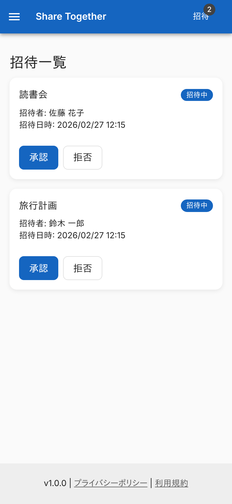 | 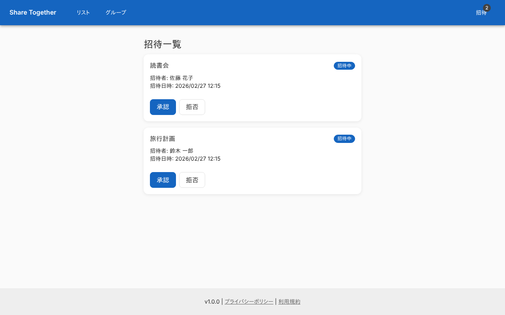 |

### 拒否の確認

「拒否」を押すと、グループ名を入れた確認を出す。

| スマホ | PC |
|---|---|
| 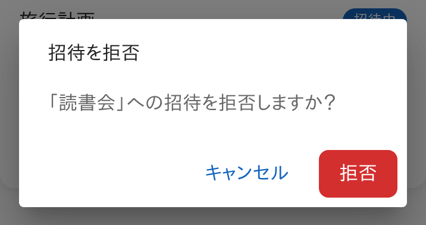 | 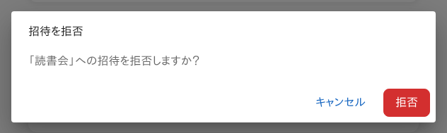 |

### 承認した直後

カードが消え、承認した旨を通知する。

| スマホ | PC |
|---|---|
| 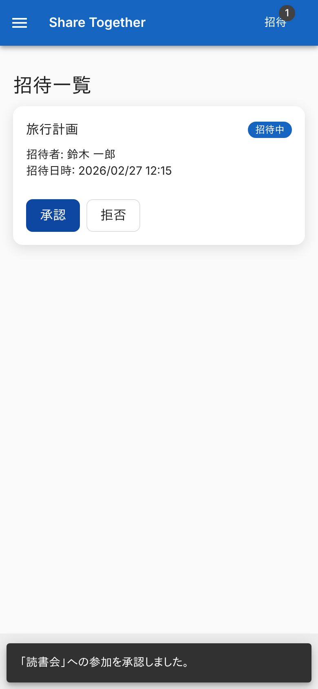 |  |

### 承認できなかったとき

承認済みのメンバーがすでに 5 名いるグループの例。通知を出し、カードは残る。

| スマホ | PC |
|---|---|
| 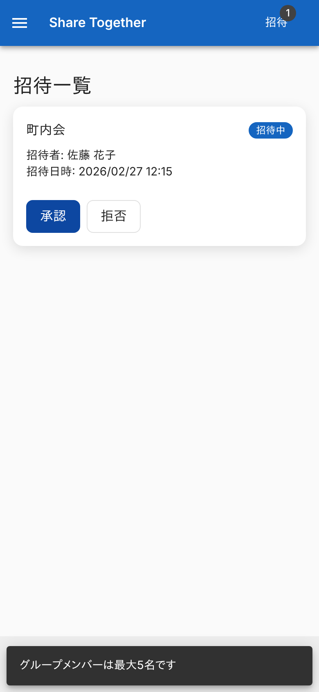 | 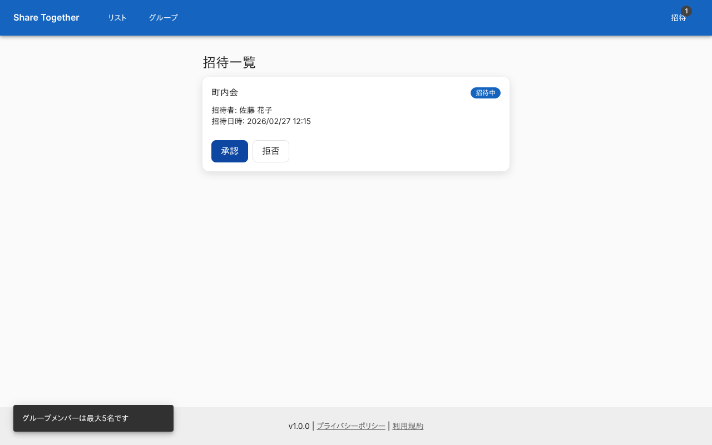 |

### 期限が切れていたとき

通知を出し、そのカードを一覧から外す。

| スマホ | PC |
|---|---|
|  |  |

### 招待がないとき

「招待はありません。」を出す。

| スマホ | PC |
|---|---|
| 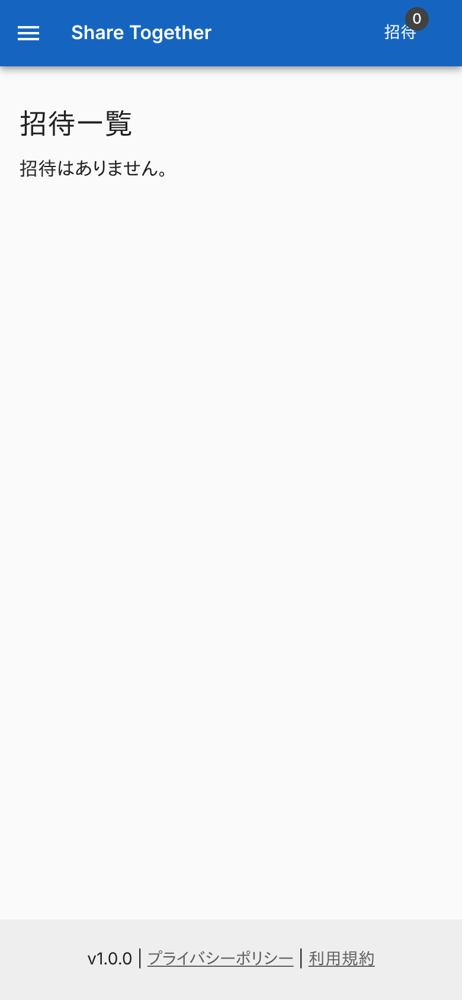 | 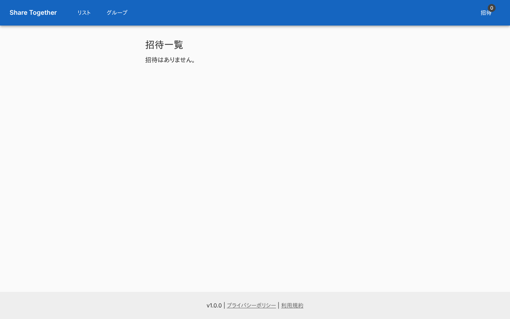 |

### 一覧の取得に失敗したとき

通知を出す。一覧は空なので「招待はありません。」も出る。

| スマホ | PC |
|---|---|
| 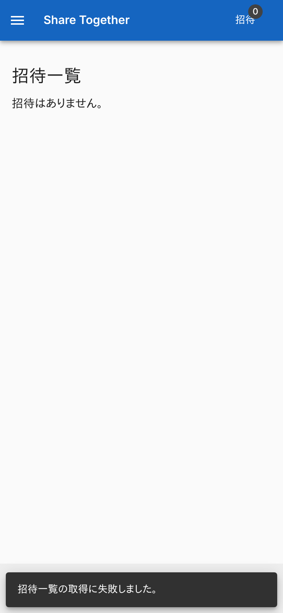 | 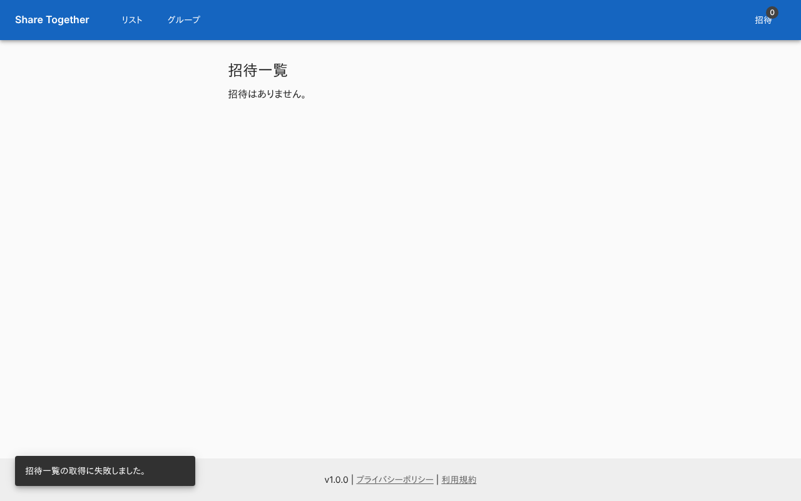 |

## つながり

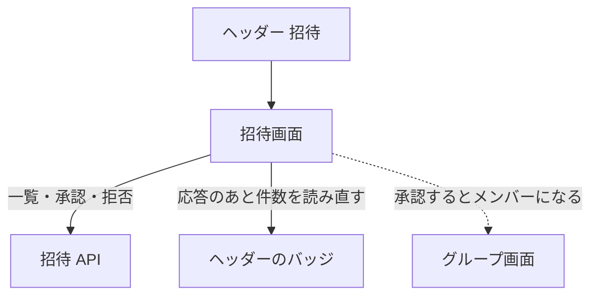
