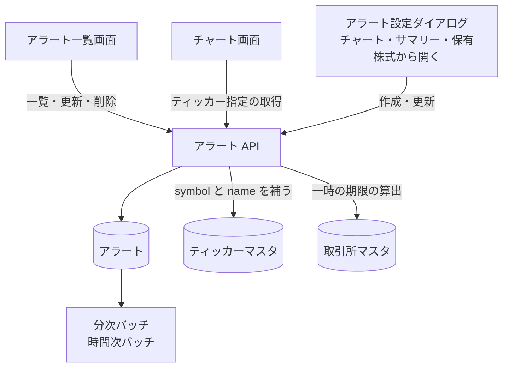

# アラート API

ログインした利用者自身の価格アラートの一覧、作成、更新、削除。条件を満たすと Web Push で通知する ([アラート通知の経路](../flow/alert-notification.md))。

## エンドポイント

| メソッド | パス | 権限 |
|---|---|---|
| GET | `/api/alerts` | `stocks:read` |
| POST | `/api/alerts` | `stocks:write-own` |
| PUT | `/api/alerts/{alertId}` | `stocks:write-own` |
| DELETE | `/api/alerts/{alertId}` | `stocks:write-own` |
| GET | `/api/alerts/tickers/{tickerId}` | `stocks:read` |

## 入力と出力

作成 (POST) の入力。

| 項目 | 条件 |
|---|---|
| `tickerId` | 必須。登録済みのティッカー |
| `exchangeId` | 任意。指定するならティッカーの取引所と同じ |
| `mode` | 必須。`Buy` か `Sell` |
| `frequency` | 必須。`MINUTE_LEVEL` (1 分間隔) か `HOURLY_LEVEL` (1 時間間隔) |
| `conditions` | 必須。1 件か 2 件。1 件は `field` が `price`、`operator` が `gte` か `lte`、`value` が 0.01〜1,000,000 |
| `logicalOperator` | 条件が 2 件なら必須 (`AND` か `OR`)。1 件なら付けられない |
| `enabled` | 任意。省略すると有効 |
| `temporary` | 任意。`true` で[一時通知](../term/temporary-alert.md) |
| `customMessage` | 任意。前後の空白を除いて 500 文字以内。空なら保存しない |
| `subscription` | 必須。[Web Push の購読](../term/push-subscription.md) (`endpoint` は URL、`keys.p256dh`、`keys.auth`) |

- 条件が 2 件のとき、2 件の `operator` は `gte` と `lte` を 1 つずつ。`AND` は範囲内で `gte` の値が `lte` の値より小さく、`OR` は範囲外で `lte` の値が `gte` の値より小さい
- 条件には、画面が割合で入力した記録として `isPercentage`、`percentageValue`、`basePrice` を付けられる。判定には `value` を使う
- 更新 (PUT) で変えられるのは `conditions`、`enabled`、`temporary`、`logicalOperator`、`customMessage`。`tickerId`、`mode`、`frequency`、購読は変えられない
    - `conditions` は、既存の条件と同じ位置のものへ、送った項目を重ねる。条件の数は変えられない
    - `temporary` を `true` にすると期限を決め直し、`false` にすると期限を消す
    - `customMessage` は空にすると消える
    - 更新後のアラート全体を、作成と同じ条件で検証する
- 出力は `alertId`、`tickerId`、`exchangeId`、`symbol`、`name`、`mode`、`frequency`、`conditions`、`logicalOperator`、`enabled`、`temporary`、`temporaryExpireDate`、`customMessage`、`createdAt`、`updatedAt`
- 一覧は `{ alerts, pagination: { count, lastKey? } }`。1 回に最大 100 件 (`limit`、省略で 50)。期限切れで削除待ちのアラートは出ない
- ティッカー指定の取得は、その利用者のアラート最大 1,000 件から、そのティッカーの分を返す。続きの `lastKey` はない
- 削除は `{ success: true, deletedAlertId }` を返す

## エラー

| 条件 | 状態 | `error` |
|---|---|---|
| 本文が JSON のオブジェクトでない、項目の型が違う | 400 | `INVALID_REQUEST` |
| 購読が不正 (作成) | 400 | `INVALID_REQUEST` |
| `tickerId` のティッカーがない、`exchangeId` がティッカーの取引所と違う (作成) | 400 | `INVALID_REQUEST` |
| 入力条件を満たさない (`details` に理由の配列) | 400 | `INVALID_REQUEST` |
| 一時にする対象の取引所がない | 400 | `INVALID_REQUEST` |
| 更新で変える項目が 1 つもない | 400 | `INVALID_REQUEST` |
| `tickerId` に `:` がない (ティッカー指定の取得) | 400 | `INVALID_REQUEST` |
| アラートがない (更新・削除) | 404 | `NOT_FOUND` |

- 権限の不足は 401 / 403。形は[API のエラー応答](../term/api-error.md)

## つながり

