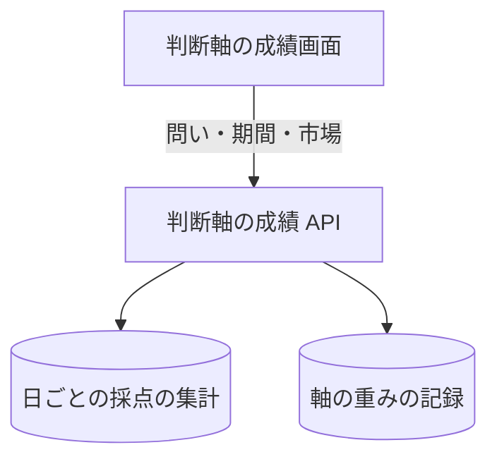

# 判断軸の成績 API

問い・期間・市場を指定して、採点済みの予測の的中率、確率帯ごとの実績、[判断軸](../term/axis.md)ごとの成績を返す。

## エンドポイント

| メソッド | パス | 権限 |
|---|---|---|
| GET | `/api/axis-performance` | `stocks:read` |

## 入力と出力

問い合わせの入力。すべて任意で、省略するとデフォルトになる。

| 項目 | 値 | デフォルト |
|---|---|---|
| `question` | `DIR`、`VOL`、`MKT` ([問い](../term/question.md)) | `DIR` |
| `period` | `30d`、`90d`、`all` | `90d` |
| `market` | `ALL`、`JP`、`US` | `ALL` |

- `question` が `MKT` のときは、`market` に `ALL` を指定できない
- 期間は、採点済みの予測日のうち最も新しい日を終わりにして数える。`30d` と `90d` は、その日を含む 30 日間と 90 日間。`all` は最初の日から
- 出力の主な項目

| 項目 | 内容 |
|---|---|
| `from`、`to` | 集計した予測日の範囲。採点済みがなければ `null` |
| `evaluatedCount`、`hitRate` | 採点した件数と、全体の的中率 (これが「ふだん」になる) |
| `neutralBand` | 指定した市場の最新の記録の中立帯。なければ `null`。`ALL` は JP と US のうち新しいほう |
| `calibration` | 確率帯ごとの `count`、`meanProbability`、`hitRate` |
| `axes` | 問いに使う軸ごとの `count`、`hitRate`、`diffFromBaseline` (的中率 - ふだん)、`currentWeight` (現在の重み)、`lowSample` |

- 軸の `meanExcessReturn` は方向のときだけ付く。`lowSample` は点灯型で件数が 30 未満のとき真
- 採点済みの件数が 0 でも 200 を返す。軸の件数と的中率は 0 になる

## エラー

| 条件 | 状態 | `error` |
|---|---|---|
| `question` が許可外 | 400 | `INVALID_QUESTION` |
| `period` が許可外 | 400 | `INVALID_PERIOD` |
| `market` が許可外 | 400 | `INVALID_MARKET` |
| `question=MKT` で `market=ALL` | 400 | `MARKET_ALL_NOT_ALLOWED` |
| 上記以外の失敗 | 500 | `INTERNAL_ERROR` |

- 権限の不足は 401 / 403。形は[API のエラー応答](../term/api-error.md)

## つながり

