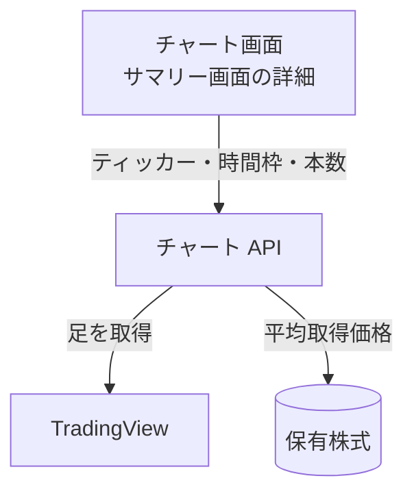

# チャート API

1 銘柄のローソク足を、TradingView から取って返す。

## エンドポイント

| メソッド | パス | 権限 |
|---|---|---|
| GET | `/api/chart/{tickerId}` | `stocks:read` |

## 入力と出力

| 項目 | 条件 |
|---|---|
| `tickerId` | `:` を含む[ティッカー ID](../term/ticker-id.md)。マスタにあるかは確かめず、そのまま TradingView に渡す |
| `timeframe` | 問い合わせ。`1`、`5`、`60`、`D` (分足、1 時間足、日足)。省略すると `60` |
| `count` | 問い合わせ。本数。1〜500。省略すると 30 |

- 出力は `{ tickerId, symbol, timeframe, data, holdingAveragePrice? }`
    - `data` は足の配列。各要素は `time`、`open`、`high`、`low`、`close`、`volume`
    - `holdingAveragePrice` は、利用者がそのティッカーを保有数が 0 より大きく持っているときだけ付く。保有の取得に失敗しても、付けずに返す (Admin へは報告する)
- 時間外取引を含む足を取る。TradingView への問い合わせは 10 秒で打ち切る

## エラー

| 条件 | 状態 | `error` |
|---|---|---|
| `tickerId` に `:` がない、`timeframe` または `count` が不正 | 400 | `INVALID_REQUEST` |
| TradingView がティッカーを認識しない | 404 | `NOT_FOUND` |
| 10 秒以内に取れない | 504 | `INTERNAL_ERROR` |
| TradingView のレート制限 | 429 | `INTERNAL_ERROR` |
| 上記以外の失敗 | 500 | `INTERNAL_ERROR` |

- 429 と 504 は、Admin へは報告しない
- 権限の不足は 401 / 403。形は[API のエラー応答](../term/api-error.md)

## つながり

