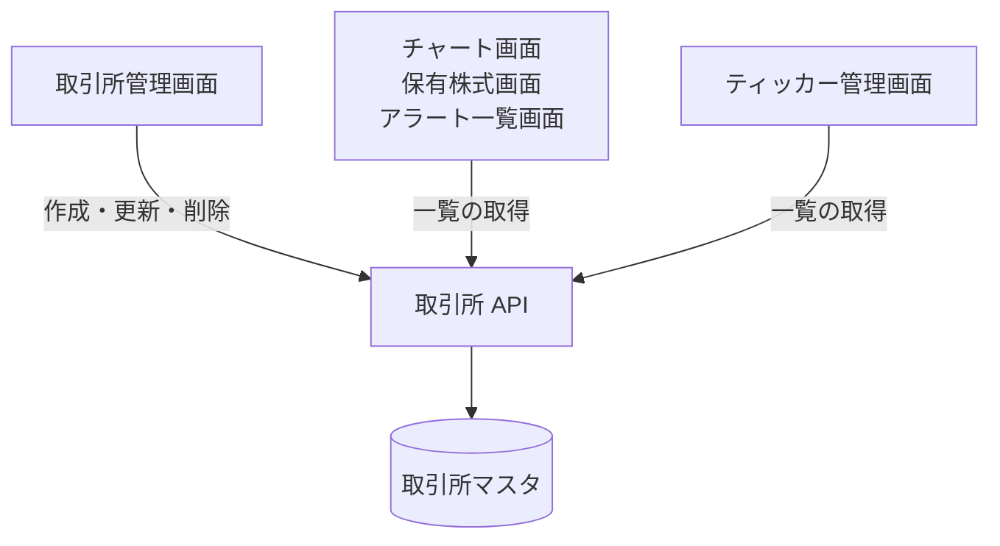

# 取引所 API

取引所マスタ (取引時間・データソース・市場) の一覧、取得、作成、更新、削除。

## エンドポイント

| メソッド | パス | 権限 |
|---|---|---|
| GET | `/api/exchanges` | `stocks:read` |
| POST | `/api/exchanges` | `stocks:manage-data` |
| GET | `/api/exchanges/{exchangeId}` | `stocks:read` |
| PUT | `/api/exchanges/{exchangeId}` | `stocks:manage-data` |
| DELETE | `/api/exchanges/{exchangeId}` | `stocks:manage-data` |

## 入力と出力

作成 (POST) の入力。

| 項目 | 条件 |
|---|---|
| `exchangeId` | 必須。1〜50 文字の英数字とハイフン |
| `name` | 必須。200 文字以内 |
| `key` | 必須。1〜20 文字の英大文字と数字。[ティッカー ID](../term/ticker-id.md) の前半になる。作成後は変えられない |
| `timezone` | 必須。`America/New_York` か `Asia/Tokyo` |
| `tradingHours.start` / `end` | 必須。`HH:MM` (24 時間表記) |
| `priceSource` | 任意。`tradingview` か `finnhub`。省略すると `tradingview` |
| `market` | 任意。`JP` か `US` |

- 更新 (PUT) で変えられるのは `name`、`timezone`、`tradingHours.start` / `end`、`priceSource`、`market` だけ。`exchangeId` と `key` は受け取らない。`market` は `null` で未設定に戻せる。送った項目だけを変え、変えた後の取引所全体を検証する
- 出力は `exchangeId`、`name`、`key`、`timezone`、`tradingHours` (`start` / `end`)、`priceSource`、`market`。一覧は `{ exchanges: [...] }`
- 作成は 201 で `createdAt` を足して返す。単体の取得は `createdAt` と `updatedAt`、更新は `updatedAt` を足して返す (時刻は ISO 8601)
- 削除は `{ success: true, deletedExchangeId }` を返す。その取引所のティッカーなど、関連するデータは確認も削除もしない

## エラー

| 条件 | 状態 | `error` |
|---|---|---|
| 本文が JSON のオブジェクトでない、項目の型が違う | 400 | `INVALID_REQUEST` |
| `priceSource` / `market` が許可外の値 | 400 | `INVALID_REQUEST` |
| 上の入力条件を満たさない (複数あるときは `, ` でつなぐ) | 400 | `INVALID_REQUEST` |
| 更新で変える項目が 1 つもない | 400 | `INVALID_REQUEST` |
| 同じ `exchangeId` が既にある (作成) | 400 | `ALREADY_EXISTS` |
| 指定の取引所がない (取得・更新・削除) | 404 | `NOT_FOUND` |

- 更新は、本文を読む前に取引所の有無を確かめる。なければ本文が不正でも 404
- 権限の不足は 401 / 403。形は[API のエラー応答](../term/api-error.md)

## つながり

