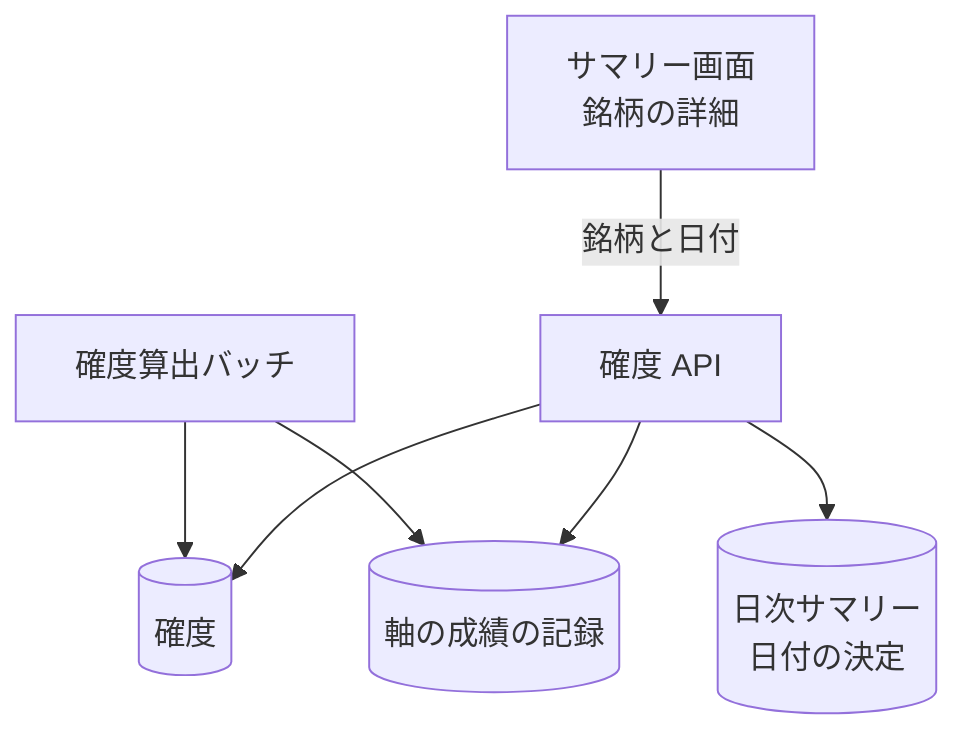

# 確度 API

1 銘柄 1 日の[確度](../term/forecast.md)を、方向と荒れの問いごとに、判断軸別の内訳つきで返す。

## エンドポイント

| メソッド | パス | 権限 |
|---|---|---|
| GET | `/api/forecasts/{tickerId}` | `stocks:read` |

## 入力と出力

- 問い合わせの `date` (`YYYY-MM-DD`) は任意。省略すると、そのティッカーの取引所の最新のサマリーの日付になる
- 出力は `{ tickerId, date, questions: { DIR, VOL } }`。確率が出ていない問いは `null`
- 問いごとの項目

| 項目 | 内容 |
|---|---|
| `probability`、`baseline`、`lean` | 確率、ふだん、寄り |
| `neutralBand` | 中立帯 (`lower`、`upper`) |
| `bandHistory` | 同じ確率帯の過去の実績 (`count`、`hitRate`)。なければ `null` |
| `axes` | 判断軸ごとの内訳 |

- 判断軸の内訳

| 項目 | 内容 |
|---|---|
| `kind` | `FLAG` (点灯型) と `NUMERIC` (数値型) |
| `lit` / `ratio` | 点灯型は点灯かどうか、数値型は平常比 (倍) |
| `performance` | 件数、的中率、ふだんとの差。方向だけ平均超過リターンも持つ。その日の市場の成績の記録から取り、なければ 0 |
| `contribution` | 確率への上乗せ (小数。0.01 が 1pt) |
| `lowSample` | 件数不足の軸か |

- 軸の並びは、点灯していない点灯型を最後に置き、それ以外は寄与の絶対値が大きい順

## エラー

| 条件 | 状態 | `error` |
|---|---|---|
| `tickerId` が空 | 400 | `INVALID_REQUEST` |
| `date` が `YYYY-MM-DD` として不正 | 400 | `INVALID_DATE` |
| ティッカーがない | 404 | `NOT_FOUND` |
| 日付を決められない (サマリーがない)、その日の確度がない | 404 | `NOT_FOUND` |
| 上記以外の失敗 | 500 | `INTERNAL_ERROR` |

- 権限の不足は 401 / 403。形は[API のエラー応答](../term/api-error.md)

## つながり

