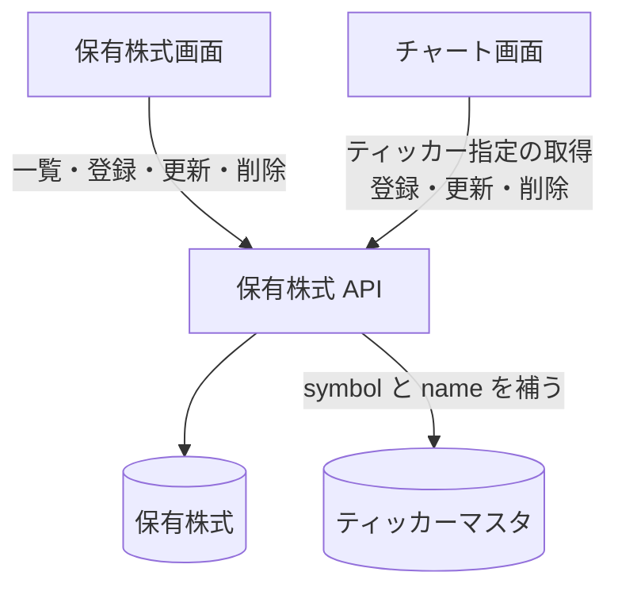

# 保有株式 API

ログインした利用者自身の保有株式の一覧、登録、更新、削除。1 つのティッカーにつき 1 件。

## エンドポイント

| メソッド | パス | 権限 |
|---|---|---|
| GET | `/api/holdings` | `stocks:read` |
| POST | `/api/holdings` | `stocks:write-own` |
| PUT | `/api/holdings/{holdingId}` | `stocks:write-own` |
| DELETE | `/api/holdings/{holdingId}` | `stocks:write-own` |
| GET | `/api/holdings/tickers/{tickerId}` | `stocks:read` |

## 入力と出力

登録 (POST) の入力。

| 項目 | 条件 |
|---|---|
| `tickerId` | 必須。登録済みのティッカー |
| `exchangeId` | 任意。指定するならティッカーの取引所と同じ。省略するとティッカーの取引所になる |
| `quantity` | 必須。0.0001〜1,000,000,000 |
| `averagePrice` | 必須。0.01〜1,000,000 |
| `currency` | 必須。`USD` か `JPY` |

- 更新 (PUT) は `quantity`、`averagePrice`、`currency` のうち送った項目だけを変える。数値は数値型、`currency` は文字列型でなければならない。登録のような値域の検証はしない
- 出力は `holdingId`、`tickerId`、`exchangeId`、`symbol`、`name`、`quantity`、`averagePrice`、`currency`、`createdAt`、`updatedAt`。`symbol` と `name` はティッカーから補う。ティッカーが見つからなければ、`symbol` はティッカー ID の後半、`name` は空になる
- 一覧は `{ holdings, pagination: { count, lastKey? } }`。1 回に最大 100 件 (`limit`、省略で 50)。続きは `lastKey` で取る
- ティッカーを指定する取得 (`/tickers/{tickerId}`) は 1 件を返す。ティッカー ID は `:` を含む形でなければならない
- 削除は `{ success: true, deletedHoldingId }` を返す。同じティッカーのアラートには触れない
- `holdingId` は[保有 ID](../term/ticker-id.md)。自分の分しか読み書きできない

## エラー

| 条件 | 状態 | `error` |
|---|---|---|
| 本文が JSON のオブジェクトでない、項目の型が違う | 400 | `INVALID_REQUEST` |
| 登録の入力条件を満たさない (`details` に理由の配列) | 400 | `INVALID_REQUEST` |
| `tickerId` のティッカーがない | 400 | `INVALID_REQUEST` |
| `exchangeId` がティッカーの取引所と違う | 400 | `INVALID_REQUEST` |
| そのティッカーの保有株式が既にある (登録) | 400 | `INVALID_REQUEST` |
| `holdingId` の形が違う、`tickerId` に `:` がない | 400 | `INVALID_REQUEST` |
| 更新で変える項目が 1 つもない | 400 | `INVALID_REQUEST` |
| `holdingId` が他の利用者のもの | 403 | `FORBIDDEN` |
| 保有株式がない (更新・削除・ティッカー指定の取得) | 404 | `NOT_FOUND` |

- 権限の不足は 401 / 403。形は[API のエラー応答](../term/api-error.md)

## つながり

