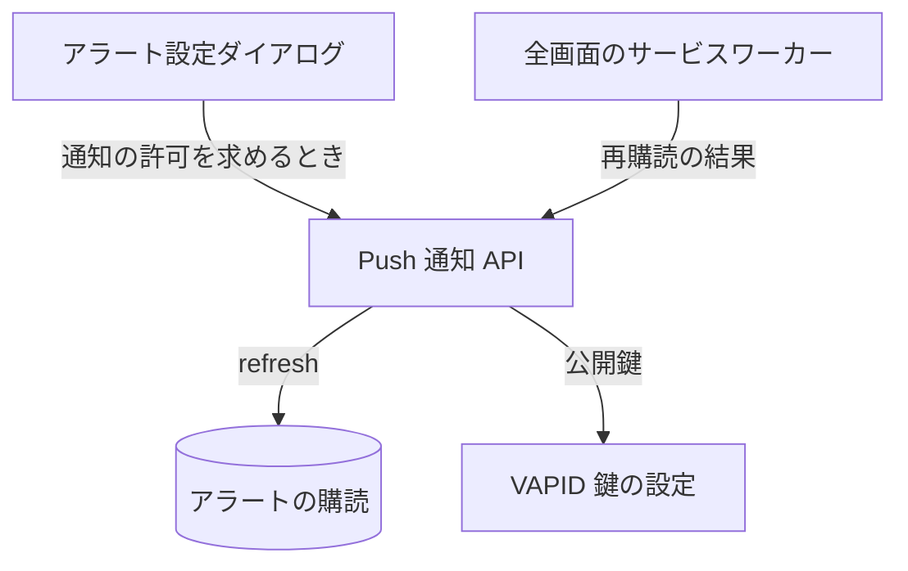

# Push 通知 API

アラートの通知を受け取るための Web Push の購読まわり。[購読](../term/push-subscription.md)の情報はアラートが持つので、購読 API 自体はデータを保存しない。通知が届くまでの流れは[アラート通知の経路](../flow/alert-notification.md)にある。

## エンドポイント

| メソッド | パス | 権限 |
|---|---|---|
| GET | `/api/push/vapid-public-key` | なし (ログイン不要) |
| POST | `/api/push/subscribe` | `stocks:write-own` |
| POST | `/api/push/refresh` | `stocks:write-own` |
| DELETE | `/api/push/unsubscribe` | `stocks:write-own` |

## 入力と出力

- 公開鍵の取得は `{ publicKey }` を返す。ブラウザが購読を作るときに使う
- 購読 (subscribe) の入力は `{ subscription }`。`subscription` は `endpoint` (URL)、`keys.p256dh`、`keys.auth`。検証を通ると 201 で `{ success: true, subscriptionId }` を返す。`subscriptionId` は `endpoint` から決まる ID で、購読は保存しない
- 更新 (refresh) の入力も `{ subscription }`。利用者の既存のアラート (最大 100 件) のうち、購読の内容が違うものを新しい購読に書き換え、`{ success: true, updatedCount }` を返す
    - 画面を開くたびに、ブラウザの再購読の結果をここへ送る
- 解除 (unsubscribe) の入力は `{ endpoint }` (URL)。検証を通ると `{ success: true }` を返すだけで、アラートの購読は消さない

## エラー

| 条件 | 状態 | `error` |
|---|---|---|
| 本文が JSON のオブジェクトでない | 400 | `INVALID_REQUEST` |
| `subscription` / `endpoint` がない、または不正 | 400 | `INVALID_REQUEST` |
| 公開鍵が未設定 (公開鍵の取得) | 500 | `INTERNAL_ERROR` |
| VAPID 鍵が未設定 (購読) | 500 | `INTERNAL_ERROR` |
| 上記以外の失敗 | 500 | `INTERNAL_ERROR` |

- 権限の不足は 401 / 403。形は[API のエラー応答](../term/api-error.md)

## つながり

