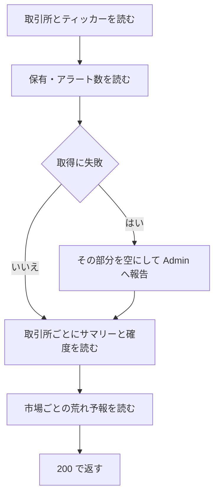
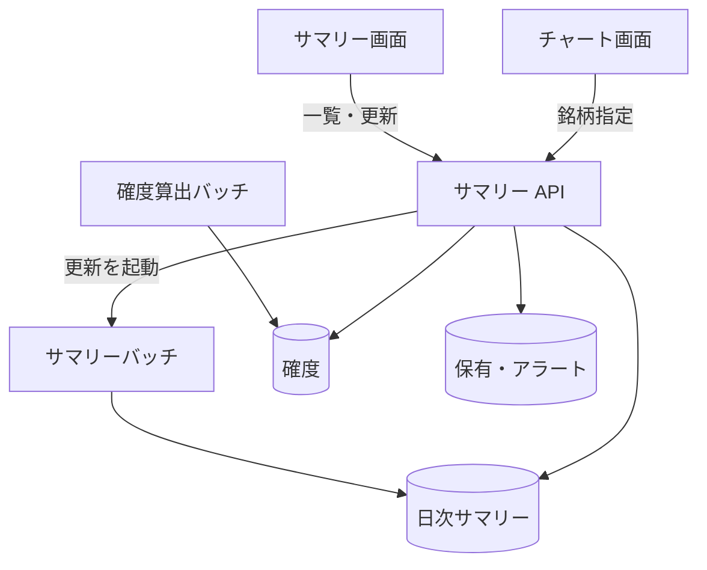

# サマリー API

取引所ごとの[日次サマリー](../term/daily-summary.md) (その日の足、パターン、確度、保有、アラート数) の取得と、サマリーバッチの手動実行。

## エンドポイント

| メソッド | パス | 権限 |
|---|---|---|
| GET | `/api/summaries` | `stocks:read` |
| GET | `/api/summaries/{tickerId}` | `stocks:read` |
| POST | `/api/summaries/refresh` | `stocks:manage-data` |

## 入力と出力

- 一覧 (`/api/summaries`) は、問い合わせの `date` (`YYYY-MM-DD`) を任意で受ける。省略すると、取引所ごとの最新の日付になる
- 一覧の出力は `{ exchanges, marketForecasts }`
    - `exchanges`: 取引所ごとに `exchangeId`、`exchangeName`、`date` (サマリーがなければ `null`)、`summaries`
    - `marketForecasts`: 市場 `JP` と `US` の「市場の荒れ予報」。`market`、`date`、`forecast` (`probability`、`baseline`、`lean`、`lowSample`。なければ `null`)。日付は、`date` の指定があればそれ、なければその市場の取引所の最新の日付のうち新しいもの
- 銘柄ごとの項目

| 項目 | 内容 |
|---|---|
| `date`、`open`、`high`、`low`、`close`、`volume`、`updatedAt` | その日の足 |
| `buyPatternCount`、`sellPatternCount` | 成立したパターンの数 (買い、売り)。判定がない銘柄は 0 |
| `buyAlertCount`、`sellAlertCount` | 利用者のアラート数。`enabled` と `disabled` に分ける |
| `holding` | 利用者の保有 (`quantity`、`averagePrice`)。なければ `null` |
| `forecast` | `dir` と `vol` の確率 (`probability`、`baseline`、`lean`)、`lit` (点灯したパターン数。`total`、`buy`、`sell`)。その日の確度がなければ `null` |

- 保有は最大 100 件、アラートは最大 1,000 件を読んで数える。ティッカーの `symbol` と `name` はマスタから補い、なければティッカー ID から作る
- 銘柄指定 (`/api/summaries/{tickerId}`) は、そのティッカーの取引所の最新の日付に、そのティッカーのサマリーがあれば 1 件を一覧の銘柄と同じ項目 (`symbol`、`name`、`exchangeId` を含む) で返す
- 更新 (`/api/summaries/refresh`) は、[サマリーバッチ](../batch/summary.md) (Lambda) を待たずに起動して 202 を返す。関数名は環境変数 `STOCK_TRACKER_SUMMARY_BATCH_FUNCTION_NAME` で決め、なければ本番の実行では `prod`、それ以外では `dev` の名前になる

## 処理

一覧は、保有・アラート・確度・市場の荒れ予報の取得が失敗しても、その部分を空にして 200 を返す。

## エラー

| 条件 | 状態 | `error` |
|---|---|---|
| `date` が `YYYY-MM-DD` として不正 (一覧) | 400 | `INVALID_DATE` |
| `tickerId` に `:` がない (銘柄指定) | 400 | `INVALID_REQUEST` |
| ティッカーがない、最新の日付にサマリーがない (銘柄指定) | 404 | `NOT_FOUND` |
| 上記以外の失敗 (更新では、バッチの起動に失敗したとき) | 500 | `INTERNAL_ERROR` |

- 権限の不足は 401 / 403。形は[API のエラー応答](../term/api-error.md)

## つながり

