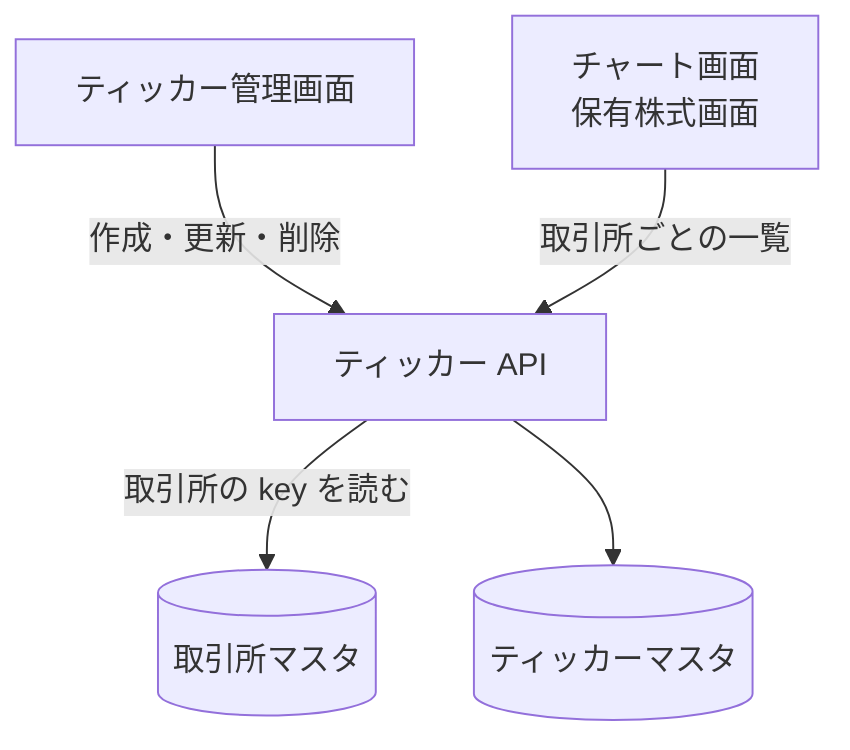

# ティッカー API

銘柄マスタ (ティッカー) の一覧、作成、名前の更新、削除。

## エンドポイント

| メソッド | パス | 権限 |
|---|---|---|
| GET | `/api/tickers` | `stocks:read` |
| POST | `/api/tickers` | `stocks:manage-data` |
| PUT | `/api/tickers/{tickerId}` | `stocks:manage-data` |
| DELETE | `/api/tickers/{tickerId}` | `stocks:manage-data` |

## 入力と出力

- 一覧は `{ tickers: [{ tickerId, symbol, name, exchangeId }] }`。ページ分けはなく全件を返す。`exchangeId` を問い合わせに付けると、その取引所のものだけに絞る
- 作成の入力

| 項目 | 条件 |
|---|---|
| `symbol` | 必須。1〜20 文字の英大文字と数字 |
| `name` | 必須。200 文字以内 |
| `exchangeId` | 必須。登録済みの取引所 |

- ティッカー ID は、取引所の `key` と `symbol` から `{key}:{symbol}` で決める。作成は 201 で `tickerId`、`symbol`、`name`、`exchangeId`、`createdAt` を返す
- 更新で変えられるのは `name` だけ (200 文字以内)。`symbol` と取引所は変えられない。`updatedAt` を足して返す
- 削除は `{ success: true, deletedTickerId }` を返す。保有株式やアラートなど、関連するデータは確認も削除もしない

## エラー

| 条件 | 状態 | `error` |
|---|---|---|
| 本文が JSON のオブジェクトでない | 400 | `INVALID_REQUEST` |
| 入力条件を満たさない (先頭のエラー 1 件を返す) | 400 | `INVALID_REQUEST` |
| `exchangeId` の取引所がない (作成) | 400 | `INVALID_REQUEST` |
| 同じティッカー ID が既にある (作成) | 400 | `INVALID_REQUEST` |
| 指定のティッカーがない (更新・削除) | 404 | `NOT_FOUND` |

- 権限の不足は 401 / 403。形は[API のエラー応答](../term/api-error.md)

## つながり

